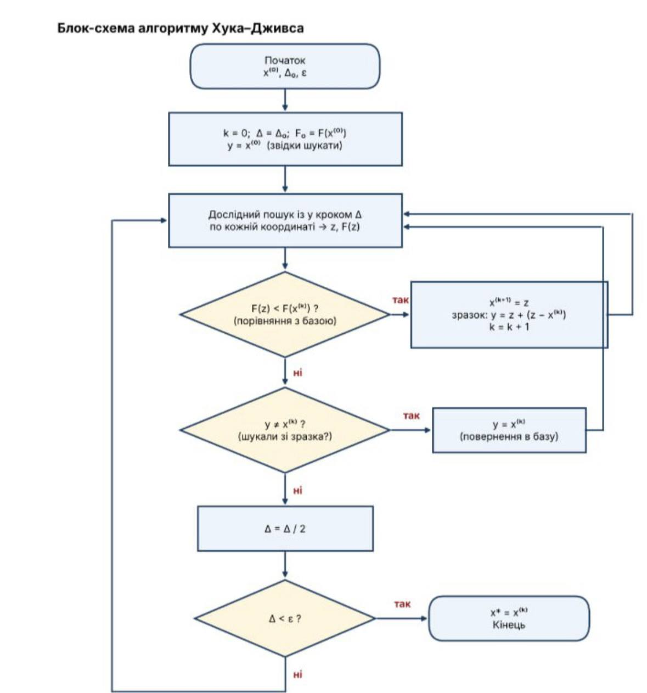
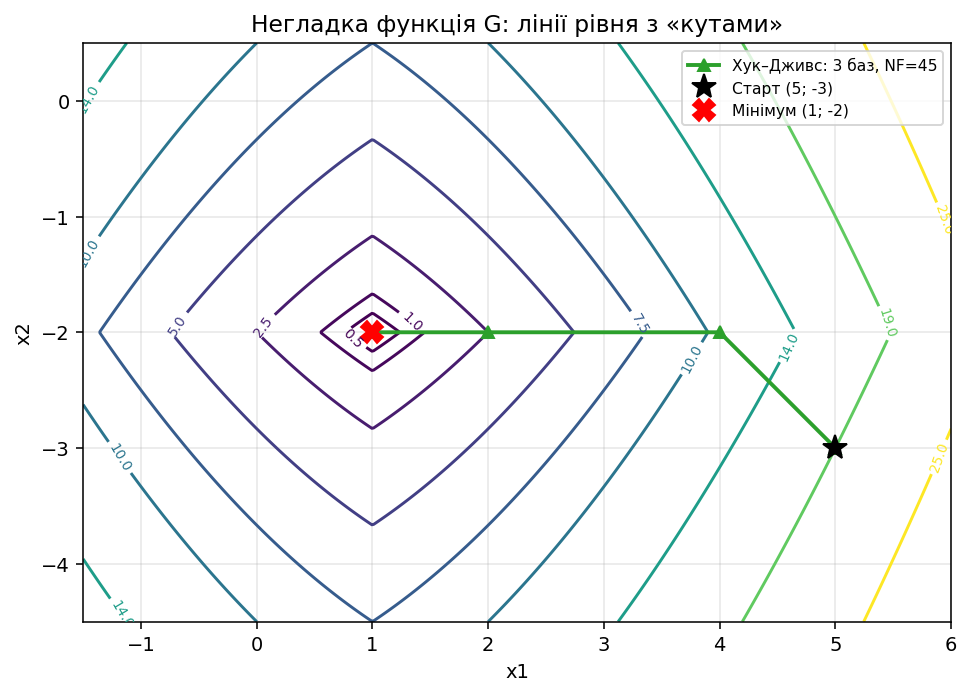
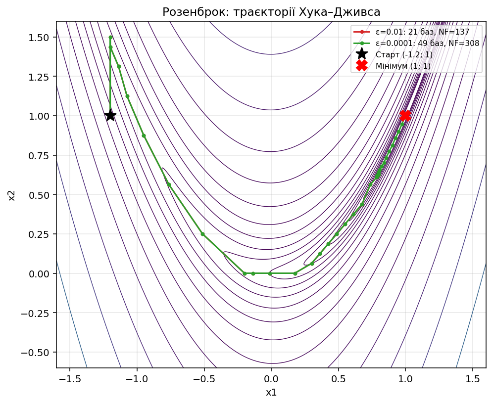
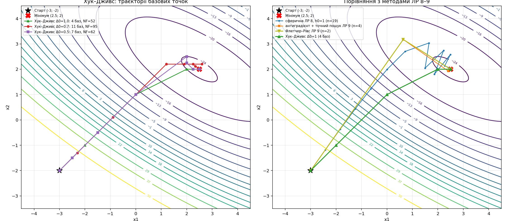

# ЛР 10. Метод Хука–Дживса (прямий пошук без похідних)


## 1. Постановка задачі

| Параметр | Значення |
|---|---|
| Цільова функція | F(x₁, x₂) = x₁² + 2x₂² + 2x₁x₂ − 9x₁ − 13x₂ |
| Початкова точка | x⁽⁰⁾ = (−3; −2), F(x⁽⁰⁾) = 82 |
| Початковий крок | Δ₀ = 1 і додатково Δ₀ = 0,7 (та Δ₀ = 0,5 для пояснення ґратки) |
| Точність | ε = 0,01, зупинка за кроком: Δ < ε |
| Що доступно методу | **лише значення F** (градієнт і гесіан не використовуються) |
| Мінімум (лише для контролю похибки) | x\* = (2,5; 2), F(x\*) = −24,25 |

Аналітичний мінімум: з 2x₁ + 2x₂ = 9 і 2x₁ + 4x₂ = 13 маємо x₂ = 2, x₁ = 2,5. Метод x\* не бачить, він потрібен тільки для обчислення похибки ‖x − x\*‖.

## 2. Метод

Три дії:

1. **Дослідний пошук** із точки y кроком Δ. Для кожної координати пробуємо x + Δeᵢ, потім x − Δeᵢ, інакше координату лишаємо. Наступну координату пробуємо вже з оновленої точки.
2. **Пошук за зразком.** Якщо пошук удався (F(z) < F бази), нова база x⁽ᵏ⁺¹⁾ = z, а зразок y = z + (z − x⁽ᵏ⁾), одне обчислення F.
3. **Невдача.** Якщо пошук зі зразка не вдався, повертаємося в базу. Якщо не вдався пошук з бази, Δ = Δ/2. Зупинка, коли Δ < ε.

Нову точку z завжди порівнюють із **базою**, а не зі зразком: зразок може бути гіршим за базу, це нормально.

### Блок-схема




## 3. Реалізація вимог завдання

| № | Вимога | Де в коді | Результат |
|---|---|---|---|
| 1 | Похідні не виводити; мінімум лише для контролю | `x_star`, `err()`; метод викликає тільки `F` | x\* = (2,5; 2) |
| 2 | Дослідний пошук і пошук за зразком як окремі функції, лічильник NF всередині F | `explore`, `pattern_search`, клас `Obj` (`Obj.F` збільшує `nf`) | NF рахується автоматично |
| 3 | Протокол Δ₀ = 1 (кожна дія, точки, F, NF) | `hooke_jeeves(..., verbose=True)`, `print_protocol` | розділ 6 |
| 4 | Δ₀ = 0,7 (і 0,5): бази, NF, похибка, ґратка | блок «П.4» | розділ 7 |
| 5 | Негладка G: метод працює; чому ЛР 8–9 не підходять | блок «П.5» | розділ 8 |
| 6 | Розенброк, ε = 0,01 і 10⁻⁴, пастка критерію | блок «П.6» | розділ 9 |
| 7 | Графік ліній рівня з базами; зведена таблиця з ЛР 8–9 | блок «П.7», `lr10_trajectories.png` | розділи 10–11 |

Для порівняння в `lab10.py` відтворено методи ЛР 8 (сферична, кубічна, октаедрична метрики з діленням кроку навпіл) і ЛР 9 (Флетчер–Рівс, антиградієнт з точним пошуком). Усі шість рядків таблиці ЛР 8 відтворюються точно: 19/28/20, 20/29/21, 10/12/11 для h₀ = 1 та 22/29/23, 17/26/18, 25/33/26 для h₀ = 0,7.

## 4. Самоперевірка реалізації

Перед розрахунками скрипт прогоняє приклад зі слайдів (F = 2x₁² + 3x₂² + x₁x₂, старт (5; −3), Δ₀ = 1) і перевіряє `assert`-ом перші дев'ять обчислень F та підсумок:

```text
Перші 9 значень F: [62, 81, 47, 36, 18, 31, 9, 8, 12]  (за слайдами: [62, 81, 47, 36, 18, 31, 9, 8, 12] )
Баз: 4, NF = 53, мінімум = (0; 0)  (за слайдами: 4 бази, NF = 53, (0; 0))
```

Усе збігається, тому реалізація коректна.

## 5. Протокол прогону Δ₀ = 1, ε = 0,01

У колонці k стоїть номер поточної бази, NF накопичується.

```text
 k дія                         точка                           F       Δ  куди                            F проб   NF
----------------------------------------------------------------------------------------------------------------------
 0 дослідний із база           (-3; -2)                       82       1  (-2; -1)                       41    2    3
 1 нова база → зразок          (-2; -1)                       41       1  (-1; 0)                        10    1    4
 1 дослідний із зразок         (-1; 0)                        10       1  (0; 1)                        -11    2    6
 2 нова база → зразок          (0; 1)                        -11       1  (2; 3)                        -23    1    7
 2 дослідний із зразок         (2; 3)                        -23       1  (2; 2)                        -24    4   11
 3 нова база → зразок          (2; 2)                        -24       1  (4; 3)                        -17    1   12
 3 дослідний із зразок         (4; 3)                        -17       1  (3; 2)                        -24    4   16
 3 повернення в базу           (2; 2)                        -24       1  —                               —    0   16
 3 дослідний із база           (2; 2)                        -24       1  (2; 2)                        -24    4   20
 3 дроблення Δ                 (2; 2)                        -24     0.5  —                               —    0   20
 3 дослідний із база           (2; 2)                        -24     0.5  (2.5; 2)                   -24.25    3   23
 4 нова база → зразок          (2.5; 2)                   -24.25     0.5  (3; 2)                        -24    1   24
 4 дослідний із зразок         (3; 2)                        -24     0.5  (2.5; 2)                   -24.25    4   28
 4 повернення в базу           (2.5; 2)                   -24.25     0.5  —                               —    0   28
 4 дослідний із база           (2.5; 2)                   -24.25     0.5  (2.5; 2)                   -24.25    4   32
 4 дроблення Δ                 (2.5; 2)                   -24.25    0.25  —                               —    0   32
 4 дослідний із база           (2.5; 2)                   -24.25    0.25  (2.5; 2)                   -24.25    4   36
 4 дроблення Δ                 (2.5; 2)                   -24.25   0.125  —                               —    0   36
 4 дослідний із база           (2.5; 2)                   -24.25   0.125  (2.5; 2)                   -24.25    4   40
 4 дроблення Δ                 (2.5; 2)                   -24.25  0.0625  —                               —    0   40
 4 дослідний із база           (2.5; 2)                   -24.25  0.0625  (2.5; 2)                   -24.25    4   44
 4 дроблення Δ                 (2.5; 2)                   -24.25 0.03125  —                               —    0   44
 4 дослідний із база           (2.5; 2)                   -24.25 0.03125  (2.5; 2)                   -24.25    4   48
 4 дроблення Δ                 (2.5; 2)                   -24.25 0.01562  —                               —    0   48
 4 дослідний із база           (2.5; 2)                   -24.25 0.01562  (2.5; 2)                   -24.25    4   52
 4 дроблення Δ                 (2.5; 2)                   -24.25 0.00781  —                               —    0   52
```

**Результат:** x = (2.5; 2), F = -24.25, баз = 4, NF = 52, N∇F = 0, ‖x - x*‖ = 0.000e+00, Δ_кінц = 0.00781

Що видно з протоколу:

- Базові точки: (−3; −2) → (−2; −1) → (0; 1) → (2; 2) → (2,5; 2), F: 82 → 41 → −11 → −24 → −24,25.
- Перші дві бази йдуть діагоналлю, і зразок розганяється: (−1; 0) і (2; 3) дають F = 10 і −23.
- На третій базі зразок (4; 3) має F = −17, що гірше за базу (−24). Пошук навколо нього знову дає F = −24, а це **не менше** за базу, тому метод повертається в базу (рядок «повернення в базу»), а не дробить Δ.
- Δ дробиться лише після невдачі з бази: 1 → 0,5, де вузол ґратки (2,5; 2) уже доступний і метод влучає в мінімум точно.
- Мінімум знайдено на NF = 23, ще 29 обчислень пішло на підтвердження дробленнями Δ до 0,0078 < ε (понад половину всіх звернень).

<details>
<summary>Усі проби прогону Δ₀ = 1 (кожне значення F)</summary>

```text
Детальний протокол (усі проби):
дослідний пошук (з точки «база»): y = (-3; -2), F = 82, Δ = 1
    x1+ F(-2; -2) = 64  ✓
    x2+ F(-2; -1) = 41  ✓
    -> z = (-2; -1), F(z) = 41;  NF = 3
нова база x(1) = (-2; -1), F = 41; зразок y = (-1; 0), F(y) = 10;  NF = 4
дослідний пошук (з точки «зразок»): y = (-1; 0), F = 10, Δ = 1
    x1+ F(0; 0) = 0  ✓
    x2+ F(0; 1) = -11  ✓
    -> z = (0; 1), F(z) = -11;  NF = 6
нова база x(2) = (0; 1), F = -11; зразок y = (2; 3), F(y) = -23;  NF = 7
дослідний пошук (з точки «зразок»): y = (2; 3), F = -23, Δ = 1
    x1+ F(3; 3) = -21  ✗
    x1- F(1; 3) = -23  ✗
    x2+ F(2; 4) = -18  ✗
    x2- F(2; 2) = -24  ✓
    -> z = (2; 2), F(z) = -24;  NF = 11
нова база x(3) = (2; 2), F = -24; зразок y = (4; 3), F(y) = -17;  NF = 12
дослідний пошук (з точки «зразок»): y = (4; 3), F = -17, Δ = 1
    x1+ F(5; 3) = -11  ✗
    x1- F(3; 3) = -21  ✓
    x2+ F(3; 4) = -14  ✗
    x2- F(3; 2) = -24  ✓
    -> z = (3; 2), F(z) = -24;  NF = 16
    -> F(z) = -24 не менше за F(бази) = -24: повернення в базу (2; 2)
дослідний пошук (з точки «база»): y = (2; 2), F = -24, Δ = 1
    x1+ F(3; 2) = -24  ✗
    x1- F(1; 2) = -22  ✗
    x2+ F(2; 3) = -23  ✗
    x2- F(2; 1) = -21  ✗
    -> z = (2; 2), F(z) = -24;  NF = 20
    -> з бази не вдалося: Δ = 1 → 0.5
дослідний пошук (з точки «база»): y = (2; 2), F = -24, Δ = 0.5
    x1+ F(2.5; 2) = -24.25  ✓
    x2+ F(2.5; 2.5) = -23.75  ✗
    x2- F(2.5; 1.5) = -23.75  ✗
    -> z = (2.5; 2), F(z) = -24.25;  NF = 23
нова база x(4) = (2.5; 2), F = -24.25; зразок y = (3; 2), F(y) = -24;  NF = 24
дослідний пошук (з точки «зразок»): y = (3; 2), F = -24, Δ = 0.5
    x1+ F(3.5; 2) = -23.25  ✗
    x1- F(2.5; 2) = -24.25  ✓
    x2+ F(2.5; 2.5) = -23.75  ✗
    x2- F(2.5; 1.5) = -23.75  ✗
    -> z = (2.5; 2), F(z) = -24.25;  NF = 28
    -> F(z) = -24.25 не менше за F(бази) = -24.25: повернення в базу (2.5; 2)
дослідний пошук (з точки «база»): y = (2.5; 2), F = -24.25, Δ = 0.5
    x1+ F(3; 2) = -24  ✗
    x1- F(2; 2) = -24  ✗
    x2+ F(2.5; 2.5) = -23.75  ✗
    x2- F(2.5; 1.5) = -23.75  ✗
    -> z = (2.5; 2), F(z) = -24.25;  NF = 32
    -> з бази не вдалося: Δ = 0.5 → 0.25
дослідний пошук (з точки «база»): y = (2.5; 2), F = -24.25, Δ = 0.25
    x1+ F(2.75; 2) = -24.1875  ✗
    x1- F(2.25; 2) = -24.1875  ✗
    x2+ F(2.5; 2.25) = -24.125  ✗
    x2- F(2.5; 1.75) = -24.125  ✗
    -> z = (2.5; 2), F(z) = -24.25;  NF = 36
    -> з бази не вдалося: Δ = 0.25 → 0.125
дослідний пошук (з точки «база»): y = (2.5; 2), F = -24.25, Δ = 0.125
    x1+ F(2.625; 2) = -24.2344  ✗
    x1- F(2.375; 2) = -24.2344  ✗
    x2+ F(2.5; 2.125) = -24.2188  ✗
    x2- F(2.5; 1.875) = -24.2188  ✗
    -> z = (2.5; 2), F(z) = -24.25;  NF = 40
    -> з бази не вдалося: Δ = 0.125 → 0.0625
дослідний пошук (з точки «база»): y = (2.5; 2), F = -24.25, Δ = 0.0625
    x1+ F(2.5625; 2) = -24.2461  ✗
    x1- F(2.4375; 2) = -24.2461  ✗
    x2+ F(2.5; 2.0625) = -24.2422  ✗
    x2- F(2.5; 1.9375) = -24.2422  ✗
    -> z = (2.5; 2), F(z) = -24.25;  NF = 44
    -> з бази не вдалося: Δ = 0.0625 → 0.0312
дослідний пошук (з точки «база»): y = (2.5; 2), F = -24.25, Δ = 0.0312
    x1+ F(2.5312; 2) = -24.249  ✗
    x1- F(2.4688; 2) = -24.249  ✗
    x2+ F(2.5; 2.0312) = -24.248  ✗
    x2- F(2.5; 1.9688) = -24.248  ✗
    -> z = (2.5; 2), F(z) = -24.25;  NF = 48
    -> з бази не вдалося: Δ = 0.0312 → 0.0156
дослідний пошук (з точки «база»): y = (2.5; 2), F = -24.25, Δ = 0.0156
    x1+ F(2.5156; 2) = -24.2498  ✗
    x1- F(2.4844; 2) = -24.2498  ✗
    x2+ F(2.5; 2.0156) = -24.2495  ✗
    x2- F(2.5; 1.9844) = -24.2495  ✗
    -> z = (2.5; 2), F(z) = -24.25;  NF = 52
    -> з бази не вдалося: Δ = 0.0156 → 0.0078
```

</details>

## 6. Прогони Δ₀ = 0,7 і Δ₀ = 0,5: ґратка

Протокол Δ₀ = 0,7:

```text
 k дія                         точка                           F       Δ  куди                            F проб   NF
----------------------------------------------------------------------------------------------------------------------
 0 дослідний із база           (-3; -2)                       82     0.7  (-2.3; -1.3)                52.25    2    3
 1 нова база → зразок          (-2.3; -1.3)                52.25     0.7  (-1.6; -0.6)                 27.4    1    4
 1 дослідний із зразок         (-1.6; -0.6)                 27.4     0.7  (-0.9; 0.1)                  7.45    2    6
 2 нова база → зразок          (-0.9; 0.1)                  7.45     0.7  (0.5; 1.5)                 -17.75    1    7
 2 дослідний із зразок         (0.5; 1.5)                 -17.75     0.7  (1.2; 2.2)                    -23    2    9
 3 нова база → зразок          (1.2; 2.2)                    -23     0.7  (3.3; 4.3)                  -9.35    1   10
 3 дослідний із зразок         (3.3; 4.3)                  -9.35     0.7  (2.6; 3.6)                  -18.8    4   14
 3 повернення в базу           (1.2; 2.2)                    -23     0.7  —                               —    0   14
 3 дослідний із база           (1.2; 2.2)                    -23     0.7  (1.9; 2.2)                 -24.05    3   17
 4 нова база → зразок          (1.9; 2.2)                 -24.05     0.7  (2.6; 2.2)                 -24.12    1   18
 4 дослідний із зразок         (2.6; 2.2)                 -24.12     0.7  (2.6; 2.2)                 -24.12    4   22
 5 нова база → зразок          (2.6; 2.2)                 -24.12     0.7  (3.3; 2.2)                 -23.21    1   23
 5 дослідний із зразок         (3.3; 2.2)                 -23.21     0.7  (2.6; 2.2)                 -24.12    4   27
 5 повернення в базу           (2.6; 2.2)                 -24.12     0.7  —                               —    0   27
 5 дослідний із база           (2.6; 2.2)                 -24.12     0.7  (2.6; 2.2)                 -24.12    4   31
 5 дроблення Δ                 (2.6; 2.2)                 -24.12    0.35  —                               —    0   31
 5 дослідний із база           (2.6; 2.2)                 -24.12    0.35  (2.25; 2.2)              -24.2075    4   35
 6 нова база → зразок          (2.25; 2.2)              -24.2075    0.35  (1.9; 2.2)                 -24.05    1   36
 6 дослідний із зразок         (1.9; 2.2)                 -24.05    0.35  (2.25; 2.2)              -24.2075    3   39
 6 повернення в базу           (2.25; 2.2)              -24.2075    0.35  —                               —    0   39
 6 дослідний із база           (2.25; 2.2)              -24.2075    0.35  (2.25; 2.2)              -24.2075    4   43
 6 дроблення Δ                 (2.25; 2.2)              -24.2075   0.175  —                               —    0   43
 6 дослідний із база           (2.25; 2.2)              -24.2075   0.175  (2.25; 2.2)              -24.2075    4   47
 6 дроблення Δ                 (2.25; 2.2)              -24.2075  0.0875  —                               —    0   47
 6 дослідний із база           (2.25; 2.2)              -24.2075  0.0875  (2.3375; 2.1125)        -24.23484    3   50
 7 нова база → зразок          (2.3375; 2.1125)        -24.23484  0.0875  (2.425; 2.025)          -24.24687    1   51
 7 дослідний із зразок         (2.425; 2.025)          -24.24687  0.0875  (2.5125; 2.025)         -24.24797    3   54
 8 нова база → зразок          (2.5125; 2.025)         -24.24797  0.0875  (2.6875; 1.9375)        -24.23047    1   55
 8 дослідний із зразок         (2.6875; 1.9375)        -24.23047  0.0875  (2.6; 1.9375)           -24.24469    4   59
 8 повернення в базу           (2.5125; 2.025)         -24.24797  0.0875  —                               —    0   59
 8 дослідний із база           (2.5125; 2.025)         -24.24797  0.0875  (2.5125; 2.025)         -24.24797    4   63
 8 дроблення Δ                 (2.5125; 2.025)         -24.24797 0.04375  —                               —    0   63
 8 дослідний із база           (2.5125; 2.025)         -24.24797 0.04375  (2.4688; 2.025)         -24.24934    4   67
 9 нова база → зразок          (2.4688; 2.025)         -24.24934 0.04375  (2.425; 2.025)          -24.24687    1   68
 9 дослідний із зразок         (2.425; 2.025)          -24.24687 0.04375  (2.4688; 2.025)         -24.24934    3   71
 9 повернення в базу           (2.4688; 2.025)         -24.24934 0.04375  —                               —    0   71
 9 дослідний із база           (2.4688; 2.025)         -24.24934 0.04375  (2.4688; 2.025)         -24.24934    4   75
 9 дроблення Δ                 (2.4688; 2.025)         -24.24934 0.02187  —                               —    0   75
 9 дослідний із база           (2.4688; 2.025)         -24.24934 0.02187  (2.4688; 2.025)         -24.24934    4   79
 9 дроблення Δ                 (2.4688; 2.025)         -24.24934 0.01094  —                               —    0   79
 9 дослідний із база           (2.4688; 2.025)         -24.24934 0.01094  (2.4797; 2.0141)        -24.24976    3   82
10 нова база → зразок          (2.4797; 2.0141)        -24.24976 0.01094  (2.4906; 2.0031)        -24.24995    1   83
10 дослідний із зразок         (2.4906; 2.0031)        -24.24995 0.01094  (2.5016; 2.0031)        -24.24997    3   86
11 нова база → зразок          (2.5016; 2.0031)        -24.24997 0.01094  (2.5234; 1.9922)        -24.24969    1   87
11 дослідний із зразок         (2.5234; 1.9922)        -24.24969 0.01094  (2.5125; 1.9922)        -24.24992    4   91
11 повернення в базу           (2.5016; 2.0031)        -24.24997 0.01094  —                               —    0   91
11 дослідний із база           (2.5016; 2.0031)        -24.24997 0.01094  (2.5016; 2.0031)        -24.24997    4   95
11 дроблення Δ                 (2.5016; 2.0031)        -24.24997 0.00547  —                               —    0   95
```

```text
Базові точки Δ0 = 0.7:
  x(0) = (-3; -2)   F = 82
  x(1) = (-2.3; -1.3)   F = 52.25
  x(2) = (-0.9; 0.1)   F = 7.45
  x(3) = (1.2; 2.2)   F = -23
  x(4) = (1.9; 2.2)   F = -24.05
  x(5) = (2.6; 2.2)   F = -24.12
  x(6) = (2.25; 2.2)   F = -24.2075
  x(7) = (2.3375; 2.1125)   F = -24.23484
  x(8) = (2.5125; 2.025)   F = -24.24797
  x(9) = (2.4688; 2.025)   F = -24.24934
  x(10) = (2.4797; 2.0141)   F = -24.24976
  x(11) = (2.5016; 2.0031)   F = -24.24997
```

```text
Порівняння:
   Δ0  баз    NF    Δ_кінц                   x_знайд      ‖x−x*‖             F
  1.0    4    52   0.00781                  (2.5; 2)    0.00e+00    -24.250000
  0.7   11    95   0.00547        (2.50156; 2.00313)    3.49e-03    -24.249968
  0.5    7    62   0.00781                  (2.5; 2)    0.00e+00    -24.250000
Ґратка: усі точки HJ мають вигляд x0 + Δ·(m, k), де Δ = Δ0·2^-j (m, k цілі). x* - x0 = (5.5; 4).
   Δ0 = 1.0: x* стає вузлом ґратки при Δ = Δ0/2^1 = 0.5 -> метод може влучити точно
   Δ0 = 0.7: x* не є вузлом ґратки Δ0/2^j за жодного j (5.5/Δ0 і 4/Δ0 не цілі) -> точно влучити неможливо
   Δ0 = 0.5: x* стає вузлом ґратки при Δ = Δ0/2^0 = 0.5 -> метод може влучити точно
```

| Δ₀ | баз | NF | Δ_кінц | ‖x − x\*‖ |
|---:|---:|---:|---:|---:|
| 1 | 4 | 52 | 0,0078 | 0 |
| 0,7 | 11 | 95 | 0,0055 | 3,49·10⁻³ |
| 0,5 | 7 | 62 | 0,0078 | 0 |

**Пояснення (ґратка).** Усі точки методу мають вигляд x⁽⁰⁾ + Δ·(m, k) з цілими m, k, де Δ = Δ₀/2ʲ. Різниця x\* − x⁽⁰⁾ = (5,5; 4).

- Δ₀ = 1: після першого дроблення Δ = 0,5, і (5,5; 4) = 0,5·(11; 8) лежить на ґратці. Метод влучає в x\* точно.
- Δ₀ = 0,5: x\* на ґратці з самого початку, тому бази 7 і NF = 62, також точно.
- Δ₀ = 0,7: 5,5/0,7 = 55/7 не ціле при жодному Δ₀/2ʲ, тому влучити в x\* **неможливо**. Метод підповзає до мінімуму, поки Δ не стане меншим за ε (0,0055), зупиняється в (2,5016; 2,0031) і має похибку 3,5·10⁻³, тобто порядку останнього кроку. Бази 11 і NF = 95, майже вдвічі дорожче.

Отже «точний нуль похибки» при Δ₀ = 1 і 0,5 є наслідком ґратки, а не властивістю методу. Чесна точність методу дорівнює останньому кроку Δ.

## 7. Негладка функція G

G(x₁, x₂) = 2|x₁ − 1| + 3|x₂ + 2| + ½(x₁ − 1)², x\* = (1; −2), G(x\*) = 0. Старт (5; −3), G = 19.

```text
 k дія                         точка                           F       Δ  куди                            F проб   NF
----------------------------------------------------------------------------------------------------------------------
 0 дослідний із база           (5; -3)                        19       1  (4; -2)                      10.5    3    4
 1 нова база → зразок          (4; -2)                      10.5       1  (3; -1)                         9    1    5
 1 дослідний із зразок         (3; -1)                         9       1  (2; -2)                       2.5    4    9
 2 нова база → зразок          (2; -2)                       2.5       1  (0; -2)                       2.5    1   10
 2 дослідний із зразок         (0; -2)                       2.5       1  (1; -2)                         0    3   13
 3 нова база → зразок          (1; -2)                         0       1  (0; -2)                       2.5    1   14
 3 дослідний із зразок         (0; -2)                       2.5       1  (1; -2)                         0    3   17
 3 повернення в базу           (1; -2)                         0       1  —                               —    0   17
 3 дослідний із база           (1; -2)                         0       1  (1; -2)                         0    4   21
 3 дроблення Δ                 (1; -2)                         0     0.5  —                               —    0   21
 3 дослідний із база           (1; -2)                         0     0.5  (1; -2)                         0    4   25
 3 дроблення Δ                 (1; -2)                         0    0.25  —                               —    0   25
 3 дослідний із база           (1; -2)                         0    0.25  (1; -2)                         0    4   29
 3 дроблення Δ                 (1; -2)                         0   0.125  —                               —    0   29
 3 дослідний із база           (1; -2)                         0   0.125  (1; -2)                         0    4   33
 3 дроблення Δ                 (1; -2)                         0  0.0625  —                               —    0   33
 3 дослідний із база           (1; -2)                         0  0.0625  (1; -2)                         0    4   37
 3 дроблення Δ                 (1; -2)                         0 0.03125  —                               —    0   37
 3 дослідний із база           (1; -2)                         0 0.03125  (1; -2)                         0    4   41
 3 дроблення Δ                 (1; -2)                         0 0.01562  —                               —    0   41
 3 дослідний із база           (1; -2)                         0 0.01562  (1; -2)                         0    4   45
 3 дроблення Δ                 (1; -2)                         0 0.00781  —                               —    0   45
Хук-Дживс: x = (1; -2), G = 0, баз = 3, NF = 45, ‖x - x*‖ = 0.00e+00
Градієнтні методи (у точках зламу беремо субградієнт, sign(0) = 0):
   сферична ЛР 8, h0=1      n = 51   x = (1; -2)              ‖∇G‖ = 3.606  зупинка: крок h < 1e-12: спаду F немає
   кубічна ЛР 8, h0=1       n = 4    x = (1; -2)              ‖∇G‖ = 0.000  зупинка: ‖∇F‖ ≤ ε
   октаедрична ЛР 8, h0=1   n = 5    x = (1; -2)              ‖∇G‖ = 0.000  зупинка: ‖∇F‖ ≤ ε
   Флетчер-Рівс ЛР 9        n = 200  x = (1; -2)              ‖∇G‖ = 3.606  зупинка: ліміт 200 ітерацій
```

```text
--- старт (5; -3), G(старт) = 19 ---
 k дія                         точка                           F       Δ  куди                            F проб   NF
----------------------------------------------------------------------------------------------------------------------
 0 дослідний із база           (5; -3)                        19       1  (4; -2)                      10.5    3    4
 1 нова база → зразок          (4; -2)                      10.5       1  (3; -1)                         9    1    5
 1 дослідний із зразок         (3; -1)                         9       1  (2; -2)                       2.5    4    9
 2 нова база → зразок          (2; -2)                       2.5       1  (0; -2)                       2.5    1   10
 2 дослідний із зразок         (0; -2)                       2.5       1  (1; -2)                         0    3   13
 3 нова база → зразок          (1; -2)                         0       1  (0; -2)                       2.5    1   14
 3 дослідний із зразок         (0; -2)                       2.5       1  (1; -2)                         0    3   17
 3 повернення в базу           (1; -2)                         0       1  —                               —    0   17
 3 дослідний із база           (1; -2)                         0       1  (1; -2)                         0    4   21
 3 дроблення Δ                 (1; -2)                         0     0.5  —                               —    0   21
 3 дослідний із база           (1; -2)                         0     0.5  (1; -2)                         0    4   25
 3 дроблення Δ                 (1; -2)                         0    0.25  —                               —    0   25
 3 дослідний із база           (1; -2)                         0    0.25  (1; -2)                         0    4   29
 3 дроблення Δ                 (1; -2)                         0   0.125  —                               —    0   29
 3 дослідний із база           (1; -2)                         0   0.125  (1; -2)                         0    4   33
 3 дроблення Δ                 (1; -2)                         0  0.0625  —                               —    0   33
 3 дослідний із база           (1; -2)                         0  0.0625  (1; -2)                         0    4   37
 3 дроблення Δ                 (1; -2)                         0 0.03125  —                               —    0   37
 3 дослідний із база           (1; -2)                         0 0.03125  (1; -2)                         0    4   41
 3 дроблення Δ                 (1; -2)                         0 0.01562  —                               —    0   41
 3 дослідний із база           (1; -2)                         0 0.01562  (1; -2)                         0    4   45
 3 дроблення Δ                 (1; -2)                         0 0.00781  —                               —    0   45
Хук-Дживс: x = (1; -2), G = 0, баз = 3, NF = 45, ‖x - x*‖ = 0.00e+00
Градієнтні методи (у точках зламу беремо субградієнт, sign(0) = 0):
   сферична ЛР 8, h0=1      n = 51   x = (1; -2)              ‖∇G‖ = 3.606  зупинка: крок h < 1e-12: спаду F немає
   кубічна ЛР 8, h0=1       n = 4    x = (1; -2)              ‖∇G‖ = 0.000  зупинка: ‖∇F‖ ≤ ε
   октаедрична ЛР 8, h0=1   n = 5    x = (1; -2)              ‖∇G‖ = 0.000  зупинка: ‖∇F‖ ≤ ε
   Флетчер-Рівс ЛР 9        n = 200  x = (1; -2)              ‖∇G‖ = 3.606  зупинка: ліміт 200 ітерацій

--- старт (5.3; -3.1), G(старт) = 21.145 ---
Хук-Дживс: x = (1.003125; -2.00625), G = 0.025005, баз = 9, NF = 93, ‖x - x*‖ = 6.99e-03
Градієнтні методи (у точках зламу беремо субградієнт, sign(0) = 0):
   сферична ЛР 8, h0=1      n = 59   x = (1; -2)              ‖∇G‖ = 3.606  зупинка: крок h < 1e-12: спаду F немає
   кубічна ЛР 8, h0=1       n = 45   x = (1; -2)              ‖∇G‖ = 3.606  зупинка: крок h < 1e-12: спаду F немає
   октаедрична ЛР 8, h0=1   n = 24   x = (1.3; -2)            ‖∇G‖ = 3.780  зупинка: крок h < 1e-12: спаду F немає
   Флетчер-Рівс ЛР 9        n = 200  x = (1; -2)              ‖∇G‖ = 3.606  зупинка: ліміт 200 ітерацій

Пояснення. Біля мінімуму ‖∇G‖ не прямує до 0: він стрибає між значеннями з компонентами ±2 і ±3 (поза самим мінімумом ‖∇G‖ ≥ 2, на практиці 3-3.8),
тому критерій ‖∇G‖ ≤ ε не спрацьовує. Для старту (5; -3) кубічна й октаедрична метрики «спрацювали» лише тому, що кроки
по цілих вузлах потрапили точно в (1; -2), де прийнято sign(0) = 0 (градієнт = 0 за домовленістю) - це збіг, а не збіжність.
```



**Хук–Дживс працює:** 3 бази, NF = 45, мінімум (1; −2) знайдено без жодної похідної. Зі зміщеного старту (5,3; −3,1) він теж збігається: 9 баз, NF = 93, похибка 7·10⁻³.

**Чому ЛР 8–9 не підходять:**

- Уздовж прямих x₁ = 1 і x₂ = −2 похідної не існує (зліва −2, справа +2). Біля мінімуму компоненти градієнта стрибають між ±2 і ±3: поза самою точкою мінімуму ‖∇G‖ ≥ 2 (у прогонах 3,6–3,8), тому критерій ‖∇G‖ ≤ ε **не виконується**. Сферична метрика і Флетчер–Рівс зупинилися лише через крах кроку h < 10⁻¹² і ліміт ітерацій при ‖∇G‖ = 3,606.
- Кубічна й октаедрична метрики зі старту (5; −3) «спрацювали» лише тому, що кроки по цілих вузлах потрапили точно в (1; −2), де за домовленістю sign(0) = 0 і градієнт дорівнює нулю. Це збіг ґратки, а не збіжність: зі старту (5,3; −3,1) вони теж не досягають критерію.
- Для Флетчера–Рівса умова «градієнт ⊥ напрямку» і формула β виведені для гладкої функції.

## 8. Функція Розенброка

f = (1 − x₁)² + 100(x₂ − x₁²)², x\* = (1; 1), старт (−1,2; 1), Δ₀ = 1.

```text
Метод                               баз     NF    N∇F                   x_знайд           f
Хук-Дживс, Δ0=1, ε=0.01              21    137      0          (0.7844; 0.6094)    4.99e-02
Хук-Дживс, Δ0=1, ε=0.0001            49    308      0               (1; 0.9999)    6.20e-08
сферична ЛР 8, h0=1                3797   3809   3798              (0.99; 0.98)    1.01e-04
Флетчер-Рівс ЛР 9 (перезапуск 2)     31    924     32          (0.9971; 0.9941)    8.64e-06
Пастка критерію зупинки: з ε = 0.01 метод зупиняється, коли Δ < ε, хоч до x* = (1; 1) ще далеко:
   ε = 0.01: ‖x - x*‖ = 0.4462, f = 4.994e-02, Δ_кінц = 7.81e-03
   ε = 0.0001: ‖x - x*‖ = 0.0001, f = 6.200e-08, Δ_кінц = 6.10e-05
```



| Метод | баз/ітер. | NF | N∇F | x знайдено | f |
|---|---:|---:|---:|---|---:|
| Хук–Дживс, ε = 0,01 | 21 | 137 | 0 | (0,7844; 0,6094) ✗ | 5,0·10⁻² |
| Хук–Дживс, ε = 10⁻⁴ | 49 | 308 | 0 | (1; 0,9999) | 6,2·10⁻⁸ |
| сферична ЛР 8, h₀ = 1 | 3797 | 3809 | 3798 | (0,99; 0,98) | 1,0·10⁻⁴ |
| Флетчер–Рівс ЛР 9 | 31 | 924 | 32 | (0,9971; 0,9941) | 8,6·10⁻⁶ |

**Пастка критерію зупинки.** З ε = 0,01 метод зупиняється в (0,784; 0,609), де f = 0,05 і до мінімуму ще 0,446. Дно яру є параболою x₂ = x₁², і крок порядку 0,01 уздовж осі виводить на стінку, де f більша. Усі чотири проби невдалі, Δ дробиться, стає меншим за ε і виникає «стоп». Метод чесно каже «на кроці 0,008 краще немає», але це не означає «мінімум». З ε = 10⁻⁴ метод доходить до (1; 1) за 308 обчислень. Тому результат Хука–Дживса треба перевіряти двома-трьома значеннями ε.

## 9. Графіки



Зліва базові точки Хука–Дживса для трьох Δ₀. Справа порівняння з ЛР 8–9: сферична метрика зигзагує біля мінімуму, Флетчер–Рівс і антиградієнт мають спільну першу точку (0,64; 3,17), після якої Флетчер–Рівс влучає в мінімум; Хук–Дживс іде ламаною по вузлах ґратки (діагоналі, потім кроки вздовж осей).

## 10. Зведена таблиця (наша F, старт (−3; −2))

```text
Метод                              n/баз    NF   N∇F  NF+N∇F  NF+3·N∇F      ‖x−x*‖
сферична ЛР 8, h0=1.0                 19    28    20      48        88    3.24e-03
кубічна ЛР 8, h0=1.0                  20    29    21      50        92    8.73e-03
октаедрична ЛР 8, h0=1.0              10    12    11      23        45    0.00e+00
сферична ЛР 8, h0=0.7                 22    29    23      52        98    6.18e-03
кубічна ЛР 8, h0=0.7                  17    26    18      44        80    5.00e-03
октаедрична ЛР 8, h0=0.7              25    33    26      59       111    2.82e-03
Флетчер-Рівс ЛР 9                      2    76     3      79        85    2.48e-06
антиградієнт+точний пошук ЛР 9         4   152     5     157       167    2.06e-03
Хук-Дживс, Δ0=1.0                      4    52     0      52        52    0.00e+00
Хук-Дживс, Δ0=0.7                     11    95     0      95        95    3.49e-03
Хук-Дживс, Δ0=0.5                      7    62     0      62        62    0.00e+00
(n для градієнтних методів - ітерації; для Хука-Дживса - кількість нових базових точок k, без стартової - як на слайдах)
```

NF + 3·N∇F означає вартість у значеннях F, якщо градієнт оцінювати різницями (n + 1 = 3 значення F на градієнт). Для Хука–Дживса n означає кількість нових баз без стартової (як на слайдах).

| Метод | n / баз | NF | N∇F | NF + N∇F | NF + 3·N∇F | ‖x − x\*‖ |
|---|---:|---:|---:|---:|---:|---:|
| сферична ЛР 8, h₀ = 1 | 19 | 28 | 20 | 48 | 88 | 3,24·10⁻³ |
| кубічна ЛР 8, h₀ = 1 | 20 | 29 | 21 | 50 | 92 | 8,73·10⁻³ |
| октаедрична ЛР 8, h₀ = 1 | 10 | 12 | 11 | 23 | 45 | 0 |
| сферична ЛР 8, h₀ = 0,7 | 22 | 29 | 23 | 52 | 98 | 6,18·10⁻³ |
| кубічна ЛР 8, h₀ = 0,7 | 17 | 26 | 18 | 44 | 80 | 5,00·10⁻³ |
| октаедрична ЛР 8, h₀ = 0,7 | 25 | 33 | 26 | 59 | 111 | 2,82·10⁻³ |
| Флетчер–Рівс ЛР 9 | 2 | 76 | 3 | 79 | 85 | 2,48·10⁻⁶ |
| антиградієнт + точний пошук ЛР 9 | 4 | 152 | 5 | 157 | 167 | 2,06·10⁻³ |
| **Хук–Дживс, Δ₀ = 1** | 4 | 52 | 0 | 52 | 52 | 0 |
| **Хук–Дживс, Δ₀ = 0,7** | 11 | 95 | 0 | 95 | 95 | 3,49·10⁻³ |
| **Хук–Дживс, Δ₀ = 0,5** | 7 | 62 | 0 | 62 | 62 | 0 |

## 11. Висновки

1. **Метод без похідних дійшов до мінімуму.** Хук–Дживс знайшов x\* = (2,5; 2) за 4 бази й 52 обчислення F, жодного разу не звернувшись до градієнта. Реалізація перевірена на прикладі зі слайдів (53 обчислення, 4 бази).
2. **Ціна ітерації.** Пошук коштує від n до 2n значень F (тут 2–4), зразок додає одне. Понад половину звернень (29 із 52) іде не на пошук мінімуму, а на підтвердження дробленням Δ, бо метод не знає, що вже в мінімумі, і мусить перевірити це пробами.
3. **Зразок прискорює.** Діагональні стрибки (−1; 0) і (2; 3) дають такий самий спад F, як кілька проб, за одне обчислення. Коли зразок перелітає мінімум (третя база), метод не приймає гірше й повертається в базу.
4. **Результат залежить від Δ₀ через ґратку.** При Δ₀ = 1 і 0,5 мінімум лежить на ґратці й знайдено точно, при Δ₀ = 0,7 ні (11 баз, 95 обчислень, похибка 3,5·10⁻³). Реальна точність методу дорівнює останньому кроку.
5. **За вартістю.** Якщо градієнт оцінювати різницями, вартість NF + 3·N∇F у ЛР 8–9 становить 80–167 (виняток: октаедрична при h₀ = 1, 45, через збіг ґратки). Хук–Дживс при Δ₀ = 1 коштує 52, при Δ₀ = 0,5 коштує 62, тобто дешевший за ці методи, але при Δ₀ = 0,7 коштує 95 і вже не виграє (кубічна h₀ = 0,7 дає 80, Флетчер–Рівс 85, сферична 88). Отже перевага залежить від вдалого Δ₀. Якщо ж аналітичний градієнт є, то за NF + N∇F методи ЛР 8 (23–59) порівнянні з Хуком–Дживсом (52–95), а за точністю виграє Флетчер–Рівс (2,5·10⁻⁶).
6. **Негладка функція.** На G Хук–Дживс знаходить мінімум за 45 обчислень, а градієнтні методи ЛР 8–9 не досягають критерію зупинки: поза самою точкою мінімуму ‖∇G‖ ≥ 2 (у прогонах 3,6–3,8). Для таких функцій (модулі, max/min, штрафи, коди з if-ами) прямий пошук є єдиним варіантом.
7. **Розенброк і пастка критерію.** З ε = 10⁻⁴ метод витрачає 308 обчислень проти 956 (Флетчер–Рівс, NF + N∇F) і 7607 (сферична), бо зразок дає діагональ уздовж яру. Але з ε = 0,01 він зупиняється в (0,784; 0,609), далеко від мінімуму: критерій Δ < ε не бачить схилу. Результат треба перевіряти зменшенням ε.
8. **Коли прямий пошук виграє.** Змінних мало (2–10), похідних немає або вони ненадійні, функція негладка чи зашумлена, кожне обчислення F дороге. **За що платить:** вартість росте з n (до 2n проб на пошук), збіжність повільна біля мінімуму, знаходить лише локальний мінімум «в радіусі Δ», точність обмежена останнім кроком, а критерій зупинки слабший за ‖∇F‖ ≤ ε. Для багатьох змінних і гладких функцій краще Флетчер–Рівс (ЛР 9) з пам'яттю O(n).


<details>
<summary>Повний вивід у консоль</summary>

```text
====================================================================================================
П.1 Постановка і аналітика (лише для контролю похибки; метод похідних не використовує)
F(x1,x2) = x1^2 + 2x2^2 + 2x1x2 - 9x1 - 13x2,  x0 = (-3; -2),  F(x0) = 82.0
Аналітичний мінімум: x* = (2.5; 2), F(x*) = -24.25

====================================================================================================
П.2 Самоперевірка реалізації на прикладі зі слайдів 8-10 (F = 2x1^2+3x2^2+x1x2, старт (5; -3), Δ0 = 1)
Перші 9 значень F: [62, 81, 47, 36, 18, 31, 9, 8, 12]  (за слайдами: [62, 81, 47, 36, 18, 31, 9, 8, 12] )
Баз: 4, NF = 53, мінімум = (0; 0)  (за слайдами: 4 бази, NF = 53, (0; 0))

====================================================================================================
П.3 Наша F, Δ0 = 1, ε = 0.01 - протокол прогону
 k дія                         точка                           F       Δ  куди                            F проб   NF
----------------------------------------------------------------------------------------------------------------------
 0 дослідний із база           (-3; -2)                       82       1  (-2; -1)                       41    2    3
 1 нова база → зразок          (-2; -1)                       41       1  (-1; 0)                        10    1    4
 1 дослідний із зразок         (-1; 0)                        10       1  (0; 1)                        -11    2    6
 2 нова база → зразок          (0; 1)                        -11       1  (2; 3)                        -23    1    7
 2 дослідний із зразок         (2; 3)                        -23       1  (2; 2)                        -24    4   11
 3 нова база → зразок          (2; 2)                        -24       1  (4; 3)                        -17    1   12
 3 дослідний із зразок         (4; 3)                        -17       1  (3; 2)                        -24    4   16
 3 повернення в базу           (2; 2)                        -24       1  —                               —    0   16
 3 дослідний із база           (2; 2)                        -24       1  (2; 2)                        -24    4   20
 3 дроблення Δ                 (2; 2)                        -24     0.5  —                               —    0   20
 3 дослідний із база           (2; 2)                        -24     0.5  (2.5; 2)                   -24.25    3   23
 4 нова база → зразок          (2.5; 2)                   -24.25     0.5  (3; 2)                        -24    1   24
 4 дослідний із зразок         (3; 2)                        -24     0.5  (2.5; 2)                   -24.25    4   28
 4 повернення в базу           (2.5; 2)                   -24.25     0.5  —                               —    0   28
 4 дослідний із база           (2.5; 2)                   -24.25     0.5  (2.5; 2)                   -24.25    4   32
 4 дроблення Δ                 (2.5; 2)                   -24.25    0.25  —                               —    0   32
 4 дослідний із база           (2.5; 2)                   -24.25    0.25  (2.5; 2)                   -24.25    4   36
 4 дроблення Δ                 (2.5; 2)                   -24.25   0.125  —                               —    0   36
 4 дослідний із база           (2.5; 2)                   -24.25   0.125  (2.5; 2)                   -24.25    4   40
 4 дроблення Δ                 (2.5; 2)                   -24.25  0.0625  —                               —    0   40
 4 дослідний із база           (2.5; 2)                   -24.25  0.0625  (2.5; 2)                   -24.25    4   44
 4 дроблення Δ                 (2.5; 2)                   -24.25 0.03125  —                               —    0   44
 4 дослідний із база           (2.5; 2)                   -24.25 0.03125  (2.5; 2)                   -24.25    4   48
 4 дроблення Δ                 (2.5; 2)                   -24.25 0.01562  —                               —    0   48
 4 дослідний із база           (2.5; 2)                   -24.25 0.01562  (2.5; 2)                   -24.25    4   52
 4 дроблення Δ                 (2.5; 2)                   -24.25 0.00781  —                               —    0   52

Результат: x = (2.5; 2), F = -24.25, баз = 4, NF = 52, N∇F = 0, ‖x - x*‖ = 0.000e+00, Δ_кінц = 0.00781

Детальний протокол (усі проби):
дослідний пошук (з точки «база»): y = (-3; -2), F = 82, Δ = 1
    x1+ F(-2; -2) = 64  ✓
    x2+ F(-2; -1) = 41  ✓
    -> z = (-2; -1), F(z) = 41;  NF = 3
нова база x(1) = (-2; -1), F = 41; зразок y = (-1; 0), F(y) = 10;  NF = 4
дослідний пошук (з точки «зразок»): y = (-1; 0), F = 10, Δ = 1
    x1+ F(0; 0) = 0  ✓
    x2+ F(0; 1) = -11  ✓
    -> z = (0; 1), F(z) = -11;  NF = 6
нова база x(2) = (0; 1), F = -11; зразок y = (2; 3), F(y) = -23;  NF = 7
дослідний пошук (з точки «зразок»): y = (2; 3), F = -23, Δ = 1
    x1+ F(3; 3) = -21  ✗
    x1- F(1; 3) = -23  ✗
    x2+ F(2; 4) = -18  ✗
    x2- F(2; 2) = -24  ✓
    -> z = (2; 2), F(z) = -24;  NF = 11
нова база x(3) = (2; 2), F = -24; зразок y = (4; 3), F(y) = -17;  NF = 12
дослідний пошук (з точки «зразок»): y = (4; 3), F = -17, Δ = 1
    x1+ F(5; 3) = -11  ✗
    x1- F(3; 3) = -21  ✓
    x2+ F(3; 4) = -14  ✗
    x2- F(3; 2) = -24  ✓
    -> z = (3; 2), F(z) = -24;  NF = 16
    -> F(z) = -24 не менше за F(бази) = -24: повернення в базу (2; 2)
дослідний пошук (з точки «база»): y = (2; 2), F = -24, Δ = 1
    x1+ F(3; 2) = -24  ✗
    x1- F(1; 2) = -22  ✗
    x2+ F(2; 3) = -23  ✗
    x2- F(2; 1) = -21  ✗
    -> z = (2; 2), F(z) = -24;  NF = 20
    -> з бази не вдалося: Δ = 1 → 0.5
дослідний пошук (з точки «база»): y = (2; 2), F = -24, Δ = 0.5
    x1+ F(2.5; 2) = -24.25  ✓
    x2+ F(2.5; 2.5) = -23.75  ✗
    x2- F(2.5; 1.5) = -23.75  ✗
    -> z = (2.5; 2), F(z) = -24.25;  NF = 23
нова база x(4) = (2.5; 2), F = -24.25; зразок y = (3; 2), F(y) = -24;  NF = 24
дослідний пошук (з точки «зразок»): y = (3; 2), F = -24, Δ = 0.5
    x1+ F(3.5; 2) = -23.25  ✗
    x1- F(2.5; 2) = -24.25  ✓
    x2+ F(2.5; 2.5) = -23.75  ✗
    x2- F(2.5; 1.5) = -23.75  ✗
    -> z = (2.5; 2), F(z) = -24.25;  NF = 28
    -> F(z) = -24.25 не менше за F(бази) = -24.25: повернення в базу (2.5; 2)
дослідний пошук (з точки «база»): y = (2.5; 2), F = -24.25, Δ = 0.5
    x1+ F(3; 2) = -24  ✗
    x1- F(2; 2) = -24  ✗
    x2+ F(2.5; 2.5) = -23.75  ✗
    x2- F(2.5; 1.5) = -23.75  ✗
    -> z = (2.5; 2), F(z) = -24.25;  NF = 32
    -> з бази не вдалося: Δ = 0.5 → 0.25
дослідний пошук (з точки «база»): y = (2.5; 2), F = -24.25, Δ = 0.25
    x1+ F(2.75; 2) = -24.1875  ✗
    x1- F(2.25; 2) = -24.1875  ✗
    x2+ F(2.5; 2.25) = -24.125  ✗
    x2- F(2.5; 1.75) = -24.125  ✗
    -> z = (2.5; 2), F(z) = -24.25;  NF = 36
    -> з бази не вдалося: Δ = 0.25 → 0.125
дослідний пошук (з точки «база»): y = (2.5; 2), F = -24.25, Δ = 0.125
    x1+ F(2.625; 2) = -24.2344  ✗
    x1- F(2.375; 2) = -24.2344  ✗
    x2+ F(2.5; 2.125) = -24.2188  ✗
    x2- F(2.5; 1.875) = -24.2188  ✗
    -> z = (2.5; 2), F(z) = -24.25;  NF = 40
    -> з бази не вдалося: Δ = 0.125 → 0.0625
дослідний пошук (з точки «база»): y = (2.5; 2), F = -24.25, Δ = 0.0625
    x1+ F(2.5625; 2) = -24.2461  ✗
    x1- F(2.4375; 2) = -24.2461  ✗
    x2+ F(2.5; 2.0625) = -24.2422  ✗
    x2- F(2.5; 1.9375) = -24.2422  ✗
    -> z = (2.5; 2), F(z) = -24.25;  NF = 44
    -> з бази не вдалося: Δ = 0.0625 → 0.0312
дослідний пошук (з точки «база»): y = (2.5; 2), F = -24.25, Δ = 0.0312
    x1+ F(2.5312; 2) = -24.249  ✗
    x1- F(2.4688; 2) = -24.249  ✗
    x2+ F(2.5; 2.0312) = -24.248  ✗
    x2- F(2.5; 1.9688) = -24.248  ✗
    -> z = (2.5; 2), F(z) = -24.25;  NF = 48
    -> з бази не вдалося: Δ = 0.0312 → 0.0156
дослідний пошук (з точки «база»): y = (2.5; 2), F = -24.25, Δ = 0.0156
    x1+ F(2.5156; 2) = -24.2498  ✗
    x1- F(2.4844; 2) = -24.2498  ✗
    x2+ F(2.5; 2.0156) = -24.2495  ✗
    x2- F(2.5; 1.9844) = -24.2495  ✗
    -> z = (2.5; 2), F(z) = -24.25;  NF = 52
    -> з бази не вдалося: Δ = 0.0156 → 0.0078

====================================================================================================
П.4 Порівняння стартових кроків: Δ0 = 1 / 0.7 / 0.5  (ε = 0.01)

Протокол Δ0 = 0.7:
 k дія                         точка                           F       Δ  куди                            F проб   NF
----------------------------------------------------------------------------------------------------------------------
 0 дослідний із база           (-3; -2)                       82     0.7  (-2.3; -1.3)                52.25    2    3
 1 нова база → зразок          (-2.3; -1.3)                52.25     0.7  (-1.6; -0.6)                 27.4    1    4
 1 дослідний із зразок         (-1.6; -0.6)                 27.4     0.7  (-0.9; 0.1)                  7.45    2    6
 2 нова база → зразок          (-0.9; 0.1)                  7.45     0.7  (0.5; 1.5)                 -17.75    1    7
 2 дослідний із зразок         (0.5; 1.5)                 -17.75     0.7  (1.2; 2.2)                    -23    2    9
 3 нова база → зразок          (1.2; 2.2)                    -23     0.7  (3.3; 4.3)                  -9.35    1   10
 3 дослідний із зразок         (3.3; 4.3)                  -9.35     0.7  (2.6; 3.6)                  -18.8    4   14
 3 повернення в базу           (1.2; 2.2)                    -23     0.7  —                               —    0   14
 3 дослідний із база           (1.2; 2.2)                    -23     0.7  (1.9; 2.2)                 -24.05    3   17
 4 нова база → зразок          (1.9; 2.2)                 -24.05     0.7  (2.6; 2.2)                 -24.12    1   18
 4 дослідний із зразок         (2.6; 2.2)                 -24.12     0.7  (2.6; 2.2)                 -24.12    4   22
 5 нова база → зразок          (2.6; 2.2)                 -24.12     0.7  (3.3; 2.2)                 -23.21    1   23
 5 дослідний із зразок         (3.3; 2.2)                 -23.21     0.7  (2.6; 2.2)                 -24.12    4   27
 5 повернення в базу           (2.6; 2.2)                 -24.12     0.7  —                               —    0   27
 5 дослідний із база           (2.6; 2.2)                 -24.12     0.7  (2.6; 2.2)                 -24.12    4   31
 5 дроблення Δ                 (2.6; 2.2)                 -24.12    0.35  —                               —    0   31
 5 дослідний із база           (2.6; 2.2)                 -24.12    0.35  (2.25; 2.2)              -24.2075    4   35
 6 нова база → зразок          (2.25; 2.2)              -24.2075    0.35  (1.9; 2.2)                 -24.05    1   36
 6 дослідний із зразок         (1.9; 2.2)                 -24.05    0.35  (2.25; 2.2)              -24.2075    3   39
 6 повернення в базу           (2.25; 2.2)              -24.2075    0.35  —                               —    0   39
 6 дослідний із база           (2.25; 2.2)              -24.2075    0.35  (2.25; 2.2)              -24.2075    4   43
 6 дроблення Δ                 (2.25; 2.2)              -24.2075   0.175  —                               —    0   43
 6 дослідний із база           (2.25; 2.2)              -24.2075   0.175  (2.25; 2.2)              -24.2075    4   47
 6 дроблення Δ                 (2.25; 2.2)              -24.2075  0.0875  —                               —    0   47
 6 дослідний із база           (2.25; 2.2)              -24.2075  0.0875  (2.3375; 2.1125)        -24.23484    3   50
 7 нова база → зразок          (2.3375; 2.1125)        -24.23484  0.0875  (2.425; 2.025)          -24.24687    1   51
 7 дослідний із зразок         (2.425; 2.025)          -24.24687  0.0875  (2.5125; 2.025)         -24.24797    3   54
 8 нова база → зразок          (2.5125; 2.025)         -24.24797  0.0875  (2.6875; 1.9375)        -24.23047    1   55
 8 дослідний із зразок         (2.6875; 1.9375)        -24.23047  0.0875  (2.6; 1.9375)           -24.24469    4   59
 8 повернення в базу           (2.5125; 2.025)         -24.24797  0.0875  —                               —    0   59
 8 дослідний із база           (2.5125; 2.025)         -24.24797  0.0875  (2.5125; 2.025)         -24.24797    4   63
 8 дроблення Δ                 (2.5125; 2.025)         -24.24797 0.04375  —                               —    0   63
 8 дослідний із база           (2.5125; 2.025)         -24.24797 0.04375  (2.4688; 2.025)         -24.24934    4   67
 9 нова база → зразок          (2.4688; 2.025)         -24.24934 0.04375  (2.425; 2.025)          -24.24687    1   68
 9 дослідний із зразок         (2.425; 2.025)          -24.24687 0.04375  (2.4688; 2.025)         -24.24934    3   71
 9 повернення в базу           (2.4688; 2.025)         -24.24934 0.04375  —                               —    0   71
 9 дослідний із база           (2.4688; 2.025)         -24.24934 0.04375  (2.4688; 2.025)         -24.24934    4   75
 9 дроблення Δ                 (2.4688; 2.025)         -24.24934 0.02187  —                               —    0   75
 9 дослідний із база           (2.4688; 2.025)         -24.24934 0.02187  (2.4688; 2.025)         -24.24934    4   79
 9 дроблення Δ                 (2.4688; 2.025)         -24.24934 0.01094  —                               —    0   79
 9 дослідний із база           (2.4688; 2.025)         -24.24934 0.01094  (2.4797; 2.0141)        -24.24976    3   82
10 нова база → зразок          (2.4797; 2.0141)        -24.24976 0.01094  (2.4906; 2.0031)        -24.24995    1   83
10 дослідний із зразок         (2.4906; 2.0031)        -24.24995 0.01094  (2.5016; 2.0031)        -24.24997    3   86
11 нова база → зразок          (2.5016; 2.0031)        -24.24997 0.01094  (2.5234; 1.9922)        -24.24969    1   87
11 дослідний із зразок         (2.5234; 1.9922)        -24.24969 0.01094  (2.5125; 1.9922)        -24.24992    4   91
11 повернення в базу           (2.5016; 2.0031)        -24.24997 0.01094  —                               —    0   91
11 дослідний із база           (2.5016; 2.0031)        -24.24997 0.01094  (2.5016; 2.0031)        -24.24997    4   95
11 дроблення Δ                 (2.5016; 2.0031)        -24.24997 0.00547  —                               —    0   95

Базові точки Δ0 = 0.7:
  x(0) = (-3; -2)   F = 82
  x(1) = (-2.3; -1.3)   F = 52.25
  x(2) = (-0.9; 0.1)   F = 7.45
  x(3) = (1.2; 2.2)   F = -23
  x(4) = (1.9; 2.2)   F = -24.05
  x(5) = (2.6; 2.2)   F = -24.12
  x(6) = (2.25; 2.2)   F = -24.2075
  x(7) = (2.3375; 2.1125)   F = -24.23484
  x(8) = (2.5125; 2.025)   F = -24.24797
  x(9) = (2.4688; 2.025)   F = -24.24934
  x(10) = (2.4797; 2.0141)   F = -24.24976
  x(11) = (2.5016; 2.0031)   F = -24.24997

Порівняння:
   Δ0  баз    NF    Δ_кінц                   x_знайд      ‖x−x*‖             F
  1.0    4    52   0.00781                  (2.5; 2)    0.00e+00    -24.250000
  0.7   11    95   0.00547        (2.50156; 2.00313)    3.49e-03    -24.249968
  0.5    7    62   0.00781                  (2.5; 2)    0.00e+00    -24.250000
Ґратка: усі точки HJ мають вигляд x0 + Δ·(m, k), де Δ = Δ0·2^-j (m, k цілі). x* - x0 = (5.5; 4).
   Δ0 = 1.0: x* стає вузлом ґратки при Δ = Δ0/2^1 = 0.5 -> метод може влучити точно
   Δ0 = 0.7: x* не є вузлом ґратки Δ0/2^j за жодного j (5.5/Δ0 і 4/Δ0 не цілі) -> точно влучити неможливо
   Δ0 = 0.5: x* стає вузлом ґратки при Δ = Δ0/2^0 = 0.5 -> метод може влучити точно

====================================================================================================
П.5 Негладка функція G = 2|x1-1| + 3|x2+2| + 0.5(x1-1)^2, x* = (1; -2), G(x*) = 0

--- старт (5; -3), G(старт) = 19 ---
 k дія                         точка                           F       Δ  куди                            F проб   NF
----------------------------------------------------------------------------------------------------------------------
 0 дослідний із база           (5; -3)                        19       1  (4; -2)                      10.5    3    4
 1 нова база → зразок          (4; -2)                      10.5       1  (3; -1)                         9    1    5
 1 дослідний із зразок         (3; -1)                         9       1  (2; -2)                       2.5    4    9
 2 нова база → зразок          (2; -2)                       2.5       1  (0; -2)                       2.5    1   10
 2 дослідний із зразок         (0; -2)                       2.5       1  (1; -2)                         0    3   13
 3 нова база → зразок          (1; -2)                         0       1  (0; -2)                       2.5    1   14
 3 дослідний із зразок         (0; -2)                       2.5       1  (1; -2)                         0    3   17
 3 повернення в базу           (1; -2)                         0       1  —                               —    0   17
 3 дослідний із база           (1; -2)                         0       1  (1; -2)                         0    4   21
 3 дроблення Δ                 (1; -2)                         0     0.5  —                               —    0   21
 3 дослідний із база           (1; -2)                         0     0.5  (1; -2)                         0    4   25
 3 дроблення Δ                 (1; -2)                         0    0.25  —                               —    0   25
 3 дослідний із база           (1; -2)                         0    0.25  (1; -2)                         0    4   29
 3 дроблення Δ                 (1; -2)                         0   0.125  —                               —    0   29
 3 дослідний із база           (1; -2)                         0   0.125  (1; -2)                         0    4   33
 3 дроблення Δ                 (1; -2)                         0  0.0625  —                               —    0   33
 3 дослідний із база           (1; -2)                         0  0.0625  (1; -2)                         0    4   37
 3 дроблення Δ                 (1; -2)                         0 0.03125  —                               —    0   37
 3 дослідний із база           (1; -2)                         0 0.03125  (1; -2)                         0    4   41
 3 дроблення Δ                 (1; -2)                         0 0.01562  —                               —    0   41
 3 дослідний із база           (1; -2)                         0 0.01562  (1; -2)                         0    4   45
 3 дроблення Δ                 (1; -2)                         0 0.00781  —                               —    0   45
Хук-Дживс: x = (1; -2), G = 0, баз = 3, NF = 45, ‖x - x*‖ = 0.00e+00
Градієнтні методи (у точках зламу беремо субградієнт, sign(0) = 0):
   сферична ЛР 8, h0=1      n = 51   x = (1; -2)              ‖∇G‖ = 3.606  зупинка: крок h < 1e-12: спаду F немає
   кубічна ЛР 8, h0=1       n = 4    x = (1; -2)              ‖∇G‖ = 0.000  зупинка: ‖∇F‖ ≤ ε
   октаедрична ЛР 8, h0=1   n = 5    x = (1; -2)              ‖∇G‖ = 0.000  зупинка: ‖∇F‖ ≤ ε
   Флетчер-Рівс ЛР 9        n = 200  x = (1; -2)              ‖∇G‖ = 3.606  зупинка: ліміт 200 ітерацій

--- старт (5.3; -3.1), G(старт) = 21.145 ---
Хук-Дживс: x = (1.003125; -2.00625), G = 0.025005, баз = 9, NF = 93, ‖x - x*‖ = 6.99e-03
Градієнтні методи (у точках зламу беремо субградієнт, sign(0) = 0):
   сферична ЛР 8, h0=1      n = 59   x = (1; -2)              ‖∇G‖ = 3.606  зупинка: крок h < 1e-12: спаду F немає
   кубічна ЛР 8, h0=1       n = 45   x = (1; -2)              ‖∇G‖ = 3.606  зупинка: крок h < 1e-12: спаду F немає
   октаедрична ЛР 8, h0=1   n = 24   x = (1.3; -2)            ‖∇G‖ = 3.780  зупинка: крок h < 1e-12: спаду F немає
   Флетчер-Рівс ЛР 9        n = 200  x = (1; -2)              ‖∇G‖ = 3.606  зупинка: ліміт 200 ітерацій

Пояснення. Біля мінімуму ‖∇G‖ не прямує до 0: він стрибає між значеннями з компонентами ±2 і ±3 (поза самим мінімумом ‖∇G‖ ≥ 2, на практиці 3-3.8),
тому критерій ‖∇G‖ ≤ ε не спрацьовує. Для старту (5; -3) кубічна й октаедрична метрики «спрацювали» лише тому, що кроки
по цілих вузлах потрапили точно в (1; -2), де прийнято sign(0) = 0 (градієнт = 0 за домовленістю) - це збіг, а не збіжність.

====================================================================================================
П.6 Розенброк f = (1-x1)^2 + 100(x2-x1^2)^2, x* = (1; 1), старт (-1.2; 1), Δ0 = 1
Метод                               баз     NF    N∇F                   x_знайд           f
Хук-Дживс, Δ0=1, ε=0.01              21    137      0          (0.7844; 0.6094)    4.99e-02
Хук-Дживс, Δ0=1, ε=0.0001            49    308      0               (1; 0.9999)    6.20e-08
сферична ЛР 8, h0=1                3797   3809   3798              (0.99; 0.98)    1.01e-04
Флетчер-Рівс ЛР 9 (перезапуск 2)     31    924     32          (0.9971; 0.9941)    8.64e-06
Пастка критерію зупинки: з ε = 0.01 метод зупиняється, коли Δ < ε, хоч до x* = (1; 1) ще далеко:
   ε = 0.01: ‖x - x*‖ = 0.4462, f = 4.994e-02, Δ_кінц = 7.81e-03
   ε = 0.0001: ‖x - x*‖ = 0.0001, f = 6.200e-08, Δ_кінц = 6.10e-05

====================================================================================================
П.7 Зведена таблиця (наша F, старт (-3; -2)). NF+3·N∇F - якщо градієнт оцінювати різницями (n+1 = 3 значення F).
Метод                              n/баз    NF   N∇F  NF+N∇F  NF+3·N∇F      ‖x−x*‖
сферична ЛР 8, h0=1.0                 19    28    20      48        88    3.24e-03
кубічна ЛР 8, h0=1.0                  20    29    21      50        92    8.73e-03
октаедрична ЛР 8, h0=1.0              10    12    11      23        45    0.00e+00
сферична ЛР 8, h0=0.7                 22    29    23      52        98    6.18e-03
кубічна ЛР 8, h0=0.7                  17    26    18      44        80    5.00e-03
октаедрична ЛР 8, h0=0.7              25    33    26      59       111    2.82e-03
Флетчер-Рівс ЛР 9                      2    76     3      79        85    2.48e-06
антиградієнт+точний пошук ЛР 9         4   152     5     157       167    2.06e-03
Хук-Дживс, Δ0=1.0                      4    52     0      52        52    0.00e+00
Хук-Дживс, Δ0=0.7                     11    95     0      95        95    3.49e-03
Хук-Дживс, Δ0=0.5                      7    62     0      62        62    0.00e+00
(n для градієнтних методів - ітерації; для Хука-Дживса - кількість нових базових точок k, без стартової - як на слайдах)

Графіки збережено: lr10_trajectories.png, lr10_rosenbrock.png, lr10_nonsmooth.png
```

</details>