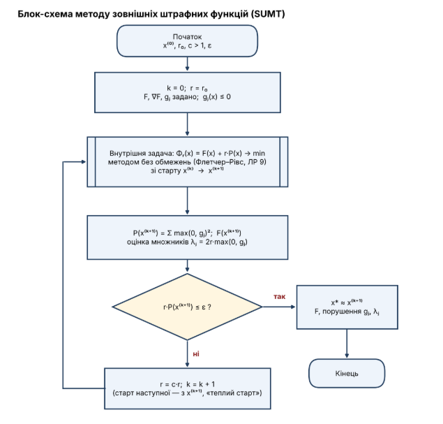
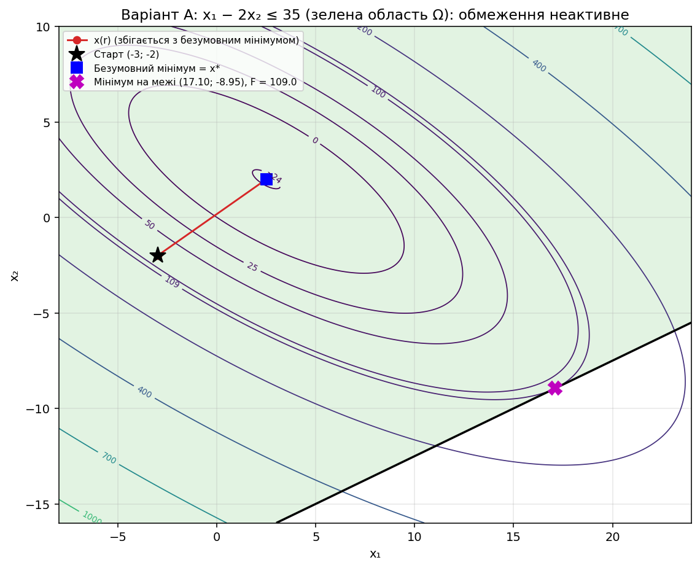
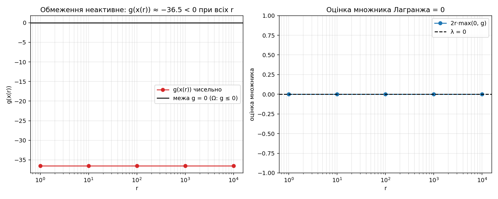
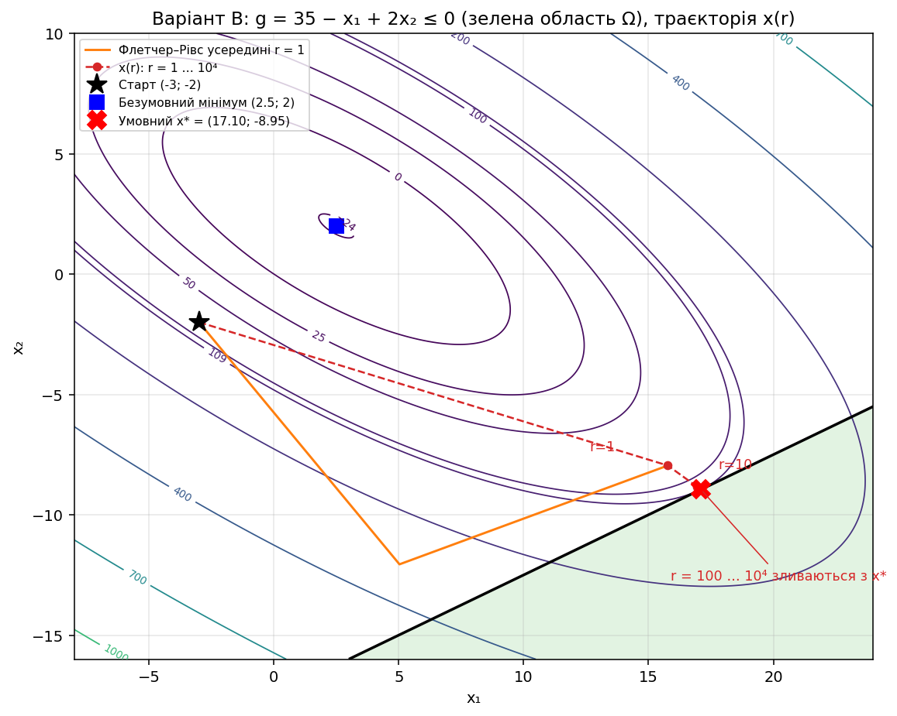
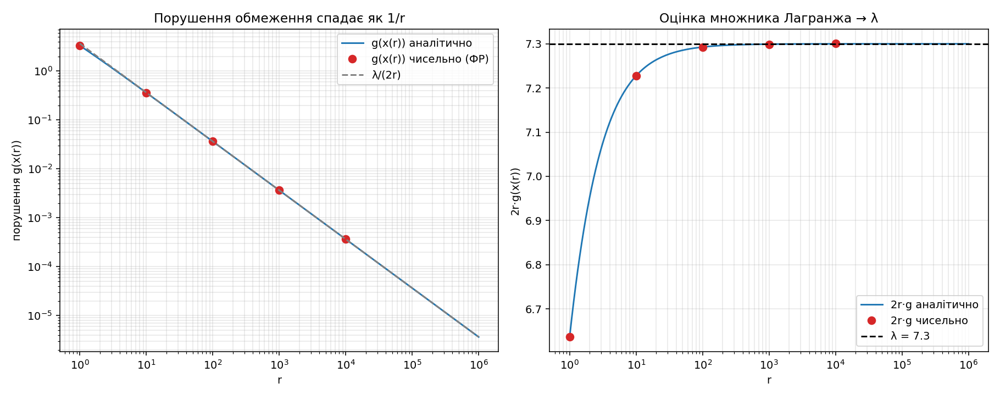

# ЛР 11 (частина 1а). Метод зовнішніх штрафних функцій


**Обмеження.** У частині 1 застосовано **обмеження 1** (x₁ − 2x₂ ≤ 35).

**Що показує розрахунок.** Безумовний мінімум F (2,5; 2) і старт (−3; −2) це обмеження **виконують** (x₁ − 2x₂ = −1,5 і 1, обидва ≤ 35), тож воно неактивне: штраф дорівнює нулю, а метод повертає безумовний мінімум з λ = 0. Це коректний результат методу для неактивного обмеження, але він відрізняється від умови «безумовний мінімум порушує обмеження». Для демонстрації активного випадку наприкінці звіту є короткий **Додаток** з контрольним варіантом (знак обернено). 

## 1. Постановка задачі

| Параметр | Значення |
|---|---|
| Цільова функція | F(x₁, x₂) = x₁² + 2x₂² + 2x₁x₂ − 9x₁ − 13x₂ |
| Градієнт | ∇F = (2x₁ + 2x₂ − 9; 2x₁ + 4x₂ − 13) |
| Гесіан | H = [[2, 2], [2, 4]] (F = ½xᵀHx − bᵀx, b = (9; 13)), власні числа 0,764 і 5,236 |
| Старт | x⁽⁰⁾ = (−3; −2), F(x⁽⁰⁾) = 82 |
| Обмеження 1 | x₁ − 2x₂ ≤ 35 |
| Параметри методу | r₀ = 1, c = 10, ε = 0,01 (зупинка при r·P ≤ ε); внутрішній критерій ‖∇Φᵣ‖ ≤ 0,01 |

**Обмеження у формі g(x) ≤ 0** **g(x) = x₁ − 2x₂ − 35 ≤ 0**, ∇g = (1; −2). Значення g > 0 означає порушення, а саме число g це його величина.

| Точка | g | Допустима? |
|---|---:|---|
| старт (−3; −2) | −34 | так |
| безумовний мінімум (2,5; 2) | −36,5 | так (запас, обмеження **неактивне**) |

**Аналітичний розв'язок для контролю**

- Безумовний мінімум допустимий, тому він і є умовним: **x\* = (2,5; 2), F\* = −24,25, λ = 0**.
- Мінімум F на самій межі x₁ = 35 + 2x₂: φ(x₂) = 10x₂² + 179x₂ + 910, φ′ = 0 дає x₂ = −8,95, x₁ = 17,1, **F = 108,975**. Там ∇F = (7,3; −14,6) = −λ·(1; −2), звідки λ = −7,3 **< 0**. Від'ємний множник означає, що притискатися до межі невигідно, тобто обмеження неактивне.

```text
F(x1,x2) = x1^2 + 2x2^2 + 2x1x2 - 9x1 - 13x2,  x0 = (-3; -2),  F(x0) = 82
∇F = (2x1+2x2-9; 2x1+4x2-13),  H = [[2, 2], [2, 4]],  безумовний мінімум x_безум = (2.5; 2), F = -24.25

Варіант A: x1 - 2x2 <= 35   (g = x1 - 2x2 - 35)
   g(старт) = -34,  g(безумовний мінімум) = -36.5  -> безумовний мінімум НЕ порушує обмеження
   мінімум F на прямій-межі: x_межі = (17.1; -8.95), F = 108.975, множник λ (∇F = -λ∇g) = -7.3   ∇F(x_межі) = (7.3; -14.6), ∇g = (1; -2)
   => обмеження НЕАКТИВНЕ: x* = (2.5; 2), F* = -24.25, λ = 0. На межі λ = -7.3 < 0, тобто «притискати до межі» F не вигідно (F на межі = 108.975 > -24.25)

Варіант B (контрольний, знак обернено): x1 - 2x2 >= 35   (g = 35 - x1 + 2x2)
   g(старт) = 34,  g(безумовний мінімум) = 36.5  -> безумовний мінімум ПОРУШУЄ обмеження
   мінімум F на прямій-межі: x_межі = (17.1; -8.95), F = 108.975, множник λ (∇F = -λ∇g) = 7.3   ∇F(x_межі) = (7.3; -14.6), ∇g = (-1; 2)
   => обмеження АКТИВНЕ: x* = (17.1; -8.95), F* = 108.975, λ = 7.3 >= 0
```

## 2. Штрафна функція Φᵣ і її градієнт

```
P(x) = Σⱼ [max(0, gⱼ(x))]²
Φᵣ(x) = F(x) + r·P(x)
∇Φᵣ(x) = ∇F(x) + 2r·Σⱼ max(0, gⱼ(x))·∇gⱼ(x)
```

Для нашого обмеження: Φᵣ = F + r·max(0, x₁ − 2x₂ − 35)², ∇Φᵣ = ∇F + 2r·max(0, x₁ − 2x₂ − 35)·(1; −2).

- Усередині Ω зрізка max(0, g) дорівнює нулю, тому Φᵣ = F і ∇Φᵣ = ∇F. Поза Ω штраф росте як квадрат порушення, а його градієнт працює як «пружина», що тягне до межі.
- Квадрат зрізки гладкий (у g = 0 і значення, і похідна нульові), тому Φᵣ можна віддати градієнтному методу. У коді це обгортки `penalty(F, gradF, cons, r)` над F та ∇F.
- Умова мінімуму Φᵣ на порушеній стороні ∇F = −2r·g·∇g збігається з ∇F = −λ∇g, тому 2r·g(x(r)) оцінює множник Лагранжа λ.

## 3. Блок-схема алгоритму



1. Задати x⁽⁰⁾, r₀, c > 1, ε.
2. k = 0, r = r₀.
3. Внутрішня задача: мінімізувати Φᵣ без обмежень методом Флетчера–Рівса зі старту x⁽ᵏ⁾, результат x⁽ᵏ⁺¹⁾.
4. Обчислити P, F і оцінки множників λⱼ = 2r·max(0, gⱼ).
5. Якщо r·P ≤ ε, то зупинка: x\* ≈ x⁽ᵏ⁺¹⁾.
6. Відповідь: точка, F і порушення gⱼ (а також λⱼ).
7. Інакше r = c·r, k = k + 1, наступна внутрішня задача стартує з x⁽ᵏ⁺¹⁾ («теплий старт»).

## 4. Реалізація вимог


| № | Вимога | Де в коді |
|---|---|---|
| 1 | Постановка g ≤ 0, x\*, F\*, λ аналітично | клас `Lin` (`CON_A`), `kkt_boundary`, блок «П.1» |
| 2 | Φᵣ і ∇Φᵣ як обгортки над F і ∇F; внутрішній метод ФР без змін | `penalty`, `fletcher_reeves`, `Obj` (лічильники NΦ, N∇Φ) |
| 3 | Прогін r₀ = 1, c = 10, ε = 0,01; протокол; повний протокол для r = 1 | `sumt(..., log_first=True)`, блок «П.3» |
| 4 | Перевірка: система 2×2; 2r·g → λ; порушення ≈ λ/(2r) | `analytic_xr`, блок «П.3» |
| 5 | Графіки: лінії рівня з Ω і траєкторією; g(x(r)) від r | блок «П.4» |
| 6 | Дошліфовування проєкцією; порівняння з великим r зі старту | блок «П.3» |

**Самоперевірка.** Перед розрахунками код прогоняє приклад зі слайдів (F = 2x₁² + 3x₂² + x₁x₂, g = 4 − x₁ − x₂ ≤ 0, старт (5; −3)). Результат збігається зі слайдами: 2, 2, 4, 4, 2 ітерації ФР, NΦ = 68, 66, 122, 101, 48 (разом 405), N∇Φ = 19, перший крок внутрішньої задачі h = 0,229, x(10⁴) = (2,498995; 1,500430). Отже, реалізація коректна.

```text
 k        r старт внутрішньої      іт.ФР    NΦ  N∇Φ  x(r)                         F(x(r))     g(x(r))        r·P      2r·g NΦ разом
-----------------------------------------------------------------------------------------------------------------------------------
 1        1 (5; -3)                    2    68    3  (1.02564; 0.615385)          3.87113    2.358975  5.565e+00    4.7179       68
 2       10 (1.0256; 0.6154)           2    66    3  (2.185791; 1.311474)        17.58187    0.502735  2.527e+00   10.0547      134
 3      100 (2.1858; 1.3115)           4   122    5  (2.46456; 1.478736)         22.35252    0.056704  3.215e-01   11.3408      256
 4     1000 (2.4646; 1.4787)           4   101    5  (2.496411; 1.497847)        22.93402    0.005742  3.297e-02   11.4834      357
 5    10000 (2.4964; 1.4978)           2    48    3  (2.498995; 1.50043)         22.99339    0.000575  3.306e-03   11.4990      405
За слайдами: ітерацій ФР 2,2,4,4,2; NΦ = 68,66,122,101,48 (разом 405), N∇Φ = 19; x(1e4) = (2.498995; 1.500430)
Збіг зі слайдами: ТАК;  перший крок внутрішньої задачі h = 0.229000 (слайд: 0.229),  точка (2.023; 0.893)
```

## 5. Результати для обмеження 1

### 5.1. Внутрішня задача r = 1 (повний протокол)

```text
Внутрішня задача r = 1 (Флетчер-Рівс, ‖∇Φ‖ ≤ 0.01), старт (-3; -2); Φ1 = F, бо g < 0 уздовж усього шляху:
 k x(k)                         Φ1(x(k)) ∇Φ1                           ‖∇Φ1‖ d(k)                             h_k        β   g(x(k))
 0 (-3; -2)                      82.0000 (-19; -27)                  33.0151 (19; 27)                    0.191564 0.002598   -34.000
 1 (0.63972; 3.17223)           -22.4025 (-1.3761; 0.96836)           1.6827 (1.42545; -0.89823)         1.305046 0.000000   -40.705
   -> x(1) = (2.500001; 2.000002),  g = -36.5000 < 0,  NΦ = 76,  N∇Φ = 3   (той самий прогін, що ЛР 9)
```

Уздовж усього шляху g < 0 (−34 → −40,7 → −36,5), зрізка нуль, тому Φ₁ ≡ F, і внутрішня задача збігається з ЛР 9: перший крок h = 0,191564 = 1090/5690 (аналітично), точка (0,6397; 3,1722), далі β = 0 за перезапуском, x(1) = (2,500001; 2,000002). Ітерацій 2, NΦ = 76, N∇Φ = 3.

### 5.2. Протокол зовнішніх ітерацій r = 1, 10, 100, 1000, 10⁴

```text
Звичайний прогін (r0 = 1, c = 10, ε = 0.01): зупинка настає одразу, бо r·P = 0 уже при r = 1
 k        r старт внутрішньої      іт.ФР    NΦ  N∇Φ  x(r)                         F(x(r))     g(x(r))        r·P      2r·g NΦ разом
-----------------------------------------------------------------------------------------------------------------------------------
 1        1 (-3; -2)                   2    76    3  (2.500001; 2.000002)       -24.25000  -36.500003  0.000e+00    0.0000       76

Примусовий прогін r = 1, 10, 100, 1000, 10^4 (щоб показати, що r нічого не змінює):
 k        r старт внутрішньої      іт.ФР    NΦ  N∇Φ  x(r)                         F(x(r))     g(x(r))        r·P      2r·g NΦ разом
-----------------------------------------------------------------------------------------------------------------------------------
 1        1 (-3; -2)                   2    76    3  (2.500001; 2.000002)       -24.25000  -36.500003  0.000e+00    0.0000       76
 2       10 (2.5; 2)                   0     0    1  (2.500001; 2.000002)       -24.25000  -36.500003  0.000e+00    0.0000       76
 3      100 (2.5; 2)                   0     0    1  (2.500001; 2.000002)       -24.25000  -36.500003  0.000e+00    0.0000       76
 4     1000 (2.5; 2)                   0     0    1  (2.500001; 2.000002)       -24.25000  -36.500003  0.000e+00    0.0000       76
 5    10000 (2.5; 2)                   0     0    1  (2.500001; 2.000002)       -24.25000  -36.500003  0.000e+00    0.0000       76
Результат: x = (2.500001; 2.000002), F = -24.25, max g = -36.5 < 0, штраф P = 0, оцінка 2r·max(0,g) = 0
Порівняння з мінімумом на межі: x_межі = (17.1; -8.95), F = 108.975  (≫ -24.25), λ = -7.3 < 0 -> межу не «чіпаємо».
```

| k | r | старт внутрішньої | ітер. ФР | NΦ | N∇Φ | x(r) | F(x(r)) | g(x(r)) | r·P | 2r·g |
|---:|---:|---|---:|---:|---:|---|---:|---:|---:|---:|
| 1 | 1 | (−3; −2) | 2 | 76 | 3 | (2,500001; 2,000002) | −24,25 | −36,5 | 0 | 0 |
| 2 | 10 | (2,5; 2) | 0 | 0 | 1 | (2,500001; 2,000002) | −24,25 | −36,5 | 0 | 0 |
| 3 | 100 | (2,5; 2) | 0 | 0 | 1 | (2,500001; 2,000002) | −24,25 | −36,5 | 0 | 0 |
| 4 | 1000 | (2,5; 2) | 0 | 0 | 1 | (2,500001; 2,000002) | −24,25 | −36,5 | 0 | 0 |
| 5 | 10⁴ | (2,5; 2) | 0 | 0 | 1 | (2,500001; 2,000002) | −24,25 | −36,5 | 0 | 0 |

- За правилом зупинки r·P ≤ ε метод зупиняється вже після r = 1, бо r·P = 0. Рядки r = 10 … 10⁴ отримано **примусовим** прогоном за вимогою завдання.
- Для r ≥ 10 внутрішня задача не потребує жодної ітерації: старт уже є мінімумом Φᵣ = F, потрібен лише один градієнт для перевірки ‖∇Φ‖ ≤ ε.
- Отже, ні r, ні штраф на результат не впливають.

### 5.3. Перевірка аналітикою

```text
Перевірка аналітикою (слайд 10). Система (H + 2r·aa')x = b + 2rβ·a правильна лише якщо її розв'язок на порушеній стороні (g > 0):
        r розв'язок системи            g(розв'язку)  висновок
        1 (15.77273; -7.95455)              -3.3182  g < 0: розв'язок УСЕРЕДИНІ Ω, зрізка нуль -> насправді x(r) = безумовний мінімум (2.5; 2)
       10 (16.95545; -8.84158)              -0.3614  g < 0: розв'язок УСЕРЕДИНІ Ω, зрізка нуль -> насправді x(r) = безумовний мінімум (2.5; 2)
      100 (17.08541; -8.93906)              -0.0365  g < 0: розв'язок УСЕРЕДИНІ Ω, зрізка нуль -> насправді x(r) = безумовний мінімум (2.5; 2)
     1000 (17.09854; -8.94891)              -0.0036  g < 0: розв'язок УСЕРЕДИНІ Ω, зрізка нуль -> насправді x(r) = безумовний мінімум (2.5; 2)
    10000 (17.09985; -8.94989)              -0.0004  g < 0: розв'язок УСЕРЕДИНІ Ω, зрізка нуль -> насправді x(r) = безумовний мінімум (2.5; 2)
Чисельне x(r) для всіх r: (2.500001; 2.000002)  (аналітично (2.5; 2)), ‖Δ‖ = 2.48e-06
Оцінка множника 2r·max(0, g) = 0 при всіх r; порушення max(0, g) = 0, тож «порушення ≈ λ/(2r)» дає 0 = 0.
```

Система 2×2 (H + 2r·aaᵀ)x = b + 2rβ·a виведена в припущенні, що розв'язок лежить на порушеній стороні (g > 0). Для нашого обмеження вона дає точки (15,77; −7,95), (16,96; −8,84), … зі значенням g < 0, тобто **всередині Ω**, де зрізка дорівнює нулю. Це і є «пастка аналітики» зі слайда 10: припущення не виконується, система неправильна, і справжній мінімум Φᵣ збігається з безумовним мінімумом (2,5; 2). Чисельний результат це підтверджує (похибка 2,5·10⁻⁶).

Ті самі точки (15,77; −7,95) … вийшли б у програмі, якби штраф записали без зрізки (r·g² замість r·max(0, g)²). Це типова помилка № 1 зі слайда 17: тоді штрафуються і допустимі точки, і задача стає неправильною.

### 5.4. Оцінка множника і порівняння з мінімумом на межі

| Величина | Значення |
|---|---|
| оцінка 2r·max(0, g) при r = 1 … 10⁴ | 0 (λ = 0) |
| точний множник λ на розв'язку | 0 (обмеження неактивне) |
| порушення max(0, g(x(r))) | 0 при всіх r |
| мінімум на межі | x = (17,1; −8,95), F = 108,975, λ = −7,3 < 0 |
| розв'язок задачі | x\* = (2,5; 2), F\* = −24,25 |

Оцінка 2r·g збігається з точним λ = 0 (точно, а не асимптотично), а співвідношення «порушення ≈ λ/(2r)» перетворюється на 0 = 0. Мінімум на межі допустимий, але F там на 133 більша, тому метод його не вибирає, а множник на межі від'ємний, що також свідчить про неактивність.

### 5.5. Дошліфовування і великі r

```text
Дошліфовування проєкцією (слайд 16) не потрібне: порушення нуль, x̂ = x. Великі r зі старту (ls_eps = 1e-6, ліміт 5000 ітер.):
сценарій                                  x                                 F      NΦ  ітер.
r = 1 (базовий)                           (2.5; 2)                  -24.25000      76      2
одразу r = 1e4 зі старту                  (2.5; 2)                  -24.25000      76      2
одразу r = 1e6 зі старту                  (2.5; 2)                  -24.25000      76      2
r = 1 → 10 → … → 1e4 (теплий старт)       (2.5; 2)                  -24.25000      76      2
Штраф неактивний, тому великий r нічого не псує (Φr = F): гесіан HΦ = H, обумовленість ≈ 6.85 при будь-якому r.
```

- Проєкція на межу (слайд 16) тут не потрібна: порушення нуль, x̂ = x.
- Одразу r = 10⁶ зі старту коштує стільки ж, як r = 1 (NΦ = 76, 2 ітерації): штраф неактивний, Φᵣ = F, гесіан внутрішньої задачі дорівнює H з обумовленістю 6,85 незалежно від r. Тому ефекту «голки» (обумовленість ∝ r) тут немає.

### 5.6. Графіки



Старт і безумовний мінімум лежать **усередині** зеленої області Ω. Червона траєкторія x(r) іде зі старту прямо в безумовний мінімум і не торкається межі, а мінімум на межі (фіолетовий хрест) має значно більшу F.



Зліва g(x(r)) ≈ −36,5 при всіх r, тобто нижче нуля (лог-шкала порушення тут не має сенсу, бо порушення нуль). Справа оцінка множника тотожно нуль.

## 6. Висновки

1. Обмеження x₁ − 2x₂ ≤ 35 є **неактивним**: безумовний мінімум (2,5; 2) і старт його виконують, g = −36,5 і −34. Тому Φᵣ = F, штраф нульовий, метод повертає x\* = (2,5; 2), F\* = −24,25, λ = 0 (точно такий самий результат, як у ЛР 9: 2 ітерації, NΦ = 76, N∇Φ = 3).
2. Зростання r при неактивному обмеженні **нічого не дає і нічого не коштує**: примусовий прогін r = 1, 10, …, 10⁴ не змінює відповіді, а для r ≥ 10 внутрішні задачі потребують 0 ітерацій. Правило r·P ≤ ε зупиняє метод уже при r = 1.
3. Аналітичну систему 2×2 слід застосовувати лише після перевірки знака g: тут її розв'язок лежить усередині Ω, тому вона неправильна, а справжній x(r) збігається з безумовним мінімумом. Штраф без зрізки дав би хибну відповідь (15,77; −7,95).
4. Коли обмеження активне (Додаток), штрафний метод вносить порушення g ≈ λ/(2r), збіжність лише лінійна за 1/r, а гесіан внутрішньої задачі погіршується як r. Для неактивного обмеження жодного з цих ефектів немає, і саме тому такий випадок корисно розглянути як контрольний.

## Додаток. Контрольний варіант B (активне обмеження): x₁ − 2x₂ ≥ 35

Це приклад, який показує, як працює метод, коли обмеження справді порушується. Запис g(x) = 35 − x₁ + 2x₂ ≤ 0, ∇g = (−1; 2), старт має g = 34 > 0. Мінімум на межі (17,1; −8,95), **x\* = (17,1; −8,95), F\* = 108,975, λ = 7,3 ≥ 0** (обмеження активне).

```text
Внутрішня задача r = 1 (Флетчер-Рівс, ‖∇Φ‖ ≤ 0.01), старт (-3; -2):
 k x(k)                         Φ1(x(k)) ∇Φ1                           ‖∇Φ1‖ d(k)                             h_k        β
 0 (-3; -2)                    1238.0000 (-87; 109)                 139.4633 (87; -109)                  0.092276 0.101764
 1 (5.02803; -12.05811)         340.6129 (-34.77167; -27.75334)      44.4895 (43.62517; 16.66102)        0.246296 0.000000
   -> x(1) = (15.772737; -7.954562),  g = 3.318139,  NΦ = 69,  N∇Φ = 3
Перевірка 1-го кроку: HΦ = H + 2r·a·a' = [[4.0, -2.0], [-2.0, 12.0]]; h = ‖∇Φ‖²/(d'HΦ d) = 19450.0000/210780.0000 = 0.092276  (чисельно 0.092276);  g на кроці = 5.8557 > 0 (зрізка не спрацьовує)
Аналітична x(1) з системи (H+2r·aa')x = b + 2rβ·a: (15.772727; -7.954545), g = 3.318182; чисельна: (15.772737; -7.954562)
```

```text
Протокол зовнішніх ітерацій (r0 = 1, c = 10, ε = 0.01, стоп при r·P ≤ ε):
 k        r старт внутрішньої      іт.ФР    NΦ  N∇Φ  x(r)                         F(x(r))     g(x(r))        r·P      2r·g NΦ разом
-----------------------------------------------------------------------------------------------------------------------------------
 1        1 (-3; -2)                   2    69    3  (15.772737; -7.954562)      85.85359    3.318139  1.101e+01    6.6363       69
 2       10 (15.7727; -7.9546)         3    91    4  (16.955448; -8.841583)     106.34994    0.361386  1.306e+00    7.2277      160
 3      100 (16.9554; -8.8416)         3    85    4  (17.08531; -8.939113)      108.70895    0.036464  1.330e-01    7.2928      245
 4     1000 (17.0853; -8.9391)         4    99    5  (17.098541; -8.948905)     108.94836    0.003650  1.332e-02    7.2990      344
 5    10000 (17.0985; -8.9489)         2    48    3  (17.099198; -8.950219)     108.97234    0.000365  1.332e-03    7.3006      392
Результат: x ≈ (17.099198; -8.950219), F ≈ 108.97234 (точно 108.975), порушення g = 3.650e-04, λ ≈ 7.3006 (точно 7.3);  NΦ = 392, N∇Φ = 19
```

| r | x(r) | g(x(r)) | 2r·g | F(x(r)) |
|---:|---|---:|---:|---:|
| 1 | (15,772737; −7,954562) | 3,318 | 6,636 | 85,8536 |
| 10 | (16,955448; −8,841583) | 0,3614 | 7,228 | 106,3499 |
| 100 | (17,085310; −8,939113) | 0,03646 | 7,293 | 108,7090 |
| 1000 | (17,098541; −8,948905) | 0,003650 | 7,299 | 108,9484 |
| 10⁴ | (17,099198; −8,950219) | 0,000365 | 7,3006 | 108,9723 |

Загалом NΦ = 392, N∇Φ = 19, зупинка при r = 10⁴ (r·P = 1,3·10⁻³ ≤ 0,01).

```text
Перевірка аналітикою (слайди 10, 13): x(r) з системи 2x2; 2r·g → λ; порушення ≈ λ/(2r); F* - F ≈ λ²/(2r)
        r x(r) чисельне             x(r) аналітичне                 ‖Δx‖   g чисельне   g аналіт.      r·g     2r·g  r·(F*-F)
        1 (15.77274; -7.95456)      (15.77273; -7.95455)        1.92e-05     3.318139    3.318182   3.3181   6.6363   23.1214
       10 (16.95545; -8.84158)      (16.95545; -8.84158)        2.77e-06     0.361386    0.361386   3.6139   7.2277   26.2506
      100 (17.08531; -8.93911)      (17.08541; -8.93906)        1.17e-04     0.036464    0.036464   3.6464   7.2928   26.6055
     1000 (17.09854; -8.9489)       (17.09854; -8.94891)        4.78e-07     0.003650    0.003650   3.6495   7.2990   26.6402
    10000 (17.0992; -8.95022)       (17.09985; -8.94989)        7.34e-04     0.000365    0.000365   3.6503   7.3006   26.6362
   Теорія: r·g → λ/2 = 3.6500;  2r·g → λ = 7.3000;  r·(F*-F) → λ²/2 = 26.6450
Властивості (слайд 8): F(x(r)) зростає до F* знизу; g(x(r)) > 0 і спадає; r·P ≥ 0 спадає:
   F(x(r)): 85.8536 < 106.3499 < 108.7089 < 108.9484 < 108.9723  < F* = 108.975
```

- Чисельне x(r) збігається з системою 2×2 у 4–5 знаках, 2r·g → λ = 7,3, порушення ≈ λ/(2r) (r·g → 3,65), F(x(r)) зростає до F\* знизу, а r·(F\* − F) → λ²/2 = 26,6 (слайд 16 дає λ²/(4r), а таблиця слайда 13 узгоджується з λ²/(2r)).

```text
x(r=10000) = (17.099198; -8.950219), g = 3.650e-04, F = 108.972336
x̂ = x - g·∇g/‖∇g‖² = (17.099271; -8.950365), g(x̂) = 0.0e+00, F(x̂) = 108.975001, ‖x̂ - x*‖ = 8.156e-04
що зробили                                    x                                    g           F     ‖x-x*‖       NΦ  ітер.ФР
зупинка при r = 10000                         (17.0992; -8.95022)          3.650e-04   108.97234   8.32e-04      392       14
+ проєкція на межу                            (17.09927; -8.95036)           0.0e+00   108.97500   8.16e-04      392       +0
```

Проєкція x̂ = x − g·∇g/‖∇g‖² робить точку допустимою (g = 0, F = 108,975001), але похибка за положенням (8·10⁻⁴) лишається, бо вона йде вздовж межі.

```text
Порівняння з великим r (внутрішній ФР: ‖∇Φ‖ ≤ 0.01, ліміт 5000 ітерацій; ls_eps - точність золотого перерізу по h):
сценарій                                            x                                 g          F    ‖x-x*‖      NΦ  ітер.  збіжність
одразу r = 1e4 зі старту, ls_eps = 1e-6             (17.0999; -8.9499)         3.65e-04   108.9723  1.82e-04     438     17  збіглась
r = 1 → 10 → … → 1e5 (теплий старт), ls_eps = 1e-6  (17.0993; -8.9504)         3.65e-05   108.9747  8.16e-04     440     16  збіглась
одразу r = 1e6 зі старту, ls_eps = 1e-6             (17.0999; -8.95)           3.65e-06   108.9750  6.72e-05   18463    768  збіглась
r = 1 → … → 1e6 (теплий старт), ls_eps = 1e-6       (17.0993; -8.9504)         9.53e-06   108.9749  7.98e-04  120440   5016  НЕ збіглась на r = 1e+06: ‖∇Φ‖ = 26.3 після 5000 ітер.
одразу r = 1e6 зі старту, ls_eps = 1e-10            (17.1; -8.95)              3.65e-06   108.9750  9.06e-06     185      4  збіглась
r = 1 → … → 1e6 (теплий старт), ls_eps = 1e-10      (17.0993; -8.9504)         3.65e-06   108.9750  8.16e-04     622     13  збіглась
Обумовленість H_Φ = H + 2r·aa': r=1: 3.54e+00, r=10: 2.58e+01, r=100: 2.51e+02, r=1000: 2.50e+03, r=10000: 2.50e+04, r=1e+06: 2.50e+06
Крок лінійного пошуку поперек межі h ≈ 1/λmax(HΦ) ≈ 1/(2r‖a‖²) = 1/(10r): при r = 1e6 це 1e-7, тобто менше за точність
золотого перерізу 1e-6 - зі ls_eps = 1e-6 такі кроки «нульові», і ФР застряє (теплий старт на r = 1e6 не збігся).
```

| Сценарій | NΦ | ітер. ФР | збіжність |
|---|---:|---:|---|
| r = 1 → … → 10⁴ (протокол) | 392 | 14 | так |
| одразу r = 10⁴ зі старту | 438 | 17 | так |
| одразу r = 10⁶ зі старту (ls_eps = 10⁻⁶) | 18463 | 768 | так, дорого |
| r = 1 → … → 10⁶ теплим стартом (ls_eps = 10⁻⁶) | 120440 | 5016 | **ні** (на r = 10⁶, ‖∇Φ‖ = 26) |
| одразу r = 10⁶ зі старту (ls_eps = 10⁻¹⁰) | 185 | 4 | так |
| r = 1 → … → 10⁶ теплим стартом (ls_eps = 10⁻¹⁰) | 622 | 13 | так |

Обумовленість гесіана Φᵣ зростає майже лінійно з r: 3,5 при r = 1 і ≈ 2,5·r при великих r. При r = 10⁶ оптимальний крок поперек межі близько 10⁻⁷, що менше за точність золотого перерізу 10⁻⁶, тому ФР застряє. Підвищення точності до 10⁻¹⁰ це виправляє.






<details>
<summary>Повний вивід у консоль</summary>

```text
======================================================================================================================
П.1 Постановка та аналітика (для контролю)
F(x1,x2) = x1^2 + 2x2^2 + 2x1x2 - 9x1 - 13x2,  x0 = (-3; -2),  F(x0) = 82
∇F = (2x1+2x2-9; 2x1+4x2-13),  H = [[2, 2], [2, 4]],  безумовний мінімум x_безум = (2.5; 2), F = -24.25

Варіант A (як у завданні): x1 - 2x2 <= 35   (g = x1 - 2x2 - 35)
   g(старт) = -34,  g(безумовний мінімум) = -36.5  -> безумовний мінімум НЕ порушує обмеження
   мінімум F на прямій-межі: x_межі = (17.1; -8.95), F = 108.975, множник λ (∇F = -λ∇g) = -7.3   ∇F(x_межі) = (7.3; -14.6), ∇g = (1; -2)
   => обмеження НЕАКТИВНЕ: x* = (2.5; 2), F* = -24.25, λ = 0. На межі λ = -7.3 < 0, тобто «притискати до межі» F не вигідно (F на межі = 108.975 > -24.25)

Варіант B (контрольний, знак обернено): x1 - 2x2 >= 35   (g = 35 - x1 + 2x2)
   g(старт) = 34,  g(безумовний мінімум) = 36.5  -> безумовний мінімум ПОРУШУЄ обмеження
   мінімум F на прямій-межі: x_межі = (17.1; -8.95), F = 108.975, множник λ (∇F = -λ∇g) = 7.3   ∇F(x_межі) = (7.3; -14.6), ∇g = (-1; 2)
   => обмеження АКТИВНЕ: x* = (17.1; -8.95), F* = 108.975, λ = 7.3 >= 0

======================================================================================================================
П.2 Самоперевірка реалізації на прикладі зі слайдів 11-15: F = 2x1^2+3x2^2+x1x2, g = 4 - x1 - x2, старт (5; -3)
 k        r старт внутрішньої      іт.ФР    NΦ  N∇Φ  x(r)                         F(x(r))     g(x(r))        r·P      2r·g NΦ разом
-----------------------------------------------------------------------------------------------------------------------------------
 1        1 (5; -3)                    2    68    3  (1.02564; 0.615385)          3.87113    2.358975  5.565e+00    4.7179       68
 2       10 (1.0256; 0.6154)           2    66    3  (2.185791; 1.311474)        17.58187    0.502735  2.527e+00   10.0547      134
 3      100 (2.1858; 1.3115)           4   122    5  (2.46456; 1.478736)         22.35252    0.056704  3.215e-01   11.3408      256
 4     1000 (2.4646; 1.4787)           4   101    5  (2.496411; 1.497847)        22.93402    0.005742  3.297e-02   11.4834      357
 5    10000 (2.4964; 1.4978)           2    48    3  (2.498995; 1.50043)         22.99339    0.000575  3.306e-03   11.4990      405
За слайдами: ітерацій ФР 2,2,4,4,2; NΦ = 68,66,122,101,48 (разом 405), N∇Φ = 19; x(1e4) = (2.498995; 1.500430)
Збіг зі слайдами: ТАК;  перший крок внутрішньої задачі h = 0.229000 (слайд: 0.229),  точка (2.023; 0.893)

======================================================================================================================
П.3 ВАРІАНТ A (як у завданні): x1 - 2x2 <= 35; обмеження неактивне
Звичайний прогін (r0 = 1, c = 10, ε = 0.01): зупинка настає одразу, бо r·P = 0 уже при r = 1
 k        r старт внутрішньої      іт.ФР    NΦ  N∇Φ  x(r)                         F(x(r))     g(x(r))        r·P      2r·g NΦ разом
-----------------------------------------------------------------------------------------------------------------------------------
 1        1 (-3; -2)                   2    76    3  (2.500001; 2.000002)       -24.25000  -36.500003  0.000e+00    0.0000       76

Примусовий прогін r = 1, 10, 100, 1000, 10^4 (щоб показати, що r нічого не змінює):
 k        r старт внутрішньої      іт.ФР    NΦ  N∇Φ  x(r)                         F(x(r))     g(x(r))        r·P      2r·g NΦ разом
-----------------------------------------------------------------------------------------------------------------------------------
 1        1 (-3; -2)                   2    76    3  (2.500001; 2.000002)       -24.25000  -36.500003  0.000e+00    0.0000       76
 2       10 (2.5; 2)                   0     0    1  (2.500001; 2.000002)       -24.25000  -36.500003  0.000e+00    0.0000       76
 3      100 (2.5; 2)                   0     0    1  (2.500001; 2.000002)       -24.25000  -36.500003  0.000e+00    0.0000       76
 4     1000 (2.5; 2)                   0     0    1  (2.500001; 2.000002)       -24.25000  -36.500003  0.000e+00    0.0000       76
 5    10000 (2.5; 2)                   0     0    1  (2.500001; 2.000002)       -24.25000  -36.500003  0.000e+00    0.0000       76
Результат: x = (2.500001; 2.000002), F = -24.25, max g = -36.5 < 0, штраф P = 0, оцінка 2r·max(0,g) = 0
Порівняння з мінімумом на межі: x_межі = (17.1; -8.95), F = 108.975  (≫ -24.25), λ = -7.3 < 0 -> межу не «чіпаємо».

Внутрішня задача r = 1 (Флетчер-Рівс, ‖∇Φ‖ ≤ 0.01), старт (-3; -2); Φ1 = F, бо g < 0 уздовж усього шляху:
 k x(k)                         Φ1(x(k)) ∇Φ1                           ‖∇Φ1‖ d(k)                             h_k        β   g(x(k))
 0 (-3; -2)                      82.0000 (-19; -27)                  33.0151 (19; 27)                    0.191564 0.002598   -34.000
 1 (0.63972; 3.17223)           -22.4025 (-1.3761; 0.96836)           1.6827 (1.42545; -0.89823)         1.305046 0.000000   -40.705
   -> x(1) = (2.500001; 2.000002),  g = -36.5000 < 0,  NΦ = 76,  N∇Φ = 3   (той самий прогін, що ЛР 9)

Перевірка аналітикою (слайд 10). Система (H + 2r·aa')x = b + 2rβ·a правильна лише якщо її розв'язок на порушеній стороні (g > 0):
        r розв'язок системи            g(розв'язку)  висновок
        1 (15.77273; -7.95455)              -3.3182  g < 0: розв'язок УСЕРЕДИНІ Ω, зрізка нуль -> насправді x(r) = безумовний мінімум (2.5; 2)
       10 (16.95545; -8.84158)              -0.3614  g < 0: розв'язок УСЕРЕДИНІ Ω, зрізка нуль -> насправді x(r) = безумовний мінімум (2.5; 2)
      100 (17.08541; -8.93906)              -0.0365  g < 0: розв'язок УСЕРЕДИНІ Ω, зрізка нуль -> насправді x(r) = безумовний мінімум (2.5; 2)
     1000 (17.09854; -8.94891)              -0.0036  g < 0: розв'язок УСЕРЕДИНІ Ω, зрізка нуль -> насправді x(r) = безумовний мінімум (2.5; 2)
    10000 (17.09985; -8.94989)              -0.0004  g < 0: розв'язок УСЕРЕДИНІ Ω, зрізка нуль -> насправді x(r) = безумовний мінімум (2.5; 2)
Чисельне x(r) для всіх r: (2.500001; 2.000002)  (аналітично (2.5; 2)), ‖Δ‖ = 2.48e-06
Оцінка множника 2r·max(0, g) = 0 при всіх r; порушення max(0, g) = 0, тож «порушення ≈ λ/(2r)» дає 0 = 0.

Дошліфовування проєкцією (слайд 16) не потрібне: порушення нуль, x̂ = x. Великі r зі старту (ls_eps = 1e-6, ліміт 5000 ітер.):
сценарій                                  x                                 F      NΦ  ітер.
r = 1 (базовий)                           (2.5; 2)                  -24.25000      76      2
одразу r = 1e4 зі старту                  (2.5; 2)                  -24.25000      76      2
одразу r = 1e6 зі старту                  (2.5; 2)                  -24.25000      76      2
r = 1 → 10 → … → 1e4 (теплий старт)       (2.5; 2)                  -24.25000      76      2
Штраф неактивний, тому великий r нічого не псує (Φr = F): гесіан HΦ = H, обумовленість ≈ 6.85 при будь-якому r.

======================================================================================================================
Д.1 ДОДАТОК. ВАРІАНТ B (контрольний, знак обернено): x1 - 2x2 >= 35, g = 35 - x1 + 2x2 <= 0; ∇g = (-1; 2)
Аналітично: x* = (17.1; -8.95), F* = 108.975, λ = 7.3

Внутрішня задача r = 1 (Флетчер-Рівс, ‖∇Φ‖ ≤ 0.01), старт (-3; -2):
 k x(k)                         Φ1(x(k)) ∇Φ1                           ‖∇Φ1‖ d(k)                             h_k        β
 0 (-3; -2)                    1238.0000 (-87; 109)                 139.4633 (87; -109)                  0.092276 0.101764
 1 (5.02803; -12.05811)         340.6129 (-34.77167; -27.75334)      44.4895 (43.62517; 16.66102)        0.246296 0.000000
   -> x(1) = (15.772737; -7.954562),  g = 3.318139,  NΦ = 69,  N∇Φ = 3
Перевірка 1-го кроку: HΦ = H + 2r·a·a' = [[4.0, -2.0], [-2.0, 12.0]]; h = ‖∇Φ‖²/(d'HΦ d) = 19450.0000/210780.0000 = 0.092276  (чисельно 0.092276);  g на кроці = 5.8557 > 0 (зрізка не спрацьовує)
Аналітична x(1) з системи (H+2r·aa')x = b + 2rβ·a: (15.772727; -7.954545), g = 3.318182; чисельна: (15.772737; -7.954562)

Протокол зовнішніх ітерацій (r0 = 1, c = 10, ε = 0.01, стоп при r·P ≤ ε):
 k        r старт внутрішньої      іт.ФР    NΦ  N∇Φ  x(r)                         F(x(r))     g(x(r))        r·P      2r·g NΦ разом
-----------------------------------------------------------------------------------------------------------------------------------
 1        1 (-3; -2)                   2    69    3  (15.772737; -7.954562)      85.85359    3.318139  1.101e+01    6.6363       69
 2       10 (15.7727; -7.9546)         3    91    4  (16.955448; -8.841583)     106.34994    0.361386  1.306e+00    7.2277      160
 3      100 (16.9554; -8.8416)         3    85    4  (17.08531; -8.939113)      108.70895    0.036464  1.330e-01    7.2928      245
 4     1000 (17.0853; -8.9391)         4    99    5  (17.098541; -8.948905)     108.94836    0.003650  1.332e-02    7.2990      344
 5    10000 (17.0985; -8.9489)         2    48    3  (17.099198; -8.950219)     108.97234    0.000365  1.332e-03    7.3006      392
Результат: x ≈ (17.099198; -8.950219), F ≈ 108.97234 (точно 108.975), порушення g = 3.650e-04, λ ≈ 7.3006 (точно 7.3);  NΦ = 392, N∇Φ = 19

Перевірка аналітикою (слайди 10, 13): x(r) з системи 2x2; 2r·g → λ; порушення ≈ λ/(2r); F* - F ≈ λ²/(2r)
        r x(r) чисельне             x(r) аналітичне                 ‖Δx‖   g чисельне   g аналіт.      r·g     2r·g  r·(F*-F)
        1 (15.77274; -7.95456)      (15.77273; -7.95455)        1.92e-05     3.318139    3.318182   3.3181   6.6363   23.1214
       10 (16.95545; -8.84158)      (16.95545; -8.84158)        2.77e-06     0.361386    0.361386   3.6139   7.2277   26.2506
      100 (17.08531; -8.93911)      (17.08541; -8.93906)        1.17e-04     0.036464    0.036464   3.6464   7.2928   26.6055
     1000 (17.09854; -8.9489)       (17.09854; -8.94891)        4.78e-07     0.003650    0.003650   3.6495   7.2990   26.6402
    10000 (17.0992; -8.95022)       (17.09985; -8.94989)        7.34e-04     0.000365    0.000365   3.6503   7.3006   26.6362
   Теорія: r·g → λ/2 = 3.6500;  2r·g → λ = 7.3000;  r·(F*-F) → λ²/2 = 26.6450
Властивості (слайд 8): F(x(r)) зростає до F* знизу; g(x(r)) > 0 і спадає; r·P ≥ 0 спадає:
   F(x(r)): 85.8536 < 106.3499 < 108.7089 < 108.9484 < 108.9723  < F* = 108.975

======================================================================================================================
Д.2 ДОДАТОК. Варіант B: дошліфовування проєкцією на межу та порівняння з великим r одразу зі старту
x(r=10000) = (17.099198; -8.950219), g = 3.650e-04, F = 108.972336
x̂ = x - g·∇g/‖∇g‖² = (17.099271; -8.950365), g(x̂) = 0.0e+00, F(x̂) = 108.975001, ‖x̂ - x*‖ = 8.156e-04
що зробили                                    x                                    g           F     ‖x-x*‖       NΦ  ітер.ФР
зупинка при r = 10000                         (17.0992; -8.95022)          3.650e-04   108.97234   8.32e-04      392       14
+ проєкція на межу                            (17.09927; -8.95036)           0.0e+00   108.97500   8.16e-04      392       +0

Порівняння з великим r (внутрішній ФР: ‖∇Φ‖ ≤ 0.01, ліміт 5000 ітерацій; ls_eps - точність золотого перерізу по h):
сценарій                                            x                                 g          F    ‖x-x*‖      NΦ  ітер.  збіжність
одразу r = 1e4 зі старту, ls_eps = 1e-6             (17.0999; -8.9499)         3.65e-04   108.9723  1.82e-04     438     17  збіглась
r = 1 → 10 → … → 1e5 (теплий старт), ls_eps = 1e-6  (17.0993; -8.9504)         3.65e-05   108.9747  8.16e-04     440     16  збіглась
одразу r = 1e6 зі старту, ls_eps = 1e-6             (17.0999; -8.95)           3.65e-06   108.9750  6.72e-05   18463    768  збіглась
r = 1 → … → 1e6 (теплий старт), ls_eps = 1e-6       (17.0993; -8.9504)         9.53e-06   108.9749  7.98e-04  120440   5016  НЕ збіглась на r = 1e+06: ‖∇Φ‖ = 26.3 після 5000 ітер.
одразу r = 1e6 зі старту, ls_eps = 1e-10            (17.1; -8.95)              3.65e-06   108.9750  9.06e-06     185      4  збіглась
r = 1 → … → 1e6 (теплий старт), ls_eps = 1e-10      (17.0993; -8.9504)         3.65e-06   108.9750  8.16e-04     622     13  збіглась
Обумовленість H_Φ = H + 2r·aa': r=1: 3.54e+00, r=10: 2.58e+01, r=100: 2.51e+02, r=1000: 2.50e+03, r=10000: 2.50e+04, r=1e+06: 2.50e+06
Крок лінійного пошуку поперек межі h ≈ 1/λmax(HΦ) ≈ 1/(2r‖a‖²) = 1/(10r): при r = 1e6 це 1e-7, тобто менше за точність
золотого перерізу 1e-6 - зі ls_eps = 1e-6 такі кроки «нульові», і ФР застряє (теплий старт на r = 1e6 не збігся).

======================================================================================================================
П.4 Графіки
Збережено: lr11_contours_A.png, lr11_violation_A.png (варіант A); lr11_contours_B.png, lr11_violation.png (додаток, варіант B)
```

</details>