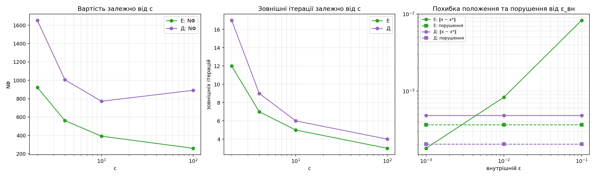
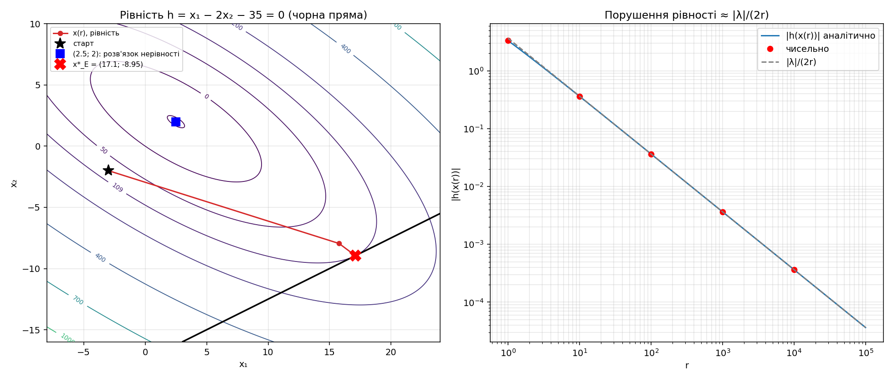
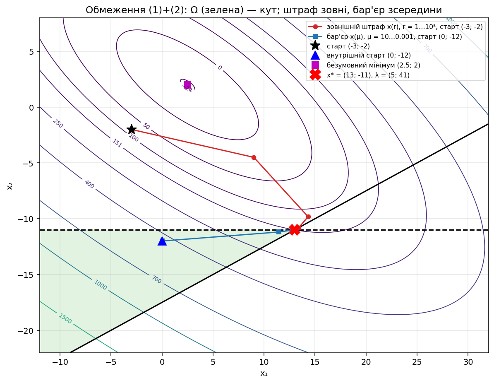
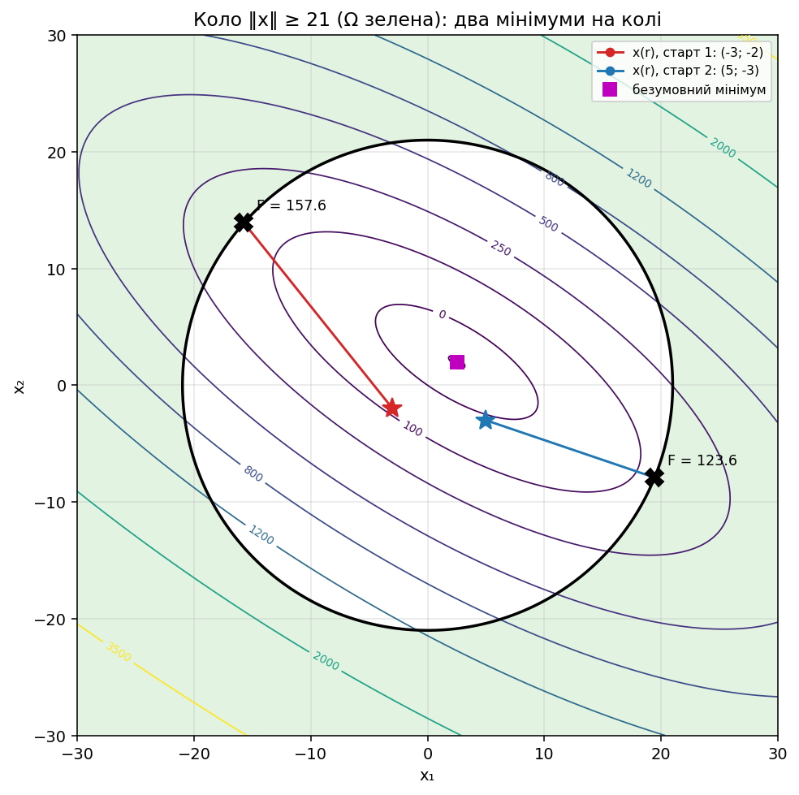

# ЛР 11 (частина 2 б). Рівності, бар'єри, кілька обмежень, коло

## 0. Обсяг, обмеження 

**Задача:** F(x₁, x₂) = x₁² + 2x₂² + 2x₁x₂ − 9x₁ − 13x₂, старт x⁽⁰⁾ = (−3; −2), безумовний мінімум (2,5; 2), F = −24,25.

| Обмеження | Запис g(x) ≤ 0 | ∇g | Безумовний мінімум | Старт |
|---|---|---|---|---|
| (1) x₁ − 2x₂ ≤ 35 | g₁ = x₁ − 2x₂ − 35 | (1; −2) | g₁ = −36,5, **виконано** | g₁ = −34, виконано |
| (2) x₂ ≤ −11 | g₂ = x₂ + 11 | (0; 1) | g₂ = 13, порушено | g₂ = 9, порушено |
| коло x₁² + x₂² ≥ 441 (R = 21) | g₃ = 441 − x₁² − x₂² | (−2x₁; −2x₂) | g₃ = 430,75, порушено | g₃ = 428, порушено |

**Щоб ці експерименти були змістовними, їх виконано на двох задачах:**

- **Е** (рівність): та сама межа x₁ − 2x₂ = 35 як h(x) = 0, одна активна межа;
- **Д** (два обмеження разом): (1) + (2), обидва активні, x\* у куті.

**Адаптивна точність лінійного пошуку.** У частині 1 було з'ясовано, що при великому r оптимальний крок поперек межі (≈ 1/(10r)) менший за точність золотого перерізу 10⁻⁶, і Флетчер–Рівс розбігається. Тому точність золотого перерізу взято ls_eps = min(10⁻⁶, 10⁻²/r) для штрафу та min(10⁻⁶, 10⁻³·μ) для бар'єра. На діапазонах слайдів (r ≤ 10⁴, μ ≥ 10⁻³) це не змінює метод, але усуває розбіжність при r = 10⁶.

**Самоперевірка реалізації** на прикладах зі слайдів 3, 6, 12, 13 (розділ 3): два обмеження (NΦ = 453, N∇Φ = 22), коло (255, 12) і рівність (368, 18) збігаються **точно**, бар'єр збігається за кількістю ітерацій `[4, 4, 5, 2]`, x(10) і F, відрізняючись лише на 2 обчислення функції на третій стадії (NΦ = 441 замість 443).

## 1. Постановка і аналітика для контролю (умови Куна–Таккера)

Для активних обмежень умова Куна–Таккера ∇F + Σλⱼ∇gⱼ = 0, λⱼ ≥ 0. Для лінійних обмежень це система [[H, Aᵀ], [A, 0]]·(x; λ) = (b; β).

| Задача | x\* | F\* | λ |
|---|---|---|---|
| рівність x₁ − 2x₂ = 35 | (17,1; −8,95) | 108,975 | λ_h = −7,3 (знак довільний) |
| (2) окремо | (15,5; −11) | 144,75 | λ₂ = 26 (але g₁ = 2,5 > 0: (1) порушується) |
| **(1) + (2) разом** | **(13; −11)** | **151** | **λ = (5; 41), обидва ≥ 0, обидва активні** |
| коло, мінімум 1 (глобальний) | (19,4538; −7,9089) | 123,5665 | 0,36213 |
| коло, мінімум 2 (локальний) | (−15,7319; 13,9107) | 157,5722 | 0,40181 |

Перевірка для (1)+(2): ∇F(13; −11) = (−5; −31) = −5·(1; −2) − 41·(0; 1). Обмеження (1) окремо неактивне, але у парі з (2) стає активним: розв'язок для (2) окремо (15,5; −11) порушує (1), тож мінімум переходить у кут (13; −11).

```text
F = x1^2 + 2x2^2 + 2x1x2 - 9x1 - 13x2,  x0 = (-3; -2),  безумовний мінімум (2.5; 2), F = -24.25
Обмеження: (1) g1 = x1 - 2x2 - 35 <= 0;  (2) g2 = x2 + 11 <= 0;  коло g3 = 441 - x1^2 - x2^2 <= 0 (R = 21)
g1(мін) = -36.50 (виконано), g2(мін) = 13.00 (порушено), g3(мін) = 430.75 (порушено); g1(старт) = -34, g2(старт) = 9

Рівність h = x1 - 2x2 - 35 = 0: x*_E = (17.1; -8.95), F = 108.97500, λ_h = -7.3000 (∇F + λ∇h = 0, знак довільний)
Обмеження (2) окремо: x* = (15.5; -11), F = 144.7500, λ2 = 26.000; але g1 там = 2.50 > 0 (порушується обмеження 1)
Обмеження (1)+(2) разом (Куна-Таккер, обидва активні): x* = (13; -11), F* = 151.0000, λ = (5.0000; 41.0000)  -> обидва ≥ 0
   перевірка: ∇F(x*) = (-5; -31) = -λ1·(1; -2) - λ2·(0; 1) = (-5; -31)
Коло x1^2 + x2^2 = 441 (мінімуми F на колі, чисельно за кутом):
   x = (19.4538; -7.9089), ‖x‖ = 21.0000, F = 123.5665, λ = 0.36213 (∇F = -λ∇g = 2λx)
   x = (-15.7319; 13.9107), ‖x‖ = 21.0000, F = 157.5722, λ = 0.40181 (∇F = -λ∇g = 2λx)
```

## 2. Реалізація вимог завдання

| № | Вимога | Де в коді |
|---|---|---|
| 1 | c = 2, 4, 10, 100 | `sumt_ext(..., c=cc)`, блок «П.2» |
| 2 | Внутрішній ε = 0,1 / 0,01 / 0,001 | `sumt_ext(..., inner_eps=ei)`, «П.3» |
| 3 | Рівність: штраф r·h² без зрізки | `Con(..., kind="eq")`, «П.4» |
| 4 | Лог-бар'єр, Φ = +∞ зовні, двостороння оцінка | `barrier`, `sumt_int`, «П.5» |
| 5 | Два обмеження, λ з Куна–Таккера, оцінки 2r·sⱼ | `kkt_active`, «П.6» |
| 6 | Коло, два старти | `CIRC`, `circle_minima`, «П.7» |
| 7 | Сферична метрика ЛР 8 замість ФР, r = 100 | `spherical`, «П.8» |
| 8 | Зведена таблиця | «П.9» |

Для кількох обмежень штраф P = Σ max(0, gⱼ)² + Σ hᵢ² і ∇Φ = ∇F + 2r·Σ sⱼ∇gⱼ (sⱼ = max(0, gⱼ) для нерівності, sⱼ = h для рівності). Бар'єр Φμ = F − μ·Σ ln(−gⱼ), ∇Φμ = ∇F − μ·Σ ∇gⱼ/gⱼ; поза Ω функція Φμ повертає +∞, а Свенн вважає це зростанням.

## 3. Самоперевірка на прикладах зі слайдів
```text
Бар'єр зі старту (5; 1): μ = 10 → 0.01:  ітерацій [4, 4, 5, 2], NΦ = [132, 125, 136, 48] (разом 441), N∇Φ = 19; x(10) = (2.95913; 1.77547), F(0.01) = 23.0100
   за слайдами: 4,4,5,2; NΦ 132,125,138,48 (443); N∇Φ = 19; x(10) = (2.95913; 1.77547); F = 23.010
Два обмеження, старт (5; -3): ітерацій [2, 4, 3, 4, 4], NΦ = 453, N∇Φ = 22, x(1e4) = (2.9992; 1.0002), 2r·s = (13.0; 4.0)   (слайди: 453, 22, (2.9992; 1.0002), (13.0; 4.0))
Коло R = 3, старт (5; -3): NΦ = 255, N∇Φ = 12, r = 100: ‖x‖ = 2.9985, F = 16.120   (слайд: 255, 12, 2.9985, 16.12)
Рівність x1 + x2 = 4: NΦ = 368, N∇Φ = 18   (слайд: 368, 18)
Збіг: два обмеження ТАК, коло ТАК, рівність ТАК; бар'єр: x(μ) і F збігаються, NΦ перших двох стадій збігаються (132, 125) - ТАК, але 3-тя стадія має 5 ітерації замість 5 (NΦ 441 замість 443) - різниця в одному лінійному пошуку біля стіни
```

## 4. Завдання 1. Множник c (r₀ = 1, ε = 0,01)

```text
Задача Е: рівність x1 - 2x2 = 35; точна відповідь (17.1; -8.95), F* = 108.9750
   c зовн.ітер.    кінц. r      NΦ   N∇Φ   порушення  x                             ‖x-x*‖  збіг.  оцінка log_c(r_кін/r0)
   2         12       2048     922    44     0.00178  (17.0989; -8.9496)          1.13e-03    так  11.0
   4          7       4096     561    27     0.00089  (17.0996; -8.9497)          4.45e-04    так  6.0
  10          5      10000     392    19     0.00037  (17.0992; -8.9502)          8.32e-04    так  4.0
 100          3      10000     260    12     0.00037  (17.0998; -8.9499)          1.88e-04    так  2.0

Задача Д: обмеження (1)+(2) разом; точна відповідь (13; -11), F* = 151.0000
   c зовн.ітер.    кінц. r      NΦ   N∇Φ   порушення  x                             ‖x-x*‖  збіг.  оцінка log_c(r_кін/r0)
   2         17      65536    1653    78     0.00031  (13.0007; -10.9997)         7.34e-04    так  16.0
   4          9      65536    1006    46     0.00031  (13.0007; -10.9997)         7.34e-04    так  8.0
  10          6     100000     772    34     0.00020  (13.0004; -10.9998)         4.81e-04    так  5.0
 100          4      1e+06     891    34     0.00002  (13; -11)                   4.81e-05    так  3.0
Для обмеження (1) окремо (неактивного) c не має значення: зупинка при r = 1, 1 зовнішня ітерація, NΦ = 76 (частина 1).
```

| Задача | c | зовн. ітер. | кінц. r | NΦ | N∇Φ | порушення | ‖x − x\*‖ |
|---|---:|---:|---:|---:|---:|---:|---:|
| Е: рівність | 2 | 12 | 2048 | 922 | 44 | 0,00178 | 1,13·10⁻³ |
| Е | 4 | 7 | 4096 | 561 | 27 | 0,00089 | 4,45·10⁻⁴ |
| Е | 10 | 5 | 10⁴ | 392 | 19 | 0,00037 | 8,32·10⁻⁴ |
| Е | 100 | 3 | 10⁴ | **260** | 12 | 0,00037 | 1,88·10⁻⁴ |
| Д: (1)+(2) | 2 | 17 | 65536 | 1653 | 78 | 0,00031 | 7,34·10⁻⁴ |
| Д | 4 | 9 | 65536 | 1006 | 46 | 0,00031 | 7,34·10⁻⁴ |
| Д | 10 | 6 | 10⁵ | **772** | 34 | 0,00020 | 4,81·10⁻⁴ |
| Д | 100 | 4 | 10⁶ | 891 | 34 | 0,00002 | 4,81·10⁻⁵ |

**Висновок про компроміс.**

- Кількість зовнішніх ітерацій дорівнює log_c(r_кін/r₀) + 1 (оцінка слайда 9 підтверджується): 12, 7, 5, 3 для Е і 17, 9, 6, 4 для Д.
- Малий c (2) дає багато дешевих зовнішніх ітерацій, але разом найдорожче (922 і 1653 обчислення Φ). Збільшення c до 10 зменшує вартість більш ніж удвічі.
- Великий c (100) на простій задачі Е найдешевший (260), проте на складнішій задачі Д дорожчий за c = 10 (891 проти 772): стрибок у 100 разів одразу виводить точку в погано обумовлену зону, і внутрішній метод витрачає більше кроків (а без адаптивного кроку розбігається, див. розділ 10).
- Порушення при c = 100 на задачі Д менше (2·10⁻⁵), але лише тому, що останній r більший (10⁶ замість 10⁵), це не вигода методу.
- Висновок: c = 10 безпечний вибір, c = 4 … 10 за підручником; c = 2 надто дорогий, c = 100 ризикований.

## 5. Завдання 2. Внутрішній ε

```text
Задача Е: рівність x1 - 2x2 = 35
   ε_вн зовн.ітер.   кінц. r      NΦ   N∇Φ  x при r_кін                   ‖x-x*‖   порушення  збіг.
    0.1          5     10000     314    16  (17.09253; -8.95355)        8.27e-03    0.000365    так
   0.01          5     10000     392    19  (17.0992; -8.95022)         8.32e-04    0.000365    так
  0.001          5     10000     472    22  (17.09986; -8.94989)        1.81e-04    0.000365    так

Задача Д: обмеження (1)+(2) разом
   ε_вн зовн.ітер.   кінц. r      NΦ   N∇Φ  x при r_кін                   ‖x-x*‖   порушення  збіг.
    0.1          6    100000     696    31  (13.00043; -10.9998)        4.81e-04    0.000205    так
   0.01          6    100000     772    34  (13.00043; -10.9998)        4.81e-04    0.000205    так
  0.001          6    100000     873    38  (13.00043; -10.9998)        4.81e-04    0.000205    так
Порушення задає r (воно ≈ λ/(2r)), а положення вздовж межі залежить від внутрішнього ε.
```

| Задача | ε_вн | NΦ | N∇Φ | ‖x − x\*‖ | порушення |
|---|---:|---:|---:|---:|---:|
| Е: рівність | 0,1 | 314 | 16 | 8,27·10⁻³ | 3,65·10⁻⁴ |
| Е | 0,01 | 392 | 19 | 8,32·10⁻⁴ | 3,65·10⁻⁴ |
| Е | 0,001 | 472 | 22 | 1,81·10⁻⁴ | 3,65·10⁻⁴ |
| Д: (1)+(2) | 0,1 | 696 | 31 | 4,81·10⁻⁴ | 2,05·10⁻⁴ |
| Д | 0,01 | 772 | 34 | 4,81·10⁻⁴ | 2,05·10⁻⁴ |
| Д | 0,001 | 873 | 38 | 4,81·10⁻⁴ | 2,05·10⁻⁴ |



**Висновок.** На задачі Е з однією межею **порушення не залежить від ε_вн** (3,65·10⁻⁴ в усіх трьох рядках, його задає r), а **положення вздовж межі залежить**: при посиленні внутрішнього критерію вдесятеро похибка ‖x − x\*‖ падає майже вдесятеро (8,3·10⁻³ → 8,3·10⁻⁴ → 1,8·10⁻⁴; кривина вздовж межі мала, критерій ‖∇Φ‖ ≤ ε зупиняє метод, коли похибка вздовж м'якого напрямку ≈ ε/λ_min). На задачі Д (кут, два активні обмеження) ефекту немає: штраф жорстко фіксує обидві координати, м'якого напрямку нема, і похибка 4,81·10⁻⁴ однакова при всіх ε_вн. Практичне правило: ε_вн ≈ зовнішній ε, а на останній ітерації на порядок жорсткіший.

## 6. Завдання 3. Рівність h = x₁ − 2x₂ − 35 = 0

Для рівності штраф r·h² без зрізки: ∇P = 2h·∇h змінює знак разом із h, тому штраф завжди тягне до лінії. Аналітично x\*_E = (17,1; −8,95), F = 108,975, λ_h = −7,3.

```text
Аналітично: x*_E = (17.1; -8.95), F = 108.97500, λ_h = -7.3000;  оцінка λ = 2r·h
 k        r старт                 іт.     NΦ   N∇Φ  x(r)                            F(x(r))        s1        r·P     2r·s1 NΦ разом
-----------------------------------------------------------------------------------------------------------------------------------
 1        1 (-3; -2)                2     69     3  (15.772737; -7.954562)         85.85359  -3.31814  1.101e+01   -6.6363       69
 2       10 (15.773; -7.955)        3     91     4  (16.955448; -8.841583)        106.34994  -0.36139  1.306e+00   -7.2277      160
 3      100 (16.955; -8.842)        3     85     4  (17.08531; -8.939113)         108.70895  -0.03646  1.330e-01   -7.2928      245
 4     1000 (17.085; -8.939)        4     99     5  (17.098541; -8.948905)        108.94836  -0.00365  1.332e-02   -7.2990      344
 5    10000 (17.099; -8.949)        2     48     3  (17.099198; -8.950219)        108.97234  -0.00037  1.332e-03   -7.3006      392
Результат: x = (17.099198; -8.950219), F = 108.97234, |h| = 3.650e-04, 2r·h = -7.3006; NΦ = 392, N∇Φ = 19
```

```text
Перевірка аналітикою: (H + 2r·aa')x = b + 2rβ·a (для рівності справедлива при будь-якому знаку h)
        r x чисельне                x аналітичне                    ‖Δx‖   h чисельне   h аналіт.      2r·h
        1 (15.77274; -7.95456)      (15.77273; -7.95455)        1.92e-05    -3.318139   -3.318182   -6.6363
       10 (16.95545; -8.84158)      (16.95545; -8.84158)        2.77e-06    -0.361386   -0.361386   -7.2277
      100 (17.08531; -8.93911)      (17.08541; -8.93906)        1.17e-04    -0.036464   -0.036464   -7.2928
     1000 (17.09854; -8.9489)       (17.09854; -8.94891)        4.78e-07    -0.003650   -0.003650   -7.2990
    10000 (17.0992; -8.95022)       (17.09985; -8.94989)        7.34e-04    -0.000365   -0.000365   -7.3006
Теорія: 2r·h → λ_h = -7.3000; h ≈ λ_h/(2r) (h < 0: наближення з боку безумовного мінімуму)
```

```text
Порівняння з НЕРІВНІСТЮ x1 - 2x2 <= 35 (та сама межа): x = (2.5; 2), F = -24.2500, штраф 0, 1 зовнішня ітерація, NΦ = 76
   рівність: x = (17.0992; -8.95022), F = 108.972; нерівність: x = (2.5; 2), F = -24.25. Різниця: безумовний мінімум нерівність виконує, а рівність вимагає лежати НА лінії
```



**Порівняння x(r) з нерівністю (слайд 3).** На слайді 3 нерівність і рівність мали ту саму траєкторію, бо безумовний мінімум порушував нерівність. Тут це не так: нерівність x₁ − 2x₂ ≤ 35 виконується безумовним мінімумом, і метод дає (2,5; 2) з F = −24,25 при нульовому штрафі (1 зовнішня ітерація, NΦ = 76), тоді як рівність вимагає лежати **на лінії** і дає (17,0992; −8,95022) з F = 108,972, NΦ = 392. Для рівності немає «усередині»: наближення з боку безумовного мінімуму (h < 0), порушення |h| ≈ |λ|/(2r) = 3,65/r, а 2r·h → λ_h = −7,3 (−6,64 → −7,23 → −7,29 → −7,299 → −7,301). Чисельне x(r) збігається з аналітичним (H + 2r·aaᵀ)x = b + 2rβ·a, яка для рівності справедлива при будь-якому знаку h.

## 7. Завдання 4. Лог-бар'єр і двостороння оцінка

**(а) Обмеження (1) окремо.** Старт (−3; −2) строго всередині (g₁ = −34), але обмеження неактивне, тому бар'єр майже не діє: F(x(μ)) спадає до F\* = −24,25 зверху (F − F\* = 0,175 → 0,0019 → 0,00002), μ/(−g₁) → λ = 0.

```text
(а) Обмеження (1) окремо, старт (-3; -2): g1 = -34 < 0 (строго всередині), x* = (2.5; 2), F* = -24.25, λ = 0
 k        μ x(μ)                               g1      F(x(μ))       F-F*    μ/(-g1)  іт.     NΦ NΦ разом  в Ω  збіг.
---------------------------------------------------------------------------------------------------------------------
 1       10 (1.97147; 2.39698)          -37.82249    -24.07510    0.17490     0.2644    2     76       76  так    так
 2        1 (2.44542; 2.04093)          -36.63644    -24.24814    0.00186     0.0273    2     78      154  так    так
 3      0.1 (2.49452; 2.00411)          -36.51369    -24.24998    0.00002     0.0027    2     78      232  так    так
 4     0.01 (2.49452; 2.00411)          -36.51369    -24.24998    0.00002     0.0003    0      0      232  так    так
 5    0.001 (2.49452; 2.00411)          -36.51369    -24.24998    0.00002     0.0000    0      0      232  так    так
   F(x(μ)) ≥ F* для всіх μ (спадає до -24.25 зверху); μ/(-g) = 0.00027 → λ = 0; усі точки в Ω
```

**(б) Обмеження (1)+(2) разом.** Старт (−3; −2) не внутрішній (g₂ = 9 > 0), тому береться внутрішня точка (0; −12) з g = (−11; −1) < 0.

```text
(б) Обмеження (1)+(2): старт (-3; -2) НЕ внутрішній (g2 = 9 > 0), тому внутрішній старт (0; -12): g = (-11; -1) < 0, F = 444
 k        μ x(μ)                               g1         g2      F(x(μ))       F-F*    μ/(-g1)    μ/(-g2)  іт.     NΦ NΦ разом  в Ω  збіг.
-------------------------------------------------------------------------------------------------------------------------------------------
 1       10 (11.43915; -11.19266)        -1.17554   -0.19266    167.88852   16.88852     8.5067    51.9058    7    204      204  так    так
 2        1 (12.77111; -11.0235)         -0.18188   -0.02350    152.93727    1.93727     5.4982    42.5480    5    135      339  так    так
 3      0.1 (12.97537; -11.00243)        -0.01977   -0.00243    151.19916    0.19916     5.0582    41.1751    5    125      464  так    так
 4     0.01 (12.99751; -11.00024)        -0.00200   -0.00024    151.02000    0.02000     5.0026    41.0095   13    312      776  так    так
 5    0.001 (12.99975; -11.00002)        -0.00020   -0.00002    151.00200    0.00200     4.9987    40.9945   16    384     1160  так    так
 6   0.0001 (12.99998; -11)              -0.00002   -0.00000    151.00020    0.00020     5.0000    41.0044   18    504     1664  так    так
   F* = 151.0000, λ = (5.000; 41.000); μ/(-g_j) → λ_j
Стоп при μ = 0.001: x = (12.99975; -11.00002), F = 151.0020, NΦ = 1160, N∇Φ = 51
```

- Усі x(μ) в Ω (g < 0), жодна точка не вийшла за межу, і F спадає до F\* = 151 **зверху**: F − F\* = 16,9 → 1,94 → 0,199 → 0,0200 → 0,0020 → 0,0002, тобто ≈ m·μ при m = 2 обмеження. Тому критерій μ·m ≤ ε означає «F уже в межах ε від F\*» (стоп при μ = 0,001).
- Оцінки μ/(−gⱼ) збігаються до λ = (5; 41) зверху: (8,51; 51,9) → (5,50; 42,5) → (5,06; 41,2) → (5,003; 41,01) → (4,999; 40,99).
- Лінійний пошук бачить Φ = +∞ за межею і зупиняється біля неї. При дуже малих μ (≤ 10⁻⁴) точності золотого перерізу 10⁻⁶ не вистачало, тому для бар'єра її звужено до 10⁻³·μ.

```text
Двостороння оцінка: F(x(r)) ≤ F* ≤ F(x(μ)):  150.9915 ≤ 151.0000 ≤ 151.0020   (ширина інтервалу 0.0105; точне F* = 151.0000)
   зовнішній штраф: r = 100000, x = (13.00043; -10.9998), порушення 2.05e-04, NΦ = 772;  бар'єр: x = (12.99975; -11.00002), g = (-0.00020; -0.00002) < 0
```

**Двостороння оцінка:** F(x(r)) ≤ F\* ≤ F(x(μ)), тобто **150,9915 ≤ F\* ≤ 151,0020**, ширина інтервалу 0,0105 (точне F\* = 151 лежить усередині). Зовнішній штраф дає нижню межу (наближення ззовні, g > 0, F знизу), бар'єр верхню (зсередини, g < 0, F зверху). Ширина інтервалу це чесна міра точності, коли точне F\* невідоме.



## 8. Завдання 5. Два обмеження, λ з умов Куна–Таккера

**Куна–Таккер:** ∇F(13; −11) = (−5; −31) = −λ₁·(1; −2) − λ₂·(0; 1), звідки λ₁ = 5, −31 = 10 − λ₂ дає λ₂ = 41. Обидва ≥ 0, отже обидва обмеження активні, **x\* = (13; −11), F\* = 151, λ = (5; 41)**.

```text
Куна-Таккер: x* = (13; -11), F* = 151.0000, λ = (5.0000; 41.0000) обидва ≥ 0 -> обидва обмеження активні
 k        r старт                 іт.     NΦ   N∇Φ  x(r)                            F(x(r))        s1        s2        r·P     2r·s1     2r·s2 NΦ разом
-------------------------------------------------------------------------------------------------------------------------------------------------------
 1        1 (-3; -2)                2     76     3  (9.000001; -4.500001)          18.00001   0.00000   6.50000  4.225e+01    0.0000   13.0000       76
 2       10 (9; -4.5)               2     68     3  (14.31818; -9.817953)         115.41402   0.00000   1.18205  1.397e+01    0.0000   23.6409      144
 3      100 (14.318; -9.818)        7    189     8  (13.390905; -10.814163)       143.65171   0.01923   0.18584  3.491e+00    3.8463   37.1673      333
 4     1000 (13.391; -10.814)       3     75     4  (13.043042; -10.9797)         150.15990   0.00244   0.02030  4.181e-01    4.8830   40.6008      408
 5    10000 (13.043; -10.98)        7    168     8  (13.004345; -10.997952)       150.91484   0.00025   0.00205  4.255e-02    4.9853   40.9532      576
 6   100000 (13.004; -10.998)       7    196     8  (13.000435; -10.999795)       150.99147   0.00002   0.00020  4.264e-03    4.9980   40.9936      772
Результат: x ≈ (13.00043; -10.9998), F = 150.9915, порушення (0.00002; 0.00020), 2r·s = (4.998; 40.994) → λ = (5.00; 41.00); NΦ = 772, N∇Φ = 34
```

```text
Аналітична перевірка штрафної системи: (H + 2r·(a1a1' + a2a2'))x = b + 2r·(β1a1 + β2a2) (правильна, коли обидва s > 0):
        r x чисельне                x аналітичне                    ‖Δx‖          g1          g2  обидва порушені?
        1 (9; -4.5)                 (15.53846; -8.42308)        7.63e+00    -2.61538     2.57692  ні -> система не застосовна
       10 (14.31818; -9.81795)      (15.01185; -9.96682)        7.09e-01    -0.05450     1.03318  ні -> система не застосовна
      100 (13.3909; -10.81416)      (13.39091; -10.81416)       6.48e-06     0.01923     0.18584  так
     1000 (13.04304; -10.9797)      (13.04302; -10.97971)       2.81e-05     0.00244     0.02029  так
    10000 (13.00434; -10.99795)     (13.00435; -10.99795)       5.73e-07     0.00025     0.00205  так
   100000 (13.00043; -10.9998)      (13.00043; -10.9998)        2.70e-08     0.00002     0.00020  так
Обмеження (1) стає порушеним лише коли обмеження (2) притискає розв'язок до x2 = -11: до цього воно неактивне (s1 = 0 при малих r).
```

- **Оцінки 2r·sⱼ → λ.** λ₁: 0 → 0 → 3,85 → 4,88 → 4,985 → 4,998; λ₂: 13,0 → 23,6 → 37,2 → 40,6 → 40,95 → 40,994. Це збігається з λ = (5; 41) з умов Куна–Таккера, обидва додатні.
- **Історія активності.** При r = 1 і 10 порушено лише (2) (s₁ = 0, оцінка λ₁ = 0): розв'язок (9; −4,5) і (14,3; −9,8) ще допустимий для (1). Від r = 100 обидва порушені, дві «пружини» тягнуть одночасно, і відповідь це вершина кута Ω.
- **Аналітична система** (H + 2r·Σaaᵀ)x = b + 2rΣβa правильна лише для r ≥ 100, коли обидва sⱼ > 0 (збіг у 5–8 знаках); для r = 1 і 10 вона не застосовна (виходить g₁ < 0), чисельний розв'язок при цьому правильний.
- **6 зовнішніх ітерацій** (до r = 10⁵), бо λ₂ = 41 велике: порушення ≈ λ₂/(2r) і r·P ≈ λ₂²/(4r) ≤ 0,01 потребує r ≈ 4·10⁴. Загалом NΦ = 772, N∇Φ = 34, порушення (2·10⁻⁵; 2·10⁻⁴).

## 9. Завдання 6. Коло x₁² + x₂² ≥ 441 з двох стартів

g = 441 − x₁² − x₂², ∇g = (−2x₁; −2x₂) залежить від точки (формули ті самі, довшою стає лише «пружина»). Мінімум F на колі шукається чисельно за кутом, ∇F = 2λx.

```text
Мінімуми F на колі (точно):
   x = (19.4538; -7.9089), F = 123.5665, λ = 0.36213
   x = (-15.7319; 13.9107), F = 157.5722, λ = 0.40181
```

```text
старт 1: (-3; -2), F(старт) = 82.00, g = 428.0 > 0 (порушено)
 k        r старт                 іт.     NΦ   N∇Φ  x(r)                            F(x(r))        s1        r·P     2r·s1 NΦ разом
-----------------------------------------------------------------------------------------------------------------------------------
 1        1 (-3; -2)               13    381    14  (-15.727693; 13.908227)       157.49152   0.20091  4.036e-02    0.4018      381
 2       10 (-15.728; 13.908)       2     48     3  (-15.730918; 13.911079)       157.56417   0.02009  4.037e-03    0.4018      429
   збіглось до x ≈ (-15.7309; 13.9111), ‖x‖ = 20.9995, F = 157.5642, порушення s = 0.0201, 2r·s = 0.4018  → мінімум (-15.732; 13.911) (F = 157.572, λ = 0.4018); NΦ = 429, N∇Φ = 17
```

```text
старт 2: (5; -3), F(старт) = 7.00, g = 407.0 > 0 (порушено)
 k        r старт                 іт.     NΦ   N∇Φ  x(r)                            F(x(r))        s1        r·P     2r·s1 NΦ разом
-----------------------------------------------------------------------------------------------------------------------------------
 1        1 (5; -3)                11    310    12  (19.449895; -7.906991)        123.50097   0.18106  3.278e-02    0.3621      310
 2       10 (19.45; -7.907)         2     48     3  (19.45349; -7.908452)         123.55998   0.01811  3.279e-03    0.3621      358
   збіглось до x ≈ (19.4535; -7.9085), ‖x‖ = 20.9996, F = 123.5600, порушення s = 0.0181, 2r·s = 0.3621  → мінімум (19.454; -7.909) (F = 123.567, λ = 0.3621); NΦ = 358, N∇Φ = 15
Ω = {x1² + x2² ≥ 441} невипукла: два локальні мінімуми з різною F; порівнювати треба F з обох стартів.
```



| Старт | Куди збіглось | ‖x‖ | F | оцінка 2r·s | точний λ |
|---|---|---:|---:|---:|---:|
| (−3; −2) | (−15,7309; 13,9111) | 20,9995 | 157,564 | 0,4018 | 0,40181 |
| (5; −3) | (19,4535; −7,9085) | 20,9996 | 123,560 | 0,3621 | 0,36213 |

**Висновок.** Ω = {‖x‖ ≥ 21} невипукла (коло «вирізає» опуклу дірку), тому штрафна задача має два локальні мінімуми, і метод збігається до того, до якого «скотився». Зі старту (−3; −2) знайдено **локальний** мінімум (F = 157,57), зі старту (5; −3) **глобальний** (F = 123,57). Тому F треба порівнювати з кількох стартів і не вірити першому знайденому мінімуму (типова помилка № 3). Оцінки 2r·s збігаються з λ до чотирьох знаків уже при r = 10 (штраф r·P = 4·10⁻³ ≤ ε).

## 10. Завдання 7. Внутрішній метод: сферична метрика проти Флетчера–Рівса

Задача Е (рівність), Φ_r квадратична всюди; критерій ‖∇Φ‖ ≤ 0,01, ліміт 5000 ітерацій.

```text
внутрішній метод                задача                        ітер.       NΦ    N∇Φ         |h|  збіг.
сферична метрика (ЛР 8)         r = 1 зі старту                  27       38     28   3.318e+00    так
сферична метрика (ЛР 8)         r = 10 зі старту                128      140    129   3.614e-01    так
сферична метрика (ЛР 8)         r = 100 зі старту              1696     1700   1697   3.646e-02    так
Флетчер–Рівс (ЛР 9)             r = 1 → … → 10⁴, теплий старт     14      392     19   3.650e-04   так
Флетчер–Рівс, ls_eps 1e-6       r = 10⁶ зі старту               253     6096    255    4.641e+93    НІ
Флетчер–Рівс, ls_eps адапт.     r = 10⁶ зі старту                13      441     14   3.651e-06    так
Ньютон (H + 2r·aa' відомий)     r = 100, 1 крок                   1        1      1   3.646e-02    так
Ньютон (H + 2r·aa' відомий)     r = 1e+06, 1 крок                 1        1      1   3.650e-06    так
Ньютон: Φr (рівність) квадратична всюди, тому один крок дає точне x(r); його вартість - 1 градієнт + 1 гесіан.
```

| Внутрішній метод | Задача | ітер. | NΦ | N∇Φ | |h| |
|---|---|---:|---:|---:|---:|
| сферична метрика (ЛР 8) | r = 1 зі старту | 27 | 38 | 28 | 3,32 |
| сферична метрика | r = 10 зі старту | 128 | 140 | 129 | 0,361 |
| сферична метрика | **r = 100 зі старту** | **1696** | 1700 | 1697 | 0,0365 |
| Флетчер–Рівс (ЛР 9) | r = 1 → … → 10⁴, теплий старт | 14 | 392 | 19 | 3,65·10⁻⁴ |
| Флетчер–Рівс, ls_eps 10⁻⁶ | r = 10⁶ зі старту | розбіг (253 ітер.) | 6096 | 255 | — |
| Флетчер–Рівс, ls_eps адаптивна | r = 10⁶ зі старту | 13 | 441 | 14 | 3,65·10⁻⁶ |
| Ньютон | будь-який r, 1 крок | 1 | 1 | 1 + 1 H | точно |

**Висновок.** Кількість ітерацій сферичної метрики різко зростає разом із r (27 → 128 → 1696): антиградієнт зигзагує в «голці» (обумовленість Φ_r ∝ r), тож уже при r = 100 він потребує 1696 ітерацій проти 14 у Флетчера–Рівса з теплим стартом. Спряжені градієнти терплять велике r, але потребують узгодженої точності лінійного пошуку: при r = 10⁶ і фіксованому ls_eps = 10⁻⁶ метод розбігається, а з адаптивною точністю збігається за 13 ітерацій. Ньютон дає точний x(r) за один крок (Φ_r квадратична), ціною гесіана. Правило: внутрішній метод має терпіти погану обумовленість (спряжені градієнти, Ньютон), а антиградієнтний метод не годиться.

## 11. Завдання 8. Зведена таблиця всіх прогонів

c = 10, r₀ = 1 / μ₀ = 10, ε = 0,01, внутрішній ε = 0,01 (якщо не вказано інше). Е = рівність x₁ − 2x₂ = 35, Д = обмеження (1)+(2) разом.

| Прогін | зовн. ітер. | NΦ | N∇Φ | відповідь | порушення | F | λ (оцінка) |
|---|---:|---:|---:|---|---:|---:|---|
| Рівність x1-2x2=35, r=1…1e4 (ФР) | 5 | 392 | 19 | (17.0992; -8.95022) | 3.65e-04 | 108.9723 | -7.301 |
| Нерівність x1-2x2<=35 (неактивна) | 1 | 76 | 3 | (2.5; 2) | 0.00e+00 | -24.2500 | 0 |
| Бар'єр (1)+(2), μ=10…0.001 | 5 | 1160 | 51 | (12.99975; -11.00002) | 0.00e+00 | 151.0020 | (5.00; 40.99) |
| Два обмеження (1)+(2), r=1…r_кін | 6 | 772 | 34 | (13.00043; -10.9998) | 2.05e-04 | 150.9915 | (5.00; 40.99) |
| Коло R=21, старт 1: (-3; -2) | 2 | 429 | 17 | (-15.73092; 13.91108) | 2.01e-02 | 157.5642 | 0.402 |
| Коло R=21, старт 2: (5; -3) | 2 | 358 | 15 | (19.45349; -7.90845) | 1.81e-02 | 123.5600 | 0.362 |
| Е: c = 2 | 12 | 922 | 44 | (17.09893; -8.94964) | 1.78e-03 | 108.9620 | -7.30 |
| Е: c = 4 | 7 | 561 | 27 | (17.09964; -8.94973) | 8.91e-04 | 108.9685 | -7.30 |
| Е: c = 100 | 3 | 260 | 12 | (17.09984; -8.9499) | 3.65e-04 | 108.9723 | -7.30 |
| Д: c = 2 | 17 | 1653 | 78 | (13.00066; -10.99969) | 3.13e-04 | 150.9870 | (5.00; 40.99) |
| Д: c = 4 | 9 | 1006 | 46 | (13.00066; -10.99969) | 3.13e-04 | 150.9870 | (5.00; 40.99) |
| Д: c = 100 | 4 | 891 | 34 | (13.00004; -10.99998) | 2.05e-05 | 150.9991 | (5.00; 40.99) |
| Е: ε_вн = 0.1 | 5 | 314 | 16 | (17.09253; -8.95355) | 3.65e-04 | 108.9725 | -7.31 |
| Е: ε_вн = 0.001 | 5 | 472 | 22 | (17.09986; -8.94989) | 3.65e-04 | 108.9723 | -7.30 |
| Д: ε_вн = 0.1 | 6 | 696 | 31 | (13.00043; -10.9998) | 2.05e-04 | 150.9915 | (5.00; 41.00) |
| Д: ε_вн = 0.001 | 6 | 873 | 38 | (13.00043; -10.9998) | 2.05e-04 | 150.9915 | (5.00; 40.99) |

Точні відповіді: рівність (17,1; −8,95), F = 108,975, λ_h = −7,3; (1)+(2): (13; −11), F = 151, λ = (5; 41); коло: (19,4538; −7,9089), F = 123,567, λ = 0,362 (глобальний) і (−15,7319; 13,9107), F = 157,572, λ = 0,402 (локальний); обмеження (1) окремо: (2,5; 2), F = −24,25, λ = 0.

## 12. Висновки за слайдом 15

1. **Скільки зовнішніх ітерацій і чому.** Для рівності при c = 10 їх 5 (r = 1 … 10⁴), для (1)+(2) шість (до r = 10⁵), для кола дві, для бар'єра п'ять–шість. Число ітерацій ≈ log_c(r_кін/r₀) + 1, а r_кін визначається множником λ: порушення ≈ λ/(2r), r·P ≈ λ²/(4r) ≤ 0,01. Тому для λ₂ = 41 потрібен r ≈ 4·10⁴, для λ = 7,3 лише 10⁴, а для кола (λ ≈ 0,4) достатньо r = 10.
2. **Як спадало порушення.** Вдесятеро на кожному кроці при c = 10: для рівності 3,32 → 0,361 → 0,0365 → 0,00365 → 0,000365, тобто g ≈ λ/(2r). Це лінійна збіжність за 1/r: кожна цифра точності коштує множника 10 у r.
3. **Що дало зростання r і що воно коштувало.** Порушення зменшується, F(x(r)) наближається до F\* знизу, оцінки 2r·sⱼ збігаються до λⱼ. Ціна: обумовленість внутрішньої задачі росте як r, сферична метрика потребує 27 → 128 → 1696 ітерацій при r = 1, 10, 100, а Флетчер–Рівс при r = 10⁶ потребує адаптивної точності лінійного пошуку. Теплий старт і поступове r тримають внутрішню задачу простою.
4. **Чому відповідь трохи недопустима і що з цим зроблено.** Зовнішній штраф дає точку поза Ω при будь-якому скінченному r (порушення 2·10⁻⁴ … 4·10⁻⁴), тому в кожній відповіді вказано точку, F і порушення. Допустиму відповідь дає бар'єр (усі точки в Ω, F зверху), а двостороння оцінка 150,9915 ≤ F\* ≤ 151,0020 показує точність двох прогонів. Для лінійних меж можна дошліфувати проєкцією на межу.
5. **Які обмеження активні і які λ.** Для (1)+(2) обидва активні, λ = (5; 41) (оцінки 2r·s = (4,998; 40,994), бар'єрні μ/(−g) = (4,999; 40,99)). Обмеження (1) саме по собі неактивне (λ = 0), але разом з (2) стає активним. Для кола активне єдине обмеження, λ = 0,362 (глобальний) і 0,402 (локальний мінімум). Для рівності λ_h = −7,3.
6. **Інші спостереження.** Рівність потребує лише зовнішнього штрафу (у лінії немає внутрішності для бар'єра). Бар'єр вимагає внутрішнього старту і лінійного пошуку з Φ = +∞. Коло дає невипуклу Ω і два мінімуми. Вплив внутрішнього ε видно лише на задачі з одним активним обмеженням, у куті його немає.


<details>
<summary>Повний вивід у консоль</summary>

```text
================================================================================================================================
П.0 Постановка та аналітика (для контролю)
F = x1^2 + 2x2^2 + 2x1x2 - 9x1 - 13x2,  x0 = (-3; -2),  безумовний мінімум (2.5; 2), F = -24.25
Обмеження: (1) g1 = x1 - 2x2 - 35 <= 0;  (2) g2 = x2 + 11 <= 0;  коло g3 = 441 - x1^2 - x2^2 <= 0 (R = 21)
g1(мін) = -36.50 (виконано), g2(мін) = 13.00 (порушено), g3(мін) = 430.75 (порушено); g1(старт) = -34, g2(старт) = 9

Рівність h = x1 - 2x2 - 35 = 0: x*_E = (17.1; -8.95), F = 108.97500, λ_h = -7.3000 (∇F + λ∇h = 0, знак довільний)
Обмеження (2) окремо: x* = (15.5; -11), F = 144.7500, λ2 = 26.000; але g1 там = 2.50 > 0 (порушується обмеження 1)
Обмеження (1)+(2) разом (Куна-Таккер, обидва активні): x* = (13; -11), F* = 151.0000, λ = (5.0000; 41.0000)  -> обидва ≥ 0
   перевірка: ∇F(x*) = (-5; -31) = -λ1·(1; -2) - λ2·(0; 1) = (-5; -31)
Коло x1^2 + x2^2 = 441 (мінімуми F на колі, чисельно за кутом):
   x = (19.4538; -7.9089), ‖x‖ = 21.0000, F = 123.5665, λ = 0.36213 (∇F = -λ∇g = 2λx)
   x = (-15.7319; 13.9107), ‖x‖ = 21.0000, F = 157.5722, λ = 0.40181 (∇F = -λ∇g = 2λx)

================================================================================================================================
П.1 Самоперевірка реалізації на прикладах зі слайдів (F = 2x1^2+3x2^2+x1x2, g = 4 - x1 - x2 <= 0)
Бар'єр зі старту (5; 1): μ = 10 → 0.01:  ітерацій [4, 4, 5, 2], NΦ = [132, 125, 136, 48] (разом 441), N∇Φ = 19; x(10) = (2.95913; 1.77547), F(0.01) = 23.0100
   за слайдами: 4,4,5,2; NΦ 132,125,138,48 (443); N∇Φ = 19; x(10) = (2.95913; 1.77547); F = 23.010
Два обмеження, старт (5; -3): ітерацій [2, 4, 3, 4, 4], NΦ = 453, N∇Φ = 22, x(1e4) = (2.9992; 1.0002), 2r·s = (13.0; 4.0)   (слайди: 453, 22, (2.9992; 1.0002), (13.0; 4.0))
Коло R = 3, старт (5; -3): NΦ = 255, N∇Φ = 12, r = 100: ‖x‖ = 2.9985, F = 16.120   (слайд: 255, 12, 2.9985, 16.12)
Рівність x1 + x2 = 4: NΦ = 368, N∇Φ = 18   (слайд: 368, 18)
Збіг: два обмеження ТАК, коло ТАК, рівність ТАК; бар'єр: x(μ) і F збігаються, NΦ перших двох стадій збігаються (132, 125) - ТАК, але 3-тя стадія має 5 ітерації замість 5 (NΦ 441 замість 443) - різниця в одному лінійному пошуку біля стіни

================================================================================================================================
П.2 Завдання 1. Множник c (r0 = 1, ε = 0.01, внутрішній ε = 0.01, ФР, теплий старт, зупинка r·P ≤ ε)

Задача Е: рівність x1 - 2x2 = 35; точна відповідь (17.1; -8.95), F* = 108.9750
   c зовн.ітер.    кінц. r      NΦ   N∇Φ   порушення  x                             ‖x-x*‖  збіг.  оцінка log_c(r_кін/r0)
   2         12       2048     922    44     0.00178  (17.0989; -8.9496)          1.13e-03    так  11.0
   4          7       4096     561    27     0.00089  (17.0996; -8.9497)          4.45e-04    так  6.0
  10          5      10000     392    19     0.00037  (17.0992; -8.9502)          8.32e-04    так  4.0
 100          3      10000     260    12     0.00037  (17.0998; -8.9499)          1.88e-04    так  2.0

Задача Д: обмеження (1)+(2) разом; точна відповідь (13; -11), F* = 151.0000
   c зовн.ітер.    кінц. r      NΦ   N∇Φ   порушення  x                             ‖x-x*‖  збіг.  оцінка log_c(r_кін/r0)
   2         17      65536    1653    78     0.00031  (13.0007; -10.9997)         7.34e-04    так  16.0
   4          9      65536    1006    46     0.00031  (13.0007; -10.9997)         7.34e-04    так  8.0
  10          6     100000     772    34     0.00020  (13.0004; -10.9998)         4.81e-04    так  5.0
 100          4      1e+06     891    34     0.00002  (13; -11)                   4.81e-05    так  3.0
Для обмеження (1) окремо (неактивного) c не має значення: зупинка при r = 1, 1 зовнішня ітерація, NΦ = 76 (частина 1).

================================================================================================================================
П.3 Завдання 2. Внутрішній ε (‖∇Φ‖ ≤ ε_вн): 0.1 / 0.01 / 0.001 (c = 10, зовнішній ε = 0.01, прогін r = 1 … r_кін)

Задача Е: рівність x1 - 2x2 = 35
   ε_вн зовн.ітер.   кінц. r      NΦ   N∇Φ  x при r_кін                   ‖x-x*‖   порушення  збіг.
    0.1          5     10000     314    16  (17.09253; -8.95355)        8.27e-03    0.000365    так
   0.01          5     10000     392    19  (17.0992; -8.95022)         8.32e-04    0.000365    так
  0.001          5     10000     472    22  (17.09986; -8.94989)        1.81e-04    0.000365    так

Задача Д: обмеження (1)+(2) разом
   ε_вн зовн.ітер.   кінц. r      NΦ   N∇Φ  x при r_кін                   ‖x-x*‖   порушення  збіг.
    0.1          6    100000     696    31  (13.00043; -10.9998)        4.81e-04    0.000205    так
   0.01          6    100000     772    34  (13.00043; -10.9998)        4.81e-04    0.000205    так
  0.001          6    100000     873    38  (13.00043; -10.9998)        4.81e-04    0.000205    так
Порушення задає r (воно ≈ λ/(2r)), а положення вздовж межі залежить від внутрішнього ε.

================================================================================================================================
П.4 Завдання 3. Рівність h = x1 - 2x2 - 35 = 0: штраф r·h² (без зрізки), r = 1 … r_кін
Аналітично: x*_E = (17.1; -8.95), F = 108.97500, λ_h = -7.3000;  оцінка λ = 2r·h
 k        r старт                 іт.     NΦ   N∇Φ  x(r)                            F(x(r))        s1        r·P     2r·s1 NΦ разом
-----------------------------------------------------------------------------------------------------------------------------------
 1        1 (-3; -2)                2     69     3  (15.772737; -7.954562)         85.85359  -3.31814  1.101e+01   -6.6363       69
 2       10 (15.773; -7.955)        3     91     4  (16.955448; -8.841583)        106.34994  -0.36139  1.306e+00   -7.2277      160
 3      100 (16.955; -8.842)        3     85     4  (17.08531; -8.939113)         108.70895  -0.03646  1.330e-01   -7.2928      245
 4     1000 (17.085; -8.939)        4     99     5  (17.098541; -8.948905)        108.94836  -0.00365  1.332e-02   -7.2990      344
 5    10000 (17.099; -8.949)        2     48     3  (17.099198; -8.950219)        108.97234  -0.00037  1.332e-03   -7.3006      392
Результат: x = (17.099198; -8.950219), F = 108.97234, |h| = 3.650e-04, 2r·h = -7.3006; NΦ = 392, N∇Φ = 19

Перевірка аналітикою: (H + 2r·aa')x = b + 2rβ·a (для рівності справедлива при будь-якому знаку h)
        r x чисельне                x аналітичне                    ‖Δx‖   h чисельне   h аналіт.      2r·h
        1 (15.77274; -7.95456)      (15.77273; -7.95455)        1.92e-05    -3.318139   -3.318182   -6.6363
       10 (16.95545; -8.84158)      (16.95545; -8.84158)        2.77e-06    -0.361386   -0.361386   -7.2277
      100 (17.08531; -8.93911)      (17.08541; -8.93906)        1.17e-04    -0.036464   -0.036464   -7.2928
     1000 (17.09854; -8.9489)       (17.09854; -8.94891)        4.78e-07    -0.003650   -0.003650   -7.2990
    10000 (17.0992; -8.95022)       (17.09985; -8.94989)        7.34e-04    -0.000365   -0.000365   -7.3006
Теорія: 2r·h → λ_h = -7.3000; h ≈ λ_h/(2r) (h < 0: наближення з боку безумовного мінімуму)

Порівняння з НЕРІВНІСТЮ x1 - 2x2 <= 35 (та сама межа): x = (2.5; 2), F = -24.2500, штраф 0, 1 зовнішня ітерація, NΦ = 76
   рівність: x = (17.0992; -8.95022), F = 108.972; нерівність: x = (2.5; 2), F = -24.25. Різниця: безумовний мінімум нерівність виконує, а рівність вимагає лежати НА лінії

================================================================================================================================
П.5 Завдання 4. Лог-бар'єр Φμ = F - μ·Σ ln(-g_j), μ0 = 10, c = 10, стоп μ·m ≤ ε = 0.01; Φ = +∞ поза Ω

(а) Обмеження (1) окремо, старт (-3; -2): g1 = -34 < 0 (строго всередині), x* = (2.5; 2), F* = -24.25, λ = 0
 k        μ x(μ)                               g1      F(x(μ))       F-F*    μ/(-g1)  іт.     NΦ NΦ разом  в Ω  збіг.
---------------------------------------------------------------------------------------------------------------------
 1       10 (1.97147; 2.39698)          -37.82249    -24.07510    0.17490     0.2644    2     76       76  так    так
 2        1 (2.44542; 2.04093)          -36.63644    -24.24814    0.00186     0.0273    2     78      154  так    так
 3      0.1 (2.49452; 2.00411)          -36.51369    -24.24998    0.00002     0.0027    2     78      232  так    так
 4     0.01 (2.49452; 2.00411)          -36.51369    -24.24998    0.00002     0.0003    0      0      232  так    так
 5    0.001 (2.49452; 2.00411)          -36.51369    -24.24998    0.00002     0.0000    0      0      232  так    так
   F(x(μ)) ≥ F* для всіх μ (спадає до -24.25 зверху); μ/(-g) = 0.00027 → λ = 0; усі точки в Ω

(б) Обмеження (1)+(2): старт (-3; -2) НЕ внутрішній (g2 = 9 > 0), тому внутрішній старт (0; -12): g = (-11; -1) < 0, F = 444
 k        μ x(μ)                               g1         g2      F(x(μ))       F-F*    μ/(-g1)    μ/(-g2)  іт.     NΦ NΦ разом  в Ω  збіг.
-------------------------------------------------------------------------------------------------------------------------------------------
 1       10 (11.43915; -11.19266)        -1.17554   -0.19266    167.88852   16.88852     8.5067    51.9058    7    204      204  так    так
 2        1 (12.77111; -11.0235)         -0.18188   -0.02350    152.93727    1.93727     5.4982    42.5480    5    135      339  так    так
 3      0.1 (12.97537; -11.00243)        -0.01977   -0.00243    151.19916    0.19916     5.0582    41.1751    5    125      464  так    так
 4     0.01 (12.99751; -11.00024)        -0.00200   -0.00024    151.02000    0.02000     5.0026    41.0095   13    312      776  так    так
 5    0.001 (12.99975; -11.00002)        -0.00020   -0.00002    151.00200    0.00200     4.9987    40.9945   16    384     1160  так    так
 6   0.0001 (12.99998; -11)              -0.00002   -0.00000    151.00020    0.00020     5.0000    41.0044   18    504     1664  так    так
   F* = 151.0000, λ = (5.000; 41.000); μ/(-g_j) → λ_j
Стоп при μ = 0.001: x = (12.99975; -11.00002), F = 151.0020, NΦ = 1160, N∇Φ = 51

Двостороння оцінка: F(x(r)) ≤ F* ≤ F(x(μ)):  150.9915 ≤ 151.0000 ≤ 151.0020   (ширина інтервалу 0.0105; точне F* = 151.0000)
   зовнішній штраф: r = 100000, x = (13.00043; -10.9998), порушення 2.05e-04, NΦ = 772;  бар'єр: x = (12.99975; -11.00002), g = (-0.00020; -0.00002) < 0

================================================================================================================================
П.6 Завдання 5. Два обмеження (1)+(2): P = max(0,g1)² + max(0,g2)², ∇Φ = ∇F + 2r·s1·∇g1 + 2r·s2·∇g2
Куна-Таккер: x* = (13; -11), F* = 151.0000, λ = (5.0000; 41.0000) обидва ≥ 0 -> обидва обмеження активні
 k        r старт                 іт.     NΦ   N∇Φ  x(r)                            F(x(r))        s1        s2        r·P     2r·s1     2r·s2 NΦ разом
-------------------------------------------------------------------------------------------------------------------------------------------------------
 1        1 (-3; -2)                2     76     3  (9.000001; -4.500001)          18.00001   0.00000   6.50000  4.225e+01    0.0000   13.0000       76
 2       10 (9; -4.5)               2     68     3  (14.31818; -9.817953)         115.41402   0.00000   1.18205  1.397e+01    0.0000   23.6409      144
 3      100 (14.318; -9.818)        7    189     8  (13.390905; -10.814163)       143.65171   0.01923   0.18584  3.491e+00    3.8463   37.1673      333
 4     1000 (13.391; -10.814)       3     75     4  (13.043042; -10.9797)         150.15990   0.00244   0.02030  4.181e-01    4.8830   40.6008      408
 5    10000 (13.043; -10.98)        7    168     8  (13.004345; -10.997952)       150.91484   0.00025   0.00205  4.255e-02    4.9853   40.9532      576
 6   100000 (13.004; -10.998)       7    196     8  (13.000435; -10.999795)       150.99147   0.00002   0.00020  4.264e-03    4.9980   40.9936      772
Результат: x ≈ (13.00043; -10.9998), F = 150.9915, порушення (0.00002; 0.00020), 2r·s = (4.998; 40.994) → λ = (5.00; 41.00); NΦ = 772, N∇Φ = 34
Аналітична перевірка штрафної системи: (H + 2r·(a1a1' + a2a2'))x = b + 2r·(β1a1 + β2a2) (правильна, коли обидва s > 0):
        r x чисельне                x аналітичне                    ‖Δx‖          g1          g2  обидва порушені?
        1 (9; -4.5)                 (15.53846; -8.42308)        7.63e+00    -2.61538     2.57692  ні -> система не застосовна
       10 (14.31818; -9.81795)      (15.01185; -9.96682)        7.09e-01    -0.05450     1.03318  ні -> система не застосовна
      100 (13.3909; -10.81416)      (13.39091; -10.81416)       6.48e-06     0.01923     0.18584  так
     1000 (13.04304; -10.9797)      (13.04302; -10.97971)       2.81e-05     0.00244     0.02029  так
    10000 (13.00434; -10.99795)     (13.00435; -10.99795)       5.73e-07     0.00025     0.00205  так
   100000 (13.00043; -10.9998)      (13.00043; -10.9998)        2.70e-08     0.00002     0.00020  так
Обмеження (1) стає порушеним лише коли обмеження (2) притискає розв'язок до x2 = -11: до цього воно неактивне (s1 = 0 при малих r).

================================================================================================================================
П.7 Завдання 6. Коло x1² + x2² ≥ 441 (g = 441 - x1² - x2², ∇g = (-2x1; -2x2) залежить від точки), два старти
Мінімуми F на колі (точно):
   x = (19.4538; -7.9089), F = 123.5665, λ = 0.36213
   x = (-15.7319; 13.9107), F = 157.5722, λ = 0.40181

старт 1: (-3; -2), F(старт) = 82.00, g = 428.0 > 0 (порушено)
 k        r старт                 іт.     NΦ   N∇Φ  x(r)                            F(x(r))        s1        r·P     2r·s1 NΦ разом
-----------------------------------------------------------------------------------------------------------------------------------
 1        1 (-3; -2)               13    381    14  (-15.727693; 13.908227)       157.49152   0.20091  4.036e-02    0.4018      381
 2       10 (-15.728; 13.908)       2     48     3  (-15.730918; 13.911079)       157.56417   0.02009  4.037e-03    0.4018      429
   збіглось до x ≈ (-15.7309; 13.9111), ‖x‖ = 20.9995, F = 157.5642, порушення s = 0.0201, 2r·s = 0.4018  → мінімум (-15.732; 13.911) (F = 157.572, λ = 0.4018); NΦ = 429, N∇Φ = 17

старт 2: (5; -3), F(старт) = 7.00, g = 407.0 > 0 (порушено)
 k        r старт                 іт.     NΦ   N∇Φ  x(r)                            F(x(r))        s1        r·P     2r·s1 NΦ разом
-----------------------------------------------------------------------------------------------------------------------------------
 1        1 (5; -3)                11    310    12  (19.449895; -7.906991)        123.50097   0.18106  3.278e-02    0.3621      310
 2       10 (19.45; -7.907)         2     48     3  (19.45349; -7.908452)         123.55998   0.01811  3.279e-03    0.3621      358
   збіглось до x ≈ (19.4535; -7.9085), ‖x‖ = 20.9996, F = 123.5600, порушення s = 0.0181, 2r·s = 0.3621  → мінімум (19.454; -7.909) (F = 123.567, λ = 0.3621); NΦ = 358, N∇Φ = 15
Ω = {x1² + x2² ≥ 441} невипукла: два локальні мінімуми з різною F; порівнювати треба F з обох стартів.

================================================================================================================================
П.8 Завдання 7. Внутрішній метод: сферична метрика ЛР 8 проти Флетчера-Рівса (рівність x1 - 2x2 = 35, ‖∇Φ‖ ≤ 0.01, ліміт 5000)
внутрішній метод                задача                        ітер.       NΦ    N∇Φ         |h|  збіг.
сферична метрика (ЛР 8)         r = 1 зі старту                  27       38     28   3.318e+00    так
сферична метрика (ЛР 8)         r = 10 зі старту                128      140    129   3.614e-01    так
сферична метрика (ЛР 8)         r = 100 зі старту              1696     1700   1697   3.646e-02    так
Флетчер–Рівс (ЛР 9)             r = 1 → … → 10⁴, теплий старт     14      392     19   3.650e-04   так
Флетчер–Рівс, ls_eps 1e-6       r = 10⁶ зі старту               253     6096    255    4.641e+93    НІ
Флетчер–Рівс, ls_eps адапт.     r = 10⁶ зі старту                13      441     14   3.651e-06    так
Ньютон (H + 2r·aa' відомий)     r = 100, 1 крок                   1        1      1   3.646e-02    так
Ньютон (H + 2r·aa' відомий)     r = 1e+06, 1 крок                 1        1      1   3.650e-06    так
Ньютон: Φr (рівність) квадратична всюди, тому один крок дає точне x(r); його вартість - 1 градієнт + 1 гесіан.

================================================================================================================================
П.9 Завдання 8. Зведена таблиця прогонів (c = 10, r0 = 1 / μ0 = 10, ε = 0.01, внутрішній ε = 0.01)
прогін                                       зовн.      NΦ   N∇Φ  відповідь                    порушення            F  λ (оцінка)
Рівність x1-2x2=35, r=1…1e4 (ФР)                 5     392    19  (17.0992; -8.95022)           3.65e-04     108.9723  -7.301
Нерівність x1-2x2<=35 (неактивна)                1      76     3  (2.5; 2)                      0.00e+00     -24.2500  0
Бар'єр (1)+(2), μ=10…0.001                       5    1160    51  (12.99975; -11.00002)         0.00e+00     151.0020  (5.00; 40.99)
Два обмеження (1)+(2), r=1…r_кін                 6     772    34  (13.00043; -10.9998)          2.05e-04     150.9915  (5.00; 40.99)
Коло R=21, старт 1: (-3; -2)                     2     429    17  (-15.73092; 13.91108)         2.01e-02     157.5642  0.402
Коло R=21, старт 2: (5; -3)                      2     358    15  (19.45349; -7.90845)          1.81e-02     123.5600  0.362
Е: c = 2                                        12     922    44  (17.09893; -8.94964)          1.78e-03     108.9620  -7.30
Е: c = 4                                         7     561    27  (17.09964; -8.94973)          8.91e-04     108.9685  -7.30
Е: c = 100                                       3     260    12  (17.09984; -8.9499)           3.65e-04     108.9723  -7.30
Д: c = 2                                        17    1653    78  (13.00066; -10.99969)         3.13e-04     150.9870  (5.00; 40.99)
Д: c = 4                                         9    1006    46  (13.00066; -10.99969)         3.13e-04     150.9870  (5.00; 40.99)
Д: c = 100                                       4     891    34  (13.00004; -10.99998)         2.05e-05     150.9991  (5.00; 40.99)
Е: ε_вн = 0.1                                    5     314    16  (17.09253; -8.95355)          3.65e-04     108.9725  -7.31
Е: ε_вн = 0.001                                  5     472    22  (17.09986; -8.94989)          3.65e-04     108.9723  -7.30
Д: ε_вн = 0.1                                    6     696    31  (13.00043; -10.9998)          2.05e-04     150.9915  (5.00; 41.00)
Д: ε_вн = 0.001                                  6     873    38  (13.00043; -10.9998)          2.05e-04     150.9915  (5.00; 40.99)
Е = рівність x1-2x2=35, Д = обмеження (1)+(2) разом. Рядки з c = 10 і ε_вн = 0.01 див. вище (рівність, два обмеження).
Точно: рівність (17.1; -8.95), F = 108.975, λ_h = -7.3;  (1)+(2): (13; -11), F = 151, λ = (5; 41);  коло: див. П.7;  (1) окремо: (2.5; 2), F = -24.25, λ = 0

================================================================================================================================
П.10 Графіки
Збережено: lr11b_combined.png, lr11b_equality.png, lr11b_circle.png, lr11b_experiments.png
```

</details>