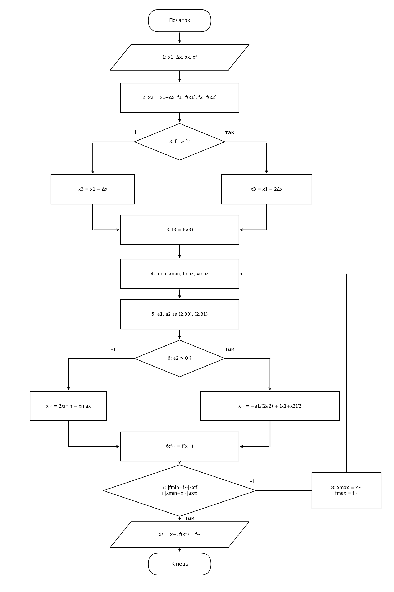
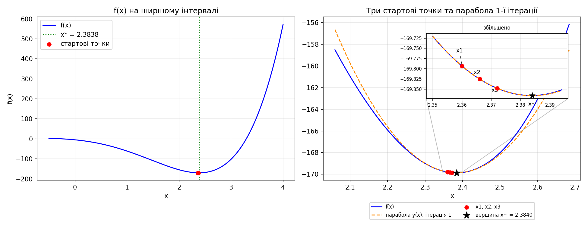

# ЛР 5. Метод Пауелла (квадратична апроксимація)

Одновимірна оптимізація без похідних (нульовий порядок): через три точки проводиться парабола, і наступним наближенням до мінімуму стає її вершина. 

## Постановка задачі

Цільова функція:

```
f(x) = (x + 1)^3 · (x + 2.5) · (x − 3.3) + 3.5
```

| Параметр | Значення |
|---|---|
| Початкова точка x₁ = a₀ (зі Свенна, ЛР 1) | 2,36 |
| Крок Δx | 0,006 |
| Точність за функцією σf | 0,01 |
| Точність за аргументом σx | 0,001 |

## Файли

| Файл | Призначення |
|---|---|
<<<<<<< HEAD
| `powell_lr5.py` | Програма: метод Пауелла, таблиці, графік, блок-схема |
=======
| `paul.py` | Програма: метод Пауелла, таблиці, графік, блок-схема |
>>>>>>> 03487acd85fbdc42a8bc65e83017526dfbcfd840
| `flowchart_lr5.png` | Блок-схема алгоритму |
| `graph_lr5.png` | Графік f(x), три стартові точки та парабола 1-ї ітерації |

**Запуск:** `pip install numpy matplotlib`, потім `python powell_lr5.py`.

## Реалізовані вимоги 

- **Точки не сортуються.** На кроці 8 вершина x̃ ставиться на місце x_max.
- **Один виклик f за ітерацію.** Після старту (3 обчислення) f рахується лише в x̃, тому Nf = n + 3.
- **a₂ ≤ 0** (зауваження 2): береться x̃ = 2x_min − x_max, тобто крок «від горба».
- **x̃ збіглося з наявною точкою:** f не перераховується, програма зупиняється і повідомляє про це.
- **Захист від ділення на нуль:** якщо дві точки збіглися, парабола не будується.
- **Зупинка лише за обох умов:** (а) |f_min − f(x̃)| ≤ σf і (б) |x_min − x̃| ≤ σx.

## Блок-схема



## Результати

### Табл. 4.7 (обов'язкові стовпці)

| k | x₁ | x₂ | x₃ | f(x₁) | f(x₂) | f(x₃) | x̃ | f(x̃) |
|---|---|---|---|---|---|---|---|---|
| 1 | 2,360000 | 2,366000 | 2,372000 | −169,793373 | −169,825043 | −169,847648 | 2,383964 | −169,865309 |
| 2 | 2,383964 | 2,366000 | 2,372000 | −169,865309 | −169,825043 | −169,847648 | 2,383768 | −169,865317 |

### Допоміжна таблиця (самоперевірка)

| k | a₁ | a₂ | \|f_min − f(x̃)\| | (а) | \|x_min − x̃\| | (б) | Дія |
|---|---|---|---|---|---|---|---|
| 1 | −5,2783 | 125,8915 | 1,77·10⁻² | ні | 1,20·10⁻² | ні | x₁ ← x̃ |
| 2 | −2,2416 | 127,5546 | 7,70·10⁻⁶ | так | 1,95·10⁻⁴ | так | СТОП |

На обох ітераціях a₂ > 0 (парабола гілками вгору), тож гілка зауваження 2 не спрацьовувала. Збігу x̃ з наявною точкою теж не було.

### Підсумок

```
x* = 2,383768
f(x*) = −169,865317
n = 2 ітерації
Nf = n + 3 = 5
```

Контроль перебором по щільній сітці (крок 10⁻⁵) дає мінімум при x ≈ 2,38371, f ≈ −169,86532. Результат збігається з методом Пауелла в межах заданої точності.

### Графік



Ліворуч: f(x) на ширшому інтервалі з мінімумом. Праворуч: три стартові точки та парабола 1-ї ітерації. Точки x₁, x₂, x₃ стоять дуже близько (Δx = 0,006), тому на врізці вони показані у збільшеному масштабі.

## Зведена табл. 4.1 (порівняння методів)

Усі методи на одній функції, інтервал зі Свенна [2,36; 2,42]. Точний мінімум (за даними ЛР 4): x = 2,38371376.

| Метод | x\* | Nf | n | \|x\* − x_точн\| |
|---|---|---|---|---|
| **Пауелл** (σx = 0,001, σf = 0,01) | 2,383768 | **5** | 2 | 5,4·10⁻⁵ |
| Дихотомія (ЛР 2), довжина інтервалу 0,001 | 2,38368 | 14 | 7 | 3,4·10⁻⁵ |
| Золотий переріз (ЛР 3), ε = 10⁻⁴ | — | 16 | — | 1,48·10⁻⁵ |
| Фібоначчі (ЛР 4), ε = 10⁻⁴ | 2,383754 | 14 | 13 | 4,03·10⁻⁵ |

Усі методи дають похибку порядку 10⁻⁵, тобто результати порівнянні за точністю. Різниця в кількості обчислень: Пауелл потребує 5, а методи виключення інтервалів 14–16. Зауваження: дихотомію зупинено на довжині інтервалу 0,001, а золотий переріз і Фібоначчі на ε = 10⁻⁴, тому критерії зупинки в них різні, але реальні похибки лежать в одному порядку.

## Висновок

Метод Пауелла знайшов мінімум функції x* = 2,383768, f(x*) = −169,865317 за **5 обчислень** функції (2 ітерації), що збігається з контрольним пошуком по сітці. Методи виключення інтервалів при порівнянній точності (похибка ~10⁻⁵) потребують помітно більше обчислень: дихотомія та Фібоначчі потребували по 14, золотий переріз 16.

**Чому Nf менший.** Методи виключення (дихотомія, золотий переріз, Фібоначчі) порівнюють значення f і використовують лише один біт інформації: яка з точок краща. Самі числа відкидаються, інтервал звужується лише на сталий множник за обчислення (для золотого перерізу 0,618). Метод Пауелла використовує самі значення f у трьох точках: через них однозначно проходить парабола, а біля мінімуму гладка функція майже парабола (розклад Тейлора, лінійний доданок зникає). Тому вершина параболи вже на першій ітерації потрапила дуже близько до мінімуму (x̃ = 2,383964 проти x* ≈ 2,38371), а похибка далі падає швидше, ніж за сталим множником (надлінійна збіжність). Кожна ітерація коштує лише одне нове обчислення f, бо дві точки з трійки зберігаються.

**Чого це коштує:**
- **Немає гарантії.** Методи виключення завжди дають інтервал, який містить x*. Метод Пауелла лише наближається до мінімуму, і за поганого старту (занадто великий Δx, трійка на «горбі», a₂ ≤ 0) може піти геть від нього. Для цього потрібна окрема обробка a₂ ≤ 0.
- **Потрібна гладкість.** Парабола добре описує функцію лише там, де вона гладка. Для функцій зі зламами чи розривами похідної метод працює погано або хаотично. У нашому випадку f є многочленом, тож умова виконується.
- **Залежність від старту.** Результат залежить від x₁ і Δx, тоді як методи виключення працюють для будь-якої унімодальної функції на заданому інтервалі.

