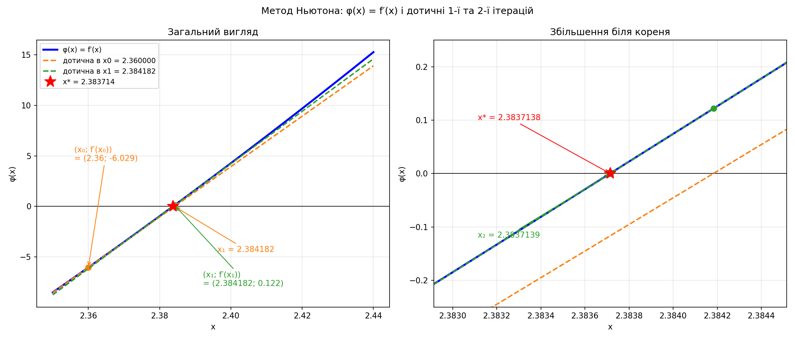
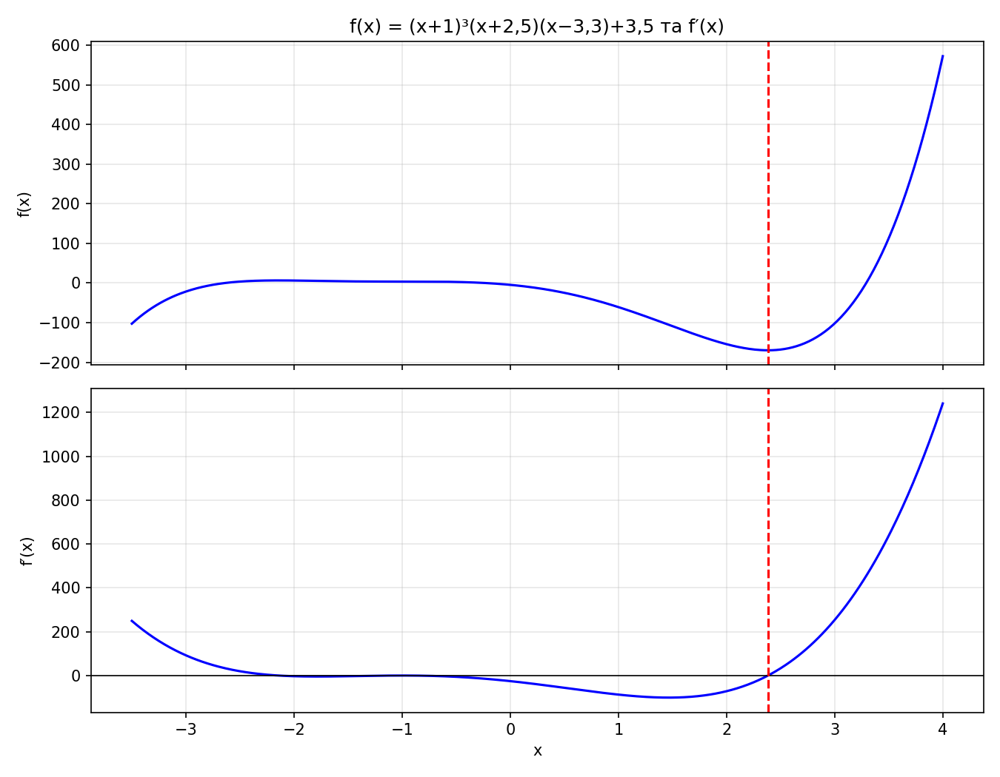
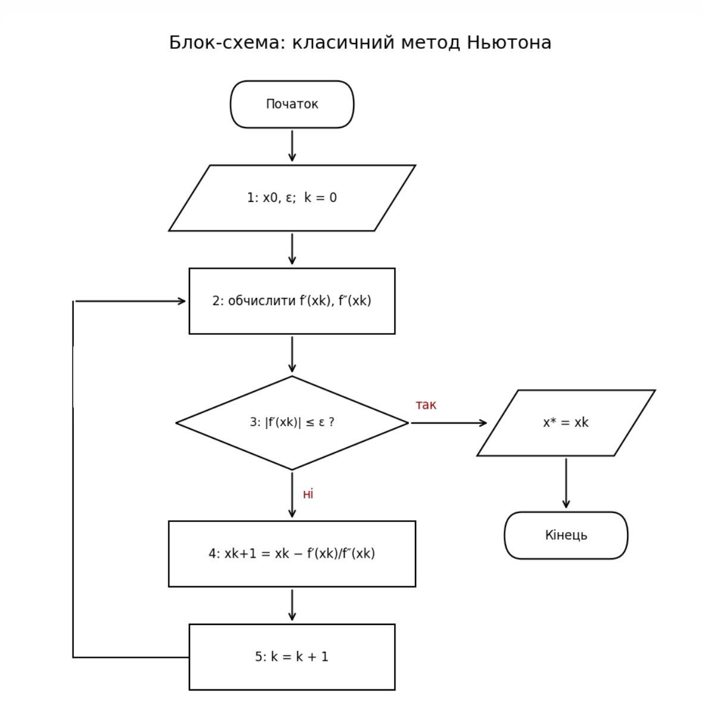
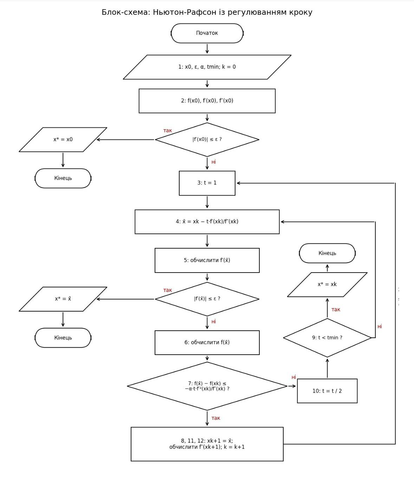

# ЛР 6. Метод Ньютона та Ньютона-Рафсона з регулюванням кроку

**Цільова функція:** f(x) = (x+1)³ · (x+2,5) · (x−3,3) + 3,5

**Вхідні дані:** x₀ = a₀ = 2,36 (ліва межа інтервалу зі Свенна [2,36; 2,42]), ε = 0,001, α = 0,25.


## 1. Похідні вручну

Нехай u = (x+1)³, v = (x+2,5)(x−3,3) = x² − 0,8x − 8,25. Тоді:

```
f′(x)  = 3(x+1)²·v + (x+1)³·(2x − 0,8) = (x+1)² · (5x² − 1,2x − 25,55)
f″(x)  = (x+1) · (20x² + 6,4x − 52,3)
```

Стаціонарні точки (f′ = 0): x = −1 (подвійний корінь, точка перегину), x ≈ −2,1437 (максимум), x ≈ 2,3837 (мінімум).
Точний мінімум: x = (1,2 + √512,44)/10 = **2,38371376**, f = **−169,86531724**.

**Чисельна перевірка** за формулою (f(x+h) − f(x−h)) / 2h, h = 10⁻⁵:

| x | f′ (аналіт.) | f′ (числ.) | f″ (аналіт.) | f″ (числ.) |
|---|---|---|---|---|
| 2,36 | −6,028646 | −6,028646 | 249,298560 | 249,298560 |
| 2,42 | 9,684619 | 9,684619 | 274,680720 | 274,680720 |
| 2,00 | −71,550000 | −71,550000 | 121,500000 | 121,500000 |
| 3,00 | 253,600000 | 253,600000 | 587,600000 | 587,600000 |

Різниця не перевищує 1,5·10⁻⁸, тобто похідні виведені правильно.

## 2. Частина А: класичний Ньютон (табл. 4.8)

xₖ₊₁ = xₖ − f′(xₖ) / f″(xₖ), зупинка за |f′(xₖ)| ≤ ε.

| k | xₖ | f(xₖ) | f′(xₖ) | \|f′(xₖ)\| | f″(xₖ) |
|---|---|---|---|---|---|
| 0 | 2,36000000 | −169,79337303 | −6,02864640 | 6,02864640 | 249,298560 |
| 1 | 2,38418244 | −169,86528877 | 0,12151890 | 0,12151890 | 259,381628 |
| 2 | 2,38371394 | −169,86531724 | 0,00004620 | 0,00004620 | — |

**Результат:** x* = 2,383714, f(x*) = −169,865317, n = 2, звернень: 3 f′ + 3 f″. Похибка |x* − x_точн| = 1,8·10⁻⁷.

## 3. Частина Б: Ньютон-Рафсон із регулюванням кроку (табл. 4.9)

Умова прийняття кроку (3.10): f(x̄) − f(xₖ) ≤ −α·t·f′²(xₖ)/f″(xₖ), у разі невдачі t := t/2.

| k | xₖ | f(xₖ) | f′(xₖ) | f″(xₖ) | t | x̄ | f(x̄) | f′(x̄) | (3.10) |
|---|---|---|---|---|---|---|---|---|---|
| 0 | 2,360000 | −169,793373 | −6,028646 | 249,2986 | 1 | 2,384182 | −169,865289 | 0,121519 | ✓ |
| 1 | 2,384182 | −169,865289 | 0,121519 | 259,3816 | 1 | 2,383714 | −169,865317 | 0,000046 | стоп |

**Результат:** x* = 2,383714, f(x*) = −169,865317, n = 1, звернень: 2 f + 3 f′ + 2 f″. Усі кроки прийняті з t = 1: коли старт хороший, регулювання просто пропускає повний крок.

**Про вибір α.** При α = 0,5 (значення з прикладу посібника) повний крок відхиляється на межі умови. Для майже квадратичної функції фактичне зменшення f дорівнює приблизно 0,5·f′²/f″, тому (3.10) виконується нестабільно. Метод тоді марно дробить t і виконує 4 ітерації (9 f + 10 f′ + 5 f″). Тому обрано α = 0,25.

## 4. Графіки



*Ліворуч загальний вигляд: φ(x) = f′(x) з дотичними в x₀ = 2,36 і x₁ = 2,384182. Праворуч збільшення біля кореня, де видно, що дотична з x₁ майже збігається з кривою.* Дотична з x₀ перетинає вісь у x₁ = 2,384182, а дотична з x₁ у x₂ = 2,383714.



*Функція f(x) та її похідна на [−3,5; 4]. Мінімум у x ≈ 2,3837, максимум у x ≈ −2,144, у x = −1 точка перегину.*

## 5. Блок-схеми 

Класичний Ньютон: 


Ньютон-Рафсон із регулюванням кроку: 


## 6. Експеримент: різні стартові точки

| Старт x₀ | Ньютон | Ньютон-Рафсон |
|---|---|---|
| a₀ = 2,36 | мінімум 2,383714, n = 2 | мінімум 2,383714, n = 1 |
| b₀ = 2,42 | мінімум 2,383715, n = 2 | мінімум 2,383715, n = 1 |
| 3,0 | мінімум 2,383714, n = 4 | мінімум 2,383714, n = 3 |
| 5,0 | мінімум 2,383714, n = 6 | мінімум 2,383714, n = 5 |
| 1,2 | x ≈ −1,0056, n = 6: **точка перегину** (f ≈ 3,5) | f″ < 0, зупинка із повідомленням |
| 0,5 | x ≈ −0,9938, n = 8: **точка перегину** (f ≈ 3,5) | f″ < 0, зупинка із повідомленням |
| −3,0 | x ≈ −2,1437, n = 5: **максимум** (f ≈ 6,40) | f″ < 0, зупинка із повідомленням |
| −1,0 | f′ = 0 одразу, стоп у точці перегину | те саме |

**Висновки.**

1. З близьких і правих стартів (2,36 … 5,0) обидва методи збігаються до мінімуму; чим далі старт, тим більше ітерацій (Ньютон: 2, 4, 6; Ньютон-Рафсон: 1, 3, 5).
2. З лівих стартів класичний Ньютон не розбігається (як у прикладі з arctg), а **зупиняється у хибній стаціонарній точці**:
   - зі стартів 0,5 і 1,2 він іде до точки перегину x = −1, де f′ має подвійний корінь. Збіжність там лише лінійна (6–8 ітерацій), а зупинка за |f′| ≤ ε спрацьовує при x ≈ −1,0056 або −0,9938, хоча f″ ≈ 0. Знак f″ в цих точках випадковий (+0,215 і −0,241), тому за ним тип точки визначати не можна. Значення f ≈ 3,5 далеке від мінімуму −169,87;
   - зі старту −3,0 він збігається до справжнього максимуму x ≈ −2,1437 (f″ = −29,6).
   У всіх випадках критерій |f′| ≤ ε виконано, але відповідь неправильна.
3. Регулювання кроку тут **не рятує**: умова (3.10) контролює лише зменшення f, а при f″ < 0 напрямок кроку веде не до мінімуму. Тому в код додано окрему перевірку f″ > 0 (типова помилка № 2 зі слайда 14), і Ньютон-Рафсон зупиняється з повідомленням. Із таких стартів потрібно змінити x₀ або змінити напрямок кроку (наприклад, −sign f′).

## 7. Зведена табл. 4.1

| Метод | x* | n | Звернення | \|x* − x_точн\| |
|---|---|---|---|---|
| Дихотомія (ЛР 2) | 2,38368 | 7 | 14 f | 3,4·10⁻⁵ |
| Половинний поділ (ЛР 2) | 2,38391 | 6 | 13 f | 2,0·10⁻⁴ |
| Золотий переріз (ЛР 3) | 2,383699 | 14 | 16 f | 1,5·10⁻⁵ |
| Фібоначчі (ЛР 4) | 2,383754 | 13 | 14 f | 4,0·10⁻⁵ |
| Пауелл (ЛР 5) | 2,383768 | 2 | 5 f | 5,4·10⁻⁵ |
| **Ньютон (ЛР 6, А)** | 2,383714 | 2 | 3 f′ + 3 f″ | 1,8·10⁻⁷ |
| **Ньютон-Рафсон (ЛР 6, Б)** | 2,383714 | 1 | 2 f + 3 f′ + 2 f″ | 1,8·10⁻⁷ |

## 8. Загальні висновки

* **Найвища точність та швидкість:** Методи з похідними дають найвищу точність: похибка ~10⁻⁷ проти 10⁻⁴–10⁻⁵ у методів виключення інтервалів і Пауелла. Збіжність квадратична: за одну ітерацію |f′| падає з 6,03 до 0,12, а за наступну — до 4,6·10⁻⁵.
* **Ціна швидкості:** Для алгоритму потрібні виведені формули f′ і f″, а звернення до похідних є обчислювально дорожчими, і їх не можна напряму порівнювати зі зверненнями до f.
* **Залежність від стартової точки:** З близьких і правих стартів (2,36 ... 5,0) обидва методи швидко збігаються до мінімуму. Старт x₀ = 2,36 зі Свенна виявився дуже вдалим, тому перевага Ньютона тут найкраще видна.
* **Небезпека хибних стаціонарних точок:** Головна проблема класичного Ньютона на цій функції — не розбіжність, а зупинка в хибних точках. З лівих стартів (0,5; 1,2; −1,0; −3,0) він іде до точки перегину (x = −1) або максимуму (x ≈ −2,1437). Критерій зупинки |f′| ≤ ε виконано, але відповідь хибна, оскільки метод не перевіряє кривину.
* **Межі регулювання кроку:** Метод Ньютона-Рафсона дорожчий за класичний на обчислення f, але він гарантує спадання функції на кожній ітерації, що захищає від розбіжності. Проте **регулювання кроку не рятує від f″ < 0**: умова (3.10) безсила, якщо напрямок кроку від початку веде не до мінімуму. Саме тому в код було додано окрему перевірку f″ > 0 (захист від типової помилки №2), завдяки якій алгоритм коректно зупиняється з повідомленням про необхідність змінити старт.

