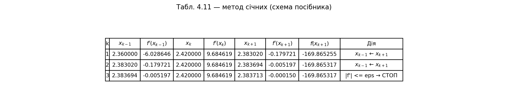
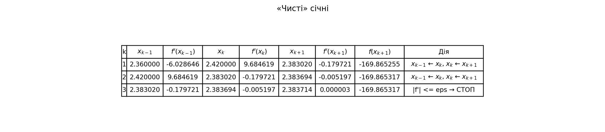
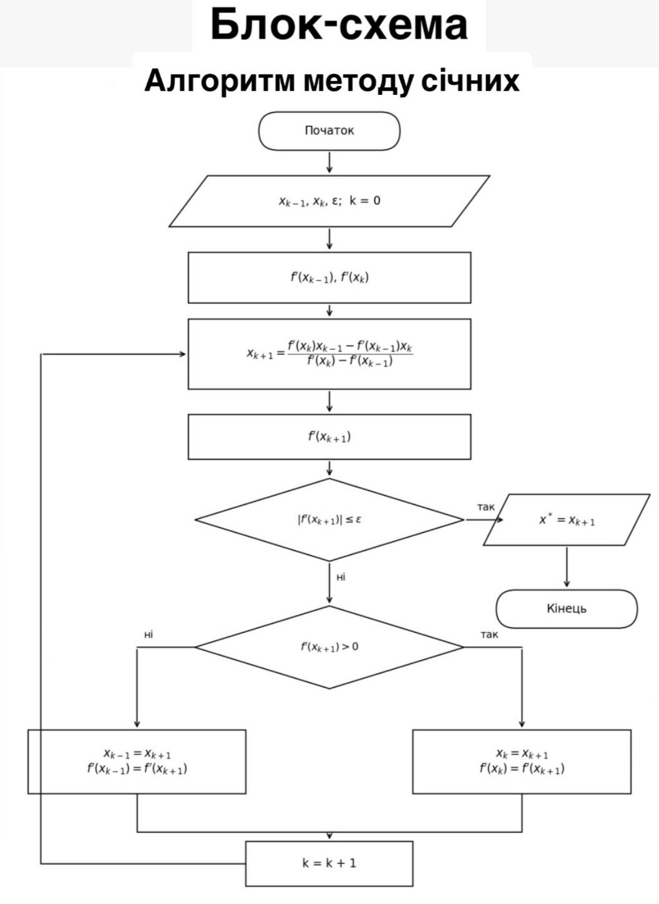
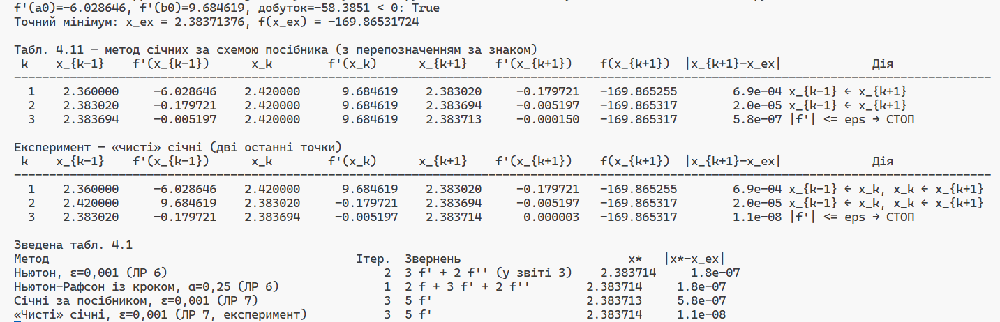

# ЛР 7. Метод січних (друга модифікація методу Ньютона)

**Цільова функція:** $f(x) = (x+1)^3 \cdot (x+2.5) \cdot (x-3.3) + 3.5$

**Похідна функції:** $f'(x) = (x+1)^2 \cdot (5x^2 - 1.2x - 25.55)$

**Вхідні дані:** $x_0 = a_0 = 2.36$, $x_1 = b_0 = 2.42$ (кінці інтервалу зі Свенна), $\varepsilon = 0.001$.

Точний мінімум: $x = \frac{1.2 + \sqrt{512.44}}{10} = 2.38371376$, $f(x) = -169.86531724$.

## 1. Локалізація кореня
Перед початком ітерацій перевіряється умова локалізації кореня $f'(x_0) \cdot f'(x_1) < 0$. 
Для заданих початкових точок:
- $f'(2.36) = -6.028646$
- $f'(2.42) = 9.684619$

Добуток дорівнює $-58.3851 < 0$, що підтверджує наявність мінімуму на заданому інтервалі.

## 2. Метод січних за схемою посібника (Табл. 4.11)

Алгоритм реалізує кроки 1–6 із методичного посібника, використовуючи робочу формулу (3.16) та перепозначення точок (крок 5) за знаком похідної.

**Результат:** $x^* = 2.383713$, $f(x^*) = -169.865317$, $n = 3$, звернень до похідної: $5 f'$ (а саме $n+2$). Похибка: $|x^* - x_{\text{точн}}| = 5.79 \cdot 10^{-7}$.

*Як видно з колонки «Дія», ліва точка $x_{k-1}$ постійно замінюється новою ($x_{k-1} \leftarrow x_{k+1}$), оскільки похідна в нових точках весь час від'ємна, а ліва межа має утримувати додатну похідну правої межі для збереження знаку добутку.*

## 3. Експеримент: «чисті» січні

У цьому варіанті перевірка знаку не виконується. На кожній ітерації завжди беруться дві останні знайдені точки ($x_{k-1} \leftarrow x_k$, $x_k \leftarrow x_{k+1}$).

**Результат:** $x^* = 2.383714$, $f(x^*) = -169.865317$, $n = 3$, звернень до похідної: $5 f'$. Похибка: $|x^* - x_{\text{точн}}| = 1.13 \cdot 10^{-8}$.

## 4. Графік $\varphi(x) = f'(x)$ із січними

![Графік phi(x) = f'(x) на [a_0, b_0] з першими двома січними](./lr7_output/graph_phi_secants.png)

*На графіку показано функцію $\varphi(x) = f'(x)$. Помаранчева лінія — перша січна через точки $(x_0, x_1)$, яка перетинає вісь у точці $x_2 = 2.383020$. Зелена лінія — друга січна після перепозначення, яка перетинає вісь у точці $x_3 = 2.383694$. На збільшеному фрагменті (справа знизу) чітко видно наближення до точного кореня $x^*$.*

## 5. Блок-схема алгоритму (ГОСТ 19.701-90)

*Блок-схема відображає логіку методу січних із зупинкою за умовою $|f'(x_{k+1})| \le \varepsilon$ та перепозначенням точок (крок 5) для збереження кореня всередині інтервалу.*

## 6. Вивід консолі (результати виконання скрипта)

*Скриншот демонструє процес роботи скрипта: перевірку локалізації, роздруківку обох таблиць (за схемою посібника та експериментальної), зведену таблицю порівняння з ЛР 6, а також фінальні показники точності та кількості викликів функцій.*

## 7. Зведена таблиця 4.1 (Порівняння методів)

| Метод | Ітерацій | Звернень | $x^*$ | $\lvert x^* - x_{\text{точн}}\rvert$ |
| :--- | :---: | :---: | :---: | :---: |
| Ньютон, $\varepsilon=0.001$ (ЛР 6) | $2$ | $3f' + 2f''$ (у звіті $3$) | $2.383714$ | $1.8 \cdot 10^{-7}$ |
| Ньютон–Рафсон із кроком, $\alpha=0.25$ (ЛР 6) | $1$ | $2f + 3f' + 2f''$ | $2.383714$ | $2.4 \cdot 10^{-7}$ |
| **Січні за посібником, $\varepsilon=0.001$ (ЛР 7)** | $3$ | $5f'$ | $2.383713$ | $5.8 \cdot 10^{-7}$ |
| **«Чисті» січні, $\varepsilon=0.001$ (ЛР 7, експ.)** | $3$ | $5f$ | $2.383714$ | $1.1 \cdot 10^{-8}$ |

## 8. Висновки

1. **Ціна відмови від другої похідної:** Метод січних дозволив повністю позбутися необхідності аналітичного виведення та програмного обчислення $f''(x)$, замінивши її оцінкою через нахил хорди. 
2. **Швидкість збіжності:** Для досягнення заданої точності $\varepsilon=0.001$ методу січних знадобилося $3$ ітерації ($5$ звернень до $f'$), тоді як класичному методу Ньютона (ЛР 6) — $2$ ітерації. Проте, оскільки обчислення $f''$ відсутнє, обчислювальна вартість однієї ітерації в методі січних є загалом меншою.
3. **«Чисті» січні vs. Схема посібника:** Експеримент показав, що алгоритм без перепозначення за знаком («чисті» січні) на цій функції дає вищу точність наближення (похибка $1.13 \cdot 10^{-8}$ проти $5.79 \cdot 10^{-7}$) за ту ж кількість ітерацій. Це пов'язано з тим, що в схемі посібника ліва точка ($2.36$) "прилипає" і не оновлюється, що знижує швидкість збіжності до лінійної. Проте схема посібника гарантує, що корінь завжди залишається всередині поточного інтервалу.
4. **Порівняння з ЛР 6:** Друга модифікація методу Ньютона (січні) є чудовою альтернативою класичному Ньютону для випадків, коли обчислення другої похідної є ускладненим або надто ресурсомістким, при цьому втрата швидкості збіжності є мінімальною.