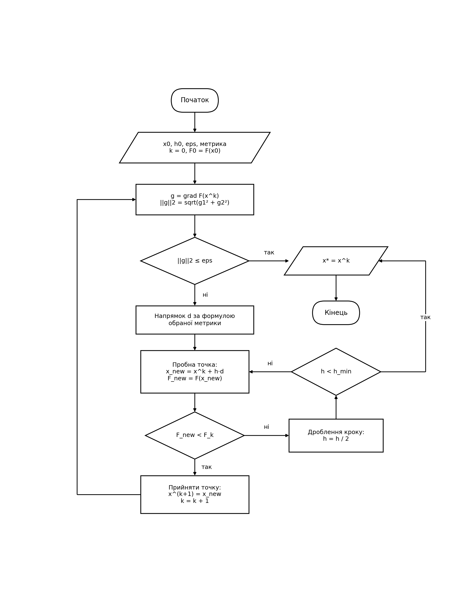
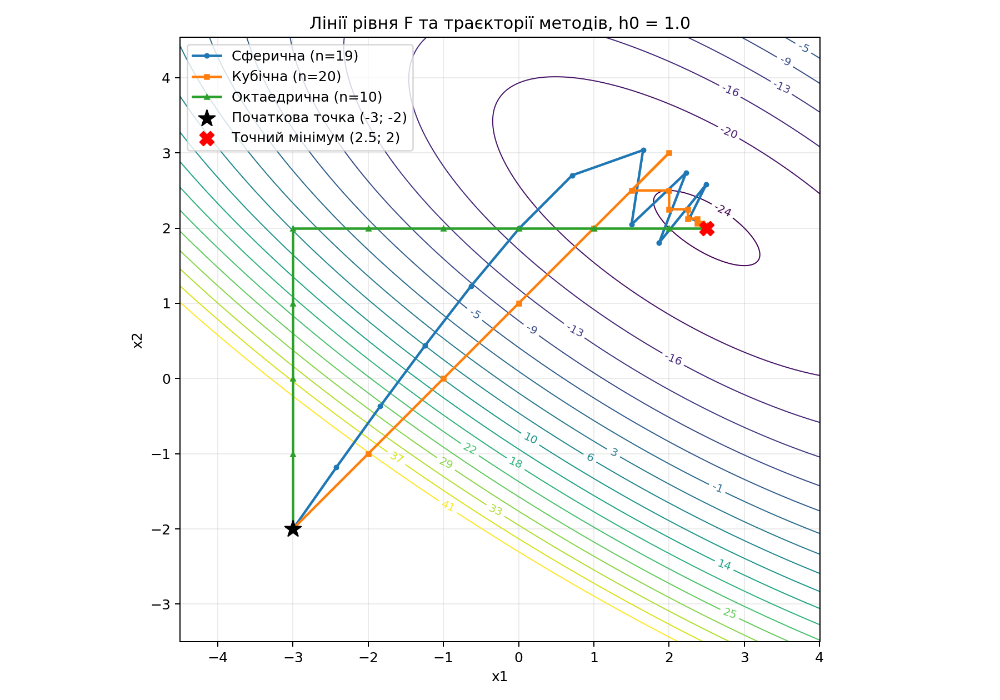
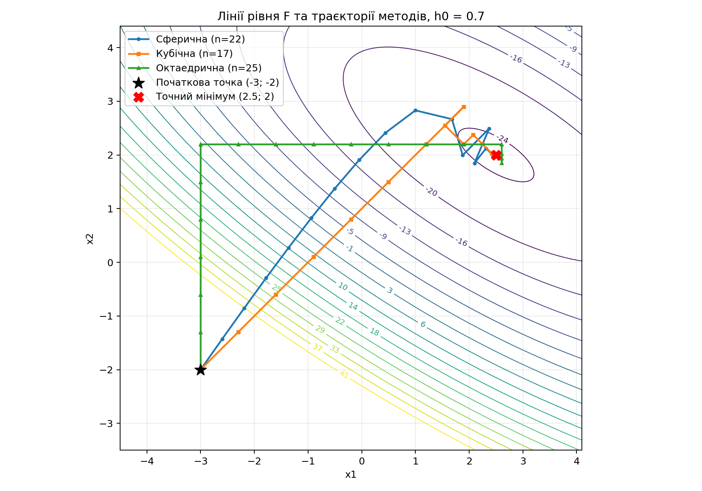

# Лабораторна робота: Градієнтні методи оптимізації

## Постановка задачі
Дослідити роботу градієнтного методу для трьох різних способів вимірювання довжини кроку (сферична, кубічна, октаедрична метрики). 
- **Цільова функція:** $F(x_1, x_2) = x_1^2 + 2x_2^2 + 2x_1x_2 - 9x_1 - 13x_2$
- **Початкова точка:** $x_0 = (-3; -2)$
- **Початковий крок:** $h_0 = 1$ та додатково $h_0 = 0.7$
- **Точність:** $\varepsilon = 0.01$
- **Критерій зупинки:** $||\nabla F(x^k)||_2 \le \varepsilon$
- **Правило кроку:** При $F(x_{new}) \ge F(x^k)$ крок ділиться навпіл. Крок не повертається до початкового значення.

## Аналітичний розрахунок

### Частинна похідна
Знайдемо частинні похідні цільової функції:
- $\frac{\partial F}{\partial x_1} = 2x_1 + 2x_2 - 9$
- $\frac{\partial F}{\partial x_2} = 2x_1 + 4x_2 - 13$

### Точний (аналітичний) мінімум
Прирівнюємо градієнт до нуля для пошуку екстремуму:
1) $2x_1 + 2x_2 = 9$
2) $2x_1 + 4x_2 = 13$

Віднімемо перше рівняння від другого:
$2x_2 = 4 \Rightarrow x_2 = 2$
Підставимо $x_2$ в перше рівняння:
$2x_1 + 4 = 9 \Rightarrow 2x_1 = 5 \Rightarrow x_1 = 2.5$

**Точний мінімум:** $x^* = (2.5; 2.0)$, $F(x^*) = -24.25$

## Блок-схема алгоритму
Алгоритм реалізовано згідно зі схемою, де напрямок обчислюється залежно від метрики:
- **Сферична:** $d = -\nabla F / ||\nabla F||_2$
- **Кубічна:** $d = -\text{sign}(\nabla F)$
- **Октаедрична:** $d = -\text{sign}(\frac{\partial F}{\partial x_j}) \cdot e_j$, де $j = \text{argmax}|\frac{\partial F}{\partial x_i}|$

*(Блок-схема збережена у файлі `flowchart.png`)*.

## Результати та таблиці ітерацій

### Зведена таблиця результатів

| Метрика | h0 | n | NF | Ngrad | \|\|x - xточн\|\|2 | \|\|grad F\|\|2 |
|---|---|---|---|---|---|---|
| Сферична | 1.0 | 19 | 28 | 20 | 3.2440e-03 | 2.6092e-03 |
| Кубічна | 1.0 | 20 | 29 | 21 | 8.7346e-03 | 7.8125e-03 |
| Октаедрична | 1.0 | 10 | 12 | 11 | 0.0000e+00 | 0.0000e+00 |
| Сферична | 0.7 | 22 | 29 | 23 | 6.1779e-03 | 4.8255e-03 |
| Кубічна | 0.7 | 17 | 26 | 18 | 5.0024e-03 | 4.9410e-03 |
| Октаедрична | 0.7 | 25 | 33 | 26 | 2.8168e-03 | 6.4423e-03 |

### Графіки траєкторій
 
 

### Повні таблиці ітерацій (розгорніть для перегляду)

<b>Таблиці для h0 = 1.0</b>

**Сферична метрика:**
| k | x1 | x2 | F(xk) | grad_x1 | grad_x2 | norm_grad | d1 | d2 | h_accepted | дробл. | F(xk+1) |
|----:|--------:|--------:|---------:|----------:|----------:|------------:|:--------|:--------|-------------:|---------:|:----------|
| 1 | -3.0000 | -2.0000 | 82.0000 | -19.0000 | -27.0000 | 33.0151 | 0.5755 | 0.8178 | 1.00000 | 0 | 51.5949 |
| 2 | -2.4245 | -1.1822 | 51.5949 | -16.2134 | -22.5778 | 27.7962 | 0.5833 | 0.8123 | 1.00000 | 0 | 26.4060 |
| 3 | -1.8412 | -0.3699 | 26.4060 | -13.4223 | -18.1622 | 22.5837 | 0.5943 | 0.8042 | 1.00000 | 0 | 6.4251 |
| 4 | -1.2469 | 0.4343 | 6.4251 | -10.6252 | -13.7566 | 17.3821 | 0.6113 | 0.7914 | 1.00000 | 0 | -8.3632 |
| 5 | -0.6356 | 1.2257 | -8.3632 | -7.8198 | -9.3684 | 12.2031 | 0.6408 | 0.7677 | 1.00000 | 0 | -17.9930 |
| 6 | 0.0052 | 1.9934 | -17.9930 | -5.0028 | -5.0160 | 7.0843 | 0.7062 | 0.7080 | 1.00000 | 0 | -22.5760 |
| 7 | 0.7114 | 2.7014 | -22.5760 | -2.1744 | -0.7715 | 2.3072 | 0.9424 | 0.3344 | 1.00000 | 0 | -23.1411 |
| 8 | 1.6538 | 3.0358 | -23.1411 | 0.3793 | 2.4509 | 2.4801 | -0.1529 | -0.9882 | 1.00000 | 0 | -23.3423 |
| 9 | 1.5009 | 2.0476 | -23.3423 | -1.9031 | -1.8079 | 2.6249 | 0.7250 | 0.6887 | 1.00000 | 0 | -23.4942 |
| 10 | 2.2259 | 2.7363 | -23.4942 | 0.9244 | 2.3971 | 2.5692 | -0.3598 | -0.9330 | 1.00000 | 0 | -23.5214 |
| 11 | 1.8661 | 1.8033 | -23.5214 | -1.6612 | -2.0546 | 2.6422 | 0.6287 | 0.7776 | 1.00000 | 0 | -23.5810 |
| 12 | 2.4948 | 2.5809 | -23.5810 | 1.1515 | 2.3133 | 2.5841 | -0.4456 | -0.8952 | 0.50000 | 1 | -24.2233 |
| 13 | 2.2720 | 2.1333 | -24.2233 | -0.1894 | 0.0773 | 0.2045 | 0.9259 | -0.3778 | 0.25000 | 1 | -24.2467 |
| 14 | 2.5035 | 2.0389 | -24.2467 | 0.0847 | 0.1624 | 0.1832 | -0.4623 | -0.8867 | 0.06250 | 2 | -24.2480 |
| 15 | 2.4746 | 1.9834 | -24.2480 | -0.0839 | -0.1170 | 0.1440 | 0.5828 | 0.8126 | 0.03125 | 1 | -24.2499 |
| 16 | 2.4928 | 2.0088 | -24.2499 | 0.0033 | 0.0210 | 0.0212 | -0.1543 | -0.9880 | 0.00781 | 2 | -24.2499 |
| 17 | 2.4916 | 2.0011 | -24.2499 | -0.0146 | -0.0123 | 0.0191 | 0.7635 | 0.6458 | 0.00781 | 0 | -24.2499 |
| 18 | 2.4976 | 2.0062 | -24.2499 | 0.0074 | 0.0198 | 0.0211 | -0.3522 | -0.9359 | 0.00781 | 0 | -24.2500 |
| 19 | 2.4948 | 1.9989 | -24.2500 | -0.0127 | -0.0150 | 0.0196 | 0.6465 | 0.7629 | 0.00391 | 1 | -24.2500 |
| 20 | 2.4973 | 2.0018 | -24.2500 | -0.0017 | 0.0020 | 0.0026 | | | 0.00391 | 0 | |

**Кубічна метрика:**
| k | x1 | x2 | F(xk) | grad_x1 | grad_x2 | norm_grad | d1 | d2 | h_accepted | дробл. | F(xk+1) |
|----:|--------:|--------:|---------:|----------:|----------:|------------:|:--------|:--------|-------------:|---------:|:----------|
| 1 | -3.0000 | -2.0000 | 82.0000 | -19.0000 | -27.0000 | 33.0151 | 1.0000 | 1.0000 | 1.00000 | 0 | 41.0000 |
| 2 | -2.0000 | -1.0000 | 41.0000 | -15.0000 | -21.0000 | 25.8070 | 1.0000 | 1.0000 | 1.00000 | 0 | 10.0000 |
| 3 | -1.0000 | 0.0000 | 10.0000 | -11.0000 | -15.0000 | 18.6011 | 1.0000 | 1.0000 | 1.00000 | 0 | -11.0000 |
| 4 | 0.0000 | 1.0000 | -11.0000 | -7.0000 | -9.0000 | 11.4018 | 1.0000 | 1.0000 | 1.00000 | 0 | -22.0000 |
| 5 | 1.0000 | 2.0000 | -22.0000 | -3.0000 | -3.0000 | 4.2426 | 1.0000 | 1.0000 | 1.00000 | 0 | -23.0000 |
| 6 | 2.0000 | 3.0000 | -23.0000 | 1.0000 | 3.0000 | 3.1623 | -1.0000 | -1.0000 | 0.50000 | 1 | -23.7500 |
| 7 | 1.5000 | 2.5000 | -23.7500 | -1.0000 | 0.0000 | 1.0000 | 1.0000 | -0.0000 | 0.50000 | 0 | -24.0000 |
| 8 | 2.0000 | 2.5000 | -24.0000 | 0.0000 | 1.0000 | 1.0000 | -0.0000 | -1.0000 | 0.25000 | 1 | -24.1250 |
| 9 | 2.0000 | 2.2500 | -24.1250 | -0.5000 | 0.0000 | 0.5000 | 1.0000 | -0.0000 | 0.25000 | 0 | -24.1875 |
| 10 | 2.2500 | 2.2500 | -24.1875 | 0.0000 | 0.5000 | 0.5000 | -0.0000 | -1.0000 | 0.12500 | 1 | -24.2188 |
| 11 | 2.2500 | 2.1250 | -24.2188 | -0.2500 | 0.0000 | 0.2500 | 1.0000 | -0.0000 | 0.12500 | 0 | -24.2344 |
| 12 | 2.3750 | 2.1250 | -24.2344 | 0.0000 | 0.2500 | 0.2500 | -0.0000 | -1.0000 | 0.06250 | 1 | -24.2422 |
| 13 | 2.3750 | 2.0625 | -24.2422 | -0.1250 | 0.0000 | 0.1250 | 1.0000 | -0.0000 | 0.06250 | 0 | -24.2461 |
| 14 | 2.4375 | 2.0625 | -24.2461 | 0.0000 | 0.1250 | 0.1250 | -0.0000 | -1.0000 | 0.03125 | 1 | -24.2480 |
| 15 | 2.4375 | 2.0312 | -24.2480 | -0.0625 | 0.0000 | 0.0625 | 1.0000 | -0.0000 | 0.03125 | 0 | -24.2490 |
| 16 | 2.4688 | 2.0312 | -24.2490 | 0.0000 | 0.0625 | 0.0625 | -0.0000 | -1.0000 | 0.01562 | 1 | -24.2495 |
| 17 | 2.4688 | 2.0156 | -24.2495 | -0.0312 | 0.0000 | 0.0312 | 1.0000 | -0.0000 | 0.01562 | 0 | -24.2498 |
| 18 | 2.4844 | 2.0156 | -24.2498 | 0.0000 | 0.0312 | 0.0312 | -0.0000 | -1.0000 | 0.00781 | 1 | -24.2499 |
| 19 | 2.4844 | 2.0078 | -24.2499 | -0.0156 | 0.0000 | 0.0156 | 1.0000 | -0.0000 | 0.00781 | 0 | -24.2499 |
| 20 | 2.4922 | 2.0078 | -24.2499 | 0.0000 | 0.0156 | 0.0156 | -0.0000 | -1.0000 | 0.00391 | 1 | -24.2500 |
| 21 | 2.4922 | 2.0039 | -24.2500 | -0.0078 | 0.0000 | 0.0078 | | | 0.00391 | 0 | |

**Октаедрична метрика:**
| k | x1 | x2 | F(xk) | grad_x1 | grad_x2 | norm_grad | d1 | d2 | h_accepted | дробл. | F(xk+1) |
|----:|--------:|--------:|---------:|----------:|----------:|------------:|:--------|:--------|-------------:|---------:|:----------|
| 1 | -3.0000 | -2.0000 | 82.0000 | -19.0000 | -27.0000 | 33.0151 | 0.0000 | 1.0000 | 1.00000 | 0 | 57.0000 |
| 2 | -3.0000 | -1.0000 | 57.0000 | -17.0000 | -23.0000 | 28.6007 | 0.0000 | 1.0000 | 1.00000 | 0 | 36.0000 |
| 3 | -3.0000 | 0.0000 | 36.0000 | -15.0000 | -19.0000 | 24.2074 | 0.0000 | 1.0000 | 1.00000 | 0 | 19.0000 |
| 4 | -3.0000 | 1.0000 | 19.0000 | -13.0000 | -15.0000 | 19.8494 | 0.0000 | 1.0000 | 1.00000 | 0 | 6.0000 |
| 5 | -3.0000 | 2.0000 | 6.0000 | -11.0000 | -11.0000 | 15.5563 | 1.0000 | 0.0000 | 1.00000 | 0 | -4.0000 |
| 6 | -2.0000 | 2.0000 | -4.0000 | -9.0000 | -9.0000 | 12.7279 | 1.0000 | 0.0000 | 1.00000 | 0 | -12.0000 |
| 7 | -1.0000 | 2.0000 | -12.0000 | -7.0000 | -7.0000 | 9.8995 | 1.0000 | 0.0000 | 1.00000 | 0 | -18.0000 |
| 8 | 0.0000 | 2.0000 | -18.0000 | -5.0000 | -5.0000 | 7.0711 | 1.0000 | 0.0000 | 1.00000 | 0 | -22.0000 |
| 9 | 1.0000 | 2.0000 | -22.0000 | -3.0000 | -3.0000 | 4.2426 | 1.0000 | 0.0000 | 1.00000 | 0 | -24.0000 |
| 10 | 2.0000 | 2.0000 | -24.0000 | -1.0000 | -1.0000 | 1.4142 | 1.0000 | 0.0000 | 0.50000 | 1 | -24.2500 |
| 11 | 2.5000 | 2.0000 | -24.2500 | 0.0000 | 0.0000 | 0.0000 | | | 0.50000 | 0 | |

<b>Таблиці для h0 = 0.7</b>

**Сферична метрика:**
| k | x1 | x2 | F(xk) | grad_x1 | grad_x2 | norm_grad | d1 | d2 | h_accepted | дробл. | F(xk+1) |
|----:|--------:|--------:|---------:|----------:|----------:|------------:|:--------|:--------|-------------:|---------:|:----------|
| 1 | -3.0000 | -2.0000 | 82.0000 | -19.0000 | -27.0000 | 33.0151 | 0.5755 | 0.8178 | 0.70000 | 0 | 60.1683 |
| 2 | -2.5972 | -1.4275 | 60.1683 | -17.0494 | -23.9045 | 29.3616 | 0.5807 | 0.8141 | 0.70000 | 0 | 40.8933 |
| 3 | -2.1907 | -0.8576 | 40.8933 | -15.0966 | -20.8119 | 25.7108 | 0.5872 | 0.8095 | 0.70000 | 0 | 24.1726 |
| 4 | -1.7797 | -0.2910 | 24.1726 | -13.1414 | -17.7234 | 22.0639 | 0.5956 | 0.8033 | 0.70000 | 0 | 10.0029 |
| 5 | -1.3627 | 0.2713 | 10.0029 | -11.1829 | -14.6404 | 18.4228 | 0.6070 | 0.7947 | 0.70000 | 0 | -1.6208 |
| 6 | -0.9378 | 0.8276 | -1.6208 | -9.2205 | -11.5654 | 14.7911 | 0.6234 | 0.7819 | 0.70000 | 0 | -10.7073 |
| 7 | -0.5015 | 1.3749 | -10.7073 | -7.2531 | -8.5033 | 11.1765 | 0.6490 | 0.7608 | 0.70000 | 0 | -17.2734 |
| 8 | -0.0472 | 1.9075 | -17.2734 | -5.2794 | -5.4645 | 7.5982 | 0.6948 | 0.7192 | 0.70000 | 0 | -21.3590 |
| 9 | 0.4392 | 2.4109 | -21.3590 | -3.2998 | -2.4780 | 4.1267 | 0.7996 | 0.6005 | 0.70000 | 0 | -23.1104 |
| 10 | 0.9989 | 2.8312 | -23.1104 | -1.3396 | 0.3228 | 1.3780 | 0.9722 | -0.2343 | 0.70000 | 0 | -23.7813 |
| 11 | 1.6795 | 2.6672 | -23.7813 | -0.3066 | 1.0279 | 1.0726 | 0.2858 | -0.9583 | 0.70000 | 0 | -23.8606 |
| 12 | 1.8795 | 1.9965 | -23.8606 | -1.2480 | -1.2551 | 1.7700 | 0.7051 | 0.7091 | 0.70000 | 0 | -23.8732 |
| 13 | 2.3731 | 2.4928 | -23.8732 | 0.7319 | 1.7175 | 1.8670 | -0.3920 | -0.9200 | 0.70000 | 0 | -23.9220 |
| 14 | 2.0987 | 1.8489 | -23.9220 | -1.1049 | -1.4072 | 1.7891 | 0.6176 | 0.7865 | 0.35000 | 1 | -24.2309 |
| 15 | 2.3148 | 2.1241 | -24.2309 | -0.1220 | 0.1263 | 0.1756 | 0.6949 | -0.7191 | 0.17500 | 1 | -24.2457 |
| 16 | 2.4365 | 1.9983 | -24.2457 | -0.1305 | -0.1339 | 0.1869 | 0.6980 | 0.7161 | 0.04375 | 2 | -24.2491 |
| 17 | 2.4670 | 2.0296 | -24.2491 | -0.0067 | 0.0525 | 0.0530 | 0.1270 | -0.9919 | 0.02187 | 1 | -24.2494 |
| 18 | 2.4698 | 2.0079 | -24.2494 | -0.0446 | -0.0287 | 0.0530 | 0.8408 | 0.5413 | 0.02187 | 0 | -24.2495 |
| 19 | 2.4882 | 2.0198 | -24.2495 | 0.0159 | 0.0555 | 0.0577 | -0.2756 | -0.9613 | 0.02187 | 0 | -24.2496 |
| 20 | 2.4821 | 1.9988 | -24.2496 | -0.0382 | -0.0407 | 0.0558 | 0.6844 | 0.7291 | 0.02187 | 0 | -24.2496 |
| 21 | 2.4971 | 2.0147 | -24.2496 | 0.0236 | 0.0530 | 0.0581 | -0.4070 | -0.9134 | 0.02187 | 0 | -24.2497 |
| 22 | 2.4882 | 1.9947 | -24.2497 | -0.0341 | -0.0447 | 0.0562 | 0.6070 | 0.7947 | 0.01094 | 1 | -24.2500 |
| 23 | 2.4948 | 2.0034 | -24.2500 | -0.0035 | 0.0033 | 0.0048 | | | 0.01094 | 0 | |

**Кубічна метрика:**
| k | x1 | x2 | F(xk) | grad_x1 | grad_x2 | norm_grad | d1 | d2 | h_accepted | дробл. | F(xk+1) |
|----:|--------:|--------:|---------:|----------:|----------:|------------:|:--------|:--------|-------------:|---------:|:----------|
| 1 | -3.0000 | -2.0000 | 82.0000 | -19.0000 | -27.0000 | 33.0151 | 1.0000 | 1.0000 | 0.70000 | 0 | 52.2500 |
| 2 | -2.3000 | -1.3000 | 52.2500 | -16.2000 | -22.8000 | 27.9693 | 1.0000 | 1.0000 | 0.70000 | 0 | 27.4000 |
| 3 | -1.6000 | -0.6000 | 27.4000 | -13.4000 | -18.6000 | 22.9242 | 1.0000 | 1.0000 | 0.70000 | 0 | 7.4500 |
| 4 | -0.9000 | 0.1000 | 7.4500 | -10.6000 | -14.4000 | 17.8807 | 1.0000 | 1.0000 | 0.70000 | 0 | -7.6000 |
| 5 | -0.2000 | 0.8000 | -7.6000 | -7.8000 | -10.2000 | 12.8406 | 1.0000 | 1.0000 | 0.70000 | 0 | -17.7500 |
| 6 | 0.5000 | 1.5000 | -17.7500 | -5.0000 | -6.0000 | 7.8102 | 1.0000 | 1.0000 | 0.70000 | 0 | -23.0000 |
| 7 | 1.2000 | 2.2000 | -23.0000 | -2.2000 | -1.8000 | 2.8425 | 1.0000 | 1.0000 | 0.70000 | 0 | -23.3500 |
| 8 | 1.9000 | 2.9000 | -23.3500 | 0.6000 | 2.4000 | 2.4739 | -1.0000 | -1.0000 | 0.35000 | 1 | -23.7875 |
| 9 | 1.5500 | 2.5500 | -23.7875 | -0.8000 | 0.3000 | 0.8544 | 1.0000 | -1.0000 | 0.35000 | 0 | -24.0500 |
| 10 | 1.9000 | 2.2000 | -24.0500 | -0.8000 | -0.4000 | 0.8944 | 1.0000 | 1.0000 | 0.17500 | 1 | -24.1069 |
| 11 | 2.0750 | 2.3750 | -24.1069 | -0.1000 | 0.6500 | 0.6576 | 1.0000 | -1.0000 | 0.17500 | 0 | -24.2075 |
| 12 | 2.2500 | 2.2000 | -24.2075 | -0.1000 | 0.3000 | 0.3162 | 1.0000 | -1.0000 | 0.17500 | 0 | -24.2469 |
| 13 | 2.4250 | 2.0250 | -24.2469 | -0.1000 | -0.0500 | 0.1118 | 1.0000 | 1.0000 | 0.02187 | 3 | -24.2478 |
| 14 | 2.4469 | 2.0469 | -24.2478 | -0.0125 | 0.0812 | 0.0822 | 1.0000 | -1.0000 | 0.02187 | 0 | -24.2493 |
| 15 | 2.4688 | 2.0250 | -24.2493 | -0.0125 | 0.0375 | 0.0395 | 1.0000 | -1.0000 | 0.02187 | 0 | -24.2500 |
| 16 | 2.4906 | 2.0031 | -24.2500 | -0.0125 | -0.0063 | 0.0140 | 1.0000 | 1.0000 | 0.00273 | 3 | -24.2500 |
| 17 | 2.4934 | 2.0059 | -24.2500 | -0.0016 | 0.0102 | 0.0103 | 1.0000 | -1.0000 | 0.00273 | 0 | -24.2500 |
| 18 | 2.4961 | 2.0031 | -24.2500 | -0.0016 | 0.0047 | 0.0049 | | | 0.00273 | 0 | |

**Октаедрична метрика:**
| k | x1 | x2 | F(xk) | grad_x1 | grad_x2 | norm_grad | d1 | d2 | h_accepted | дробл. | F(xk+1) |
|----:|--------:|--------:|---------:|----------:|----------:|------------:|:--------|:--------|-------------:|---------:|:----------|
| 1 | -3.0000 | -2.0000 | 82.0000 | -19.0000 | -27.0000 | 33.0151 | 0.0000 | 1.0000 | 0.70000 | 0 | 64.0800 |
| 2 | -3.0000 | -1.3000 | 64.0800 | -17.6000 | -24.2000 | 29.9232 | 0.0000 | 1.0000 | 0.70000 | 0 | 48.1200 |
| 3 | -3.0000 | -0.6000 | 48.1200 | -16.2000 | -21.4000 | 26.8403 | 0.0000 | 1.0000 | 0.70000 | 0 | 34.1200 |
| 4 | -3.0000 | 0.1000 | 34.1200 | -14.8000 | -18.6000 | 23.7697 | 0.0000 | 1.0000 | 0.70000 | 0 | 22.0800 |
| 5 | -3.0000 | 0.8000 | 22.0800 | -13.4000 | -15.8000 | 20.7171 | 0.0000 | 1.0000 | 0.70000 | 0 | 12.0000 |
| 6 | -3.0000 | 1.5000 | 12.0000 | -12.0000 | -13.0000 | 17.6918 | 0.0000 | 1.0000 | 0.70000 | 0 | 3.8800 |
| 7 | -3.0000 | 2.2000 | 3.8800 | -10.6000 | -10.2000 | 14.7105 | 1.0000 | 0.0000 | 0.70000 | 0 | -3.0500 |
| 8 | -2.3000 | 2.2000 | -3.0500 | -9.2000 | -8.8000 | 12.7311 | 1.0000 | 0.0000 | 0.70000 | 0 | -9.0000 |
| 9 | -1.6000 | 2.2000 | -9.0000 | -7.8000 | -7.4000 | 10.7517 | 1.0000 | 0.0000 | 0.70000 | 0 | -13.9700 |
| 10 | -0.9000 | 2.2000 | -13.9700 | -6.4000 | -6.0000 | 8.7727 | 1.0000 | 0.0000 | 0.70000 | 0 | -17.9600 |
| 11 | -0.2000 | 2.2000 | -17.9600 | -5.0000 | -4.6000 | 6.7941 | 1.0000 | 0.0000 | 0.70000 | 0 | -20.9700 |
| 12 | 0.5000 | 2.2000 | -20.9700 | -3.6000 | -3.2000 | 4.8166 | 1.0000 | 0.0000 | 0.70000 | 0 | -23.0000 |
| 13 | 1.2000 | 2.2000 | -23.0000 | -2.2000 | -1.8000 | 2.8425 | 1.0000 | 0.0000 | 0.70000 | 0 | -24.0500 |
| 14 | 1.9000 | 2.2000 | -24.0500 | -0.8000 | -0.4000 | 0.8944 | 1.0000 | 0.0000 | 0.70000 | 0 | -24.1200 |
| 15 | 2.6000 | 2.2000 | -24.1200 | 0.6000 | 1.0000 | 1.1662 | 0.0000 | -1.0000 | 0.35000 | 1 | -24.2250 |
| 16 | 2.6000 | 1.8500 | -24.2250 | -0.1000 | -0.4000 | 0.4123 | 0.0000 | 1.0000 | 0.17500 | 1 | -24.2338 |
| 17 | 2.6000 | 2.0250 | -24.2338 | 0.2500 | 0.3000 | 0.3905 | 0.0000 | -1.0000 | 0.08750 | 1 | -24.2447 |
| 18 | 2.6000 | 1.9375 | -24.2447 | 0.0750 | -0.0500 | 0.0901 | -1.0000 | 0.0000 | 0.04375 | 1 | -24.2461 |
| 19 | 2.5562 | 1.9375 | -24.2461 | -0.0125 | -0.1375 | 0.1381 | 0.0000 | 1.0000 | 0.04375 | 0 | -24.2482 |
| 20 | 2.5562 | 1.9812 | -24.2482 | 0.0750 | 0.0375 | 0.0839 | -1.0000 | 0.0000 | 0.04375 | 0 | -24.2496 |
| 21 | 2.5125 | 1.9812 | -24.2496 | -0.0125 | -0.0500 | 0.0515 | 0.0000 | 1.0000 | 0.02187 | 1 | -24.2497 |
| 22 | 2.5125 | 2.0031 | -24.2497 | 0.0312 | 0.0375 | 0.0488 | 0.0000 | -1.0000 | 0.01094 | 1 | -24.2499 |
| 23 | 2.5125 | 1.9922 | -24.2499 | 0.0094 | -0.0063 | 0.0113 | -1.0000 | 0.0000 | 0.00547 | 1 | -24.2499 |
| 24 | 2.5070 | 1.9922 | -24.2499 | -0.0016 | -0.0172 | 0.0173 | 0.0000 | 1.0000 | 0.00547 | 0 | -24.2500 |
| 25 | 2.5070 | 1.9977 | -24.2500 | 0.0094 | 0.0047 | 0.0105 | -1.0000 | 0.0000 | 0.00547 | 0 | -24.2500 |
| 26 | 2.5016 | 1.9977 | -24.2500 | -0.0016 | -0.0063 | 0.0064 | | | 0.00547 | 0 | |

## Висновки
Аналіз зведеної таблиці результатів показав наступне:
1. Для даної функції лінії рівня мають форму майже круглих еліпсів.
2. При $h_0 = 1.0$ кубічна та октаедрична метрики випадково влучили в точку точного мінімуму швидше за сферичну, оскільки старт і мінімум лежать у цілочисельних вузлах ґратки, і кроки йшли рівно по 1.
3. При $h_0 = 0.7$ ситуація змінюється. Сферична метрика забезпечила плавніший спуск (найшвидший шлях), оскільки антиградієнт направлений майже в центр (мінімум).
4. Октаедрична метрика завжди має найбільше ітерацій, оскільки рухається "сходинками" — змінює лише одну координату за крок, але при цьому потребує найменше обчислювальних ресурсів на один крок.