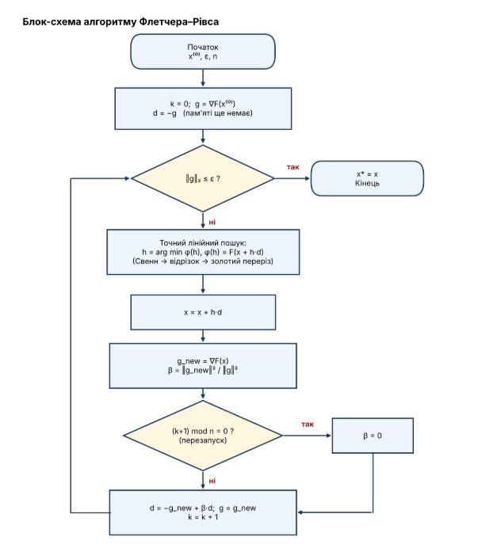

# ЛР 9. Метод спряжених градієнтів Флетчера–Рівса


## 1. Постановка задачі

| Параметр | Значення |
|---|---|
| Цільова функція | F(x₁, x₂) = x₁² + 2x₂² + 2x₁x₂ − 9x₁ − 13x₂ |
| Початкова точка | x⁽⁰⁾ = (−3; −2), F(x⁽⁰⁾) = 82 |
| Точність | ε = 0,01, критерій зупинки ‖∇F(x⁽ᵏ⁾)‖₂ ≤ ε |
| Лінійний пошук | точний: Свенн (Δ₀ = 0,01) + золотий переріз до 10⁻⁶ |
| Перезапуск | кожні n = 2 ітерації (β = 0) |

Метод Флетчера–Рівса:

```
d⁽⁰⁾ = −∇F(x⁽⁰⁾)
x⁽ᵏ⁺¹⁾ = x⁽ᵏ⁾ + hₖ·d⁽ᵏ⁾,   hₖ = arg min_h F(x⁽ᵏ⁾ + h·d⁽ᵏ⁾)
d⁽ᵏ⁾ = −∇F(x⁽ᵏ⁾) + βₖ·d⁽ᵏ⁻¹⁾,   βₖ = ‖∇F(x⁽ᵏ⁾)‖² / ‖∇F(x⁽ᵏ⁻¹⁾)‖²
```

## 2. Градієнт ∇F і гесіан H, аналітичний мінімум

**Градієнт:**

∇F = (∂F/∂x₁; ∂F/∂x₂) = (2x₁ + 2x₂ − 9; 2x₁ + 4x₂ − 13)

**Гесіан** (похідні других порядків, для квадратичної функції це сталі):

∂²F/∂x₁² = 2, ∂²F/∂x₁∂x₂ = 2, ∂²F/∂x₂∂x₁ = 2, ∂²F/∂x₂² = 4, отже **H = [[2, 2], [2, 4]]**.

Власні числа H: 0,764 і 5,236 (обидва додатні, H додатно визначений, мінімум єдиний). Відношення κ ≈ 6,85, тож лінії рівня помітно витягнуті.

Запис F = ½xᵀHx − bᵀx з b = (9; 13) дає ∇F(x) = Hx − b. У старті ∇F(x⁽⁰⁾) = (−19; −27), що збігається з H·x⁽⁰⁾ − b.

**Аналітичний мінімум** (∇F = 0): 2x₁ + 2x₂ = 9 і 2x₁ + 4x₂ = 13, звідки x₂ = 2, x₁ = 2,5.

**x\* = (2,5; 2), F(x\*) = −24,25.**

## 3. Виведення формули β (7 рядків)

Позначення: g⁽⁰⁾ = ∇F(x⁽⁰⁾), g⁽¹⁾ = ∇F(x⁽¹⁾), d⁽⁰⁾ = −g⁽⁰⁾. Вимагаємо, щоб d⁽¹⁾ був спряженим до d⁽⁰⁾, тобто d⁽¹⁾ᵀ·H·d⁽⁰⁾ = 0, де d⁽¹⁾ = −g⁽¹⁾ + β·d⁽⁰⁾.

| № | Крок виведення | Пояснення |
|---|---|---|
| 1 | d⁽¹⁾ = −g⁽¹⁾ + β·d⁽⁰⁾; вимога d⁽¹⁾ᵀHd⁽⁰⁾ = 0 | умова спряженості |
| 2 | −g⁽¹⁾ᵀHd⁽⁰⁾ + β·d⁽⁰⁾ᵀHd⁽⁰⁾ = 0, отже β = g⁽¹⁾ᵀHd⁽⁰⁾ / d⁽⁰⁾ᵀHd⁽⁰⁾ | розв'язали відносно β; у формулі ще є H |
| 3 | H·d⁽⁰⁾ = (g⁽¹⁾ − g⁽⁰⁾)/h₀ | для квадратичної F: ∇F(y) − ∇F(x) = H(y − x), а x⁽¹⁾ − x⁽⁰⁾ = h₀d⁽⁰⁾ |
| 4 | β = g⁽¹⁾ᵀ(g⁽¹⁾ − g⁽⁰⁾) / d⁽⁰⁾ᵀ(g⁽¹⁾ − g⁽⁰⁾) | h₀ скоротилось, H зникла (формула Гестенеса–Штіфеля) |
| 5 | d⁽⁰⁾ᵀg⁽¹⁾ = 0 (точний пошук), d⁽⁰⁾ = −g⁽⁰⁾, тому знаменник = ‖g⁽⁰⁾‖² | перпендикулярність нового градієнта старому напрямку |
| 6 | β = (‖g⁽¹⁾‖² − g⁽¹⁾ᵀg⁽⁰⁾) / ‖g⁽⁰⁾‖² | формула Полака–Ріб'єра |
| 7 | g⁽¹⁾ᵀg⁽⁰⁾ = 0, тому **β = ‖g⁽¹⁾‖² / ‖g⁽⁰⁾‖²** | формула Флетчера–Рівса |

**Перевірка на наших числах.**

- g⁽⁰⁾ = (−19; −27), ‖g⁽⁰⁾‖² = 361 + 729 = 1090; d⁽⁰⁾ = (19; 27).
- H·d⁽⁰⁾ = (2·19 + 2·27; 2·19 + 4·27) = (92; 146), d⁽⁰⁾ᵀHd⁽⁰⁾ = 19·92 + 27·146 = 5690.
- h₀ = 1090/5690 = 0,191564, x⁽¹⁾ = (0,639719; 3,172232), g⁽¹⁾ = (−1,376098; 0,968366), ‖g⁽¹⁾‖² = 2,831379.
- Крок 3: (g⁽¹⁾ − g⁽⁰⁾)/h₀ = (92; 146), що збігається з H·d⁽⁰⁾.
- Крок 7: g⁽¹⁾ᵀg⁽⁰⁾ = 26,146 − 26,146 = 0.
- Кроки 2 і 7 дають одне й те саме: g⁽¹⁾ᵀHd⁽⁰⁾/d⁽⁰⁾ᵀHd⁽⁰⁾ = 14,780316/5690 = 0,0025976 і ‖g⁽¹⁾‖²/‖g⁽⁰⁾‖² = 2,831379/1090 = 0,0025976.

**β₁ = 0,002598**: градієнт різко впав (з 33,0 до 1,68), тож метод майже «забуває» старий напрямок.

## 4. Блок-схема алгоритму



Алгоритм у 7 кроках:

1. Задати x⁽⁰⁾, ε і n (період перезапуску).
2. k = 0, g = ∇F(x⁽⁰⁾), d = −g (пам'яті ще немає).
3. Якщо ‖g‖₂ ≤ ε, то x\* = x, кінець.
4. Точний лінійний пошук: h = arg min F(x + h·d), де Свенн локалізує відрізок, а золотий переріз його уточнює.
5. x = x + h·d.
6. g_new = ∇F(x), β = ‖g_new‖²/‖g‖². Якщо (k+1) кратне n, то перезапуск β = 0.
7. d = −g_new + β·d, g = g_new, k = k + 1, перехід до кроку 3.


## 5. Лінійний пошук (Свенн + золотий переріз) на першому кроці

x⁽⁰⁾ = (−3; −2), d⁽⁰⁾ = (19; 27), φ(h) = F(x⁽⁰⁾ + h·d⁽⁰⁾) = 82 − 1090h + 2845h².

```text
phi(h) = F(x0 + h*d0) = 82 + (-1090)h + 2845h^2   (<g,d> = -1090, d'Hd = 5690)
Метод Свенна, початковий крок 0.01 (крок подвоюється, поки phi спадає):
   h = 0.00   phi = 82.0000
   h = 0.01   phi = 71.3845
   h = 0.03   phi = 51.8605
   h = 0.07   phi = 19.6405
   h = 0.15   phi = -17.4875
   h = 0.31   phi = 17.5045
   перше зростання на h = 0.31 -> відрізок [a; b] = [0.07; 0.31], 6 обчислень F
Золотий переріз, eps = 1e-6:
   початковий відрізок: [0.070000; 0.310000]
   кінцевий відрізок:   [0.191564; 0.191565]  (довжина 8.84e-07)
   h = 0.191564, ітерацій: 26, обчислень F: 28
Перевірка: h* = -<g,d>/d'Hd = 0.191564;  |h - h*| = 1.3e-08
```

h збігається з h\* = −⟨∇F, d⟩/dᵀHd = 1090/5690 = 0,191564, тож лінійний пошук коректний.

## 6. Таблиця ітерацій і три перевірки

```text
 k x(k)                     F(x(k)) grad F                   |grad| d(k)                        h_k     beta     F(k+1)
-----------------------------------------------------------------------------------------------------------------------
 0 (-3.00000; -2.00000)     82.0000 (-19.00000; -27.00000)  33.0151 (19.00000; 27.00000)   0.191564 0.002598 -2.240e+01
 1 (0.63972; 3.17223)      -22.4025 (-1.37610; 0.96836)      1.6827 (1.42545; -0.89823)    1.305046 0.000000 -2.425e+01
 2 (2.50000; 2.00000)     -2.42e+01 (0.00001; 0.00001)     1.30e-05   -> стоп
n = 2, NF = 76, Ngrad = 3, ||x-x*|| = 2.480e-06
```

Базові значення: x⁽⁰⁾ → x⁽¹⁾ = (0,6397; 3,1722), F: 82 → −22,4025 → −24,25. На другій ітерації β = 0 через перезапуск (k+1 = 2 кратне n = 2).

**Три перевірки:**

```text
1) <grad F(x1), d0>   = -7.370e-05   (має бути ~0)
2) d1' H d0           = 3.837e-04   (має бути ~0)
3) <grad F(x1), d1>   = -2.831379  (має бути < 0);  -||g1||^2 = -2.831378
   кут між d0 і d1 = 87.08 град
   Кількість ітерацій = 2  (так, n=2)
```

| Перевірка | Значення | Очікується |
|---|---|---|
| ⟨∇F(x⁽¹⁾), d⁽⁰⁾⟩ | −7,4·10⁻⁵ | ≈ 0, градієнт ⊥ напрямку після точного пошуку |
| d⁽¹⁾ᵀ·H·d⁽⁰⁾ | 3,8·10⁻⁴ | ≈ 0, напрямки спряжені |
| ⟨∇F(x⁽¹⁾), d⁽¹⁾⟩ | −2,8314 = −‖g⁽¹⁾‖² | < 0, напрямок спуску |

Кут між d⁽⁰⁾ і d⁽¹⁾ дорівнює 87,08°: напрямки спряжені, а не перпендикулярні. Метод зробив **рівно n = 2 ітерації**, як передбачає теорема. Відмінність перших двох значень від нуля зумовлена точністю золотого перерізу (10⁻⁶ по h).

## 7. Антиградієнт + точний пошук (β = 0 завжди)

```text
   cos між кроками 1 і 2: 1.33e-06
   cos між кроками 2 і 3: 2.48e-07
   cos між кроками 3 і 4: -8.31e-07
Сферична метрика ЛР 8 (для порівняння, дроблення кроку навпіл):
   h0 = 1.0: n = 19, NF = 28, Ngrad = 20, ||x-x*|| = 3.2440e-03
   h0 = 0.7: n = 22, NF = 29, Ngrad = 23, ||x-x*|| = 6.1779e-03
```

Сусідні кроки перпендикулярні (косинуси ≈ 10⁻⁶), метод робить 4 ітерації замість 2. Перша точка така сама, як у Флетчера–Рівса, різниця починається з другого кроку.

## 8. Графік траєкторій


Зелена траєкторія (Флетчер–Рівс) за два кроки потрапляє в мінімум. Помаранчева (антиградієнт із точним пошуком) має той самий перший крок, а далі робить дрібні поправки. Синя (сферична метрика ЛР 8, h₀ = 1) зигзагує біля мінімуму через дроблення кроку.

## 9. Функція Розенброка: Флетчер–Рівс із перезапуском і без

f = (1 − x₁)² + 100(x₂ − x₁²)², x\* = (1; 1), старт (−1,2; 1), ε = 0,01.

```text
  ФР, перезапуск кожні 2               n=31     NF=924     Ngrad=32     f=8.64e-06
  ФР, без перезапуску                  n=61     NF=1490    Ngrad=62     f=3.55e-05
  Сферична ЛР 8 (h0=1, ліміт 5000)     n=3797   NF=3809    Ngrad=3798   f=1.01e-04
```

| Метод | n | NF | N∇F | f |
|---|---:|---:|---:|---:|
| ФР з перезапуском кожні 2 | 31 | 924 | 32 | 8,6·10⁻⁶ |
| ФР без перезапуску | 61 | 1490 | 62 | 3,6·10⁻⁵ |
| сферична ЛР 8 (h₀ = 1, ліміт 5000) | 3797 | 3809 | 3798 | 1,0·10⁻⁴ |

Теорема «за n кроків» тут не діє, бо функція не квадратична: гесіан у кожній точці інший. Метод працює як хороший евристичний градієнтний метод, який долає яр (31 ітерація проти 3797 у ЛР 8). Перезапуск скидає пам'ять, яка поступово перестає відповідати справжній кривині, тому з ним удвічі менше ітерацій (31 проти 61).

## 10. Зведена таблиця (наша F, старт (−3; −2))

```text
Метод                                n    NF  Ngrad  NF+Ngrad    ||x-x*||
Сферична ЛР 8, h0=1                 19    28     20        48    3.24e-03
Сферична ЛР 8, h0=0.7               22    29     23        52    6.18e-03
Антиградієнт + точний пошук          4   152      5       157    2.06e-03
Флетчер–Рівс                         2    76      3        79    2.48e-06
```

| Метод | n | NF | N∇F | NF + N∇F | ‖x − x\*‖ |
|---|---:|---:|---:|---:|---:|
| сферична ЛР 8, h₀ = 1 | 19 | 28 | 20 | 48 | 3,24·10⁻³ |
| сферична ЛР 8, h₀ = 0,7 | 22 | 29 | 23 | 52 | 6,18·10⁻³ |
| антиградієнт + точний пошук | 4 | 152 | 5 | 157 | 2,06·10⁻³ |
| **Флетчер–Рівс** | **2** | 76 | 3 | 79 | **2,48·10⁻⁶** |

## 11. Висновки

**Про «за n кроків».**

1. Теорема підтверджена: для квадратичної функції n = 2 змінних із додатно визначеним H і точним лінійним пошуком Флетчер–Рівс знайшов мінімум за 2 ітерації (точність 2,5·10⁻⁶). Антиградієнт з точним пошуком витратив 4 ітерації, сферична метрика ЛР 8 витратила 19–22.
2. Механізм перевірено числами: ⟨∇F(x⁽¹⁾), d⁽⁰⁾⟩ ≈ 0, d⁽¹⁾ᵀHd⁽⁰⁾ ≈ 0, ⟨∇F(x⁽¹⁾), d⁽¹⁾⟩ = −‖g⁽¹⁾‖² < 0. Антиградієнт без пам'яті робить повороти рівно на 90°, що спричиняє зигзаг, а доданок β·d⁽⁰⁾ повертає напрямок так, щоб він дивився в центр еліпсів.
3. Теорема працює лише за двох умов: функція квадратична і пошук точний. На Розенброку (неквадратична функція) «за n кроків» уже немає: 31 ітерація з перезапуском і 61 без нього.

**Про ціну точного пошуку.**

4. Один точний лінійний пошук коштує близько 35 значень F (Свенн ≈ 6–7 і золотий переріз ≈ 28–30). Тому за кількістю ітерацій ФР найкращий (2), а за звернень NF + N∇F на цій простій функції програє сферичній метриці: 79 проти 48–52.
5. Два рахунки не можна плутати: кількість ітерацій n (те, що бачить теорема) і кількість звернень NF + N∇F (те, за що платить комп'ютер). У звіті наводять обидва.
6. Точний пошук окупається на складних функціях: на Розенброку Флетчер–Рівс витратив 956 звернень (924 + 32) проти 7607 у сферичної метрики.
7. Пам'ять методу O(n) (кілька векторів), тоді як метод Ньютона потребує матрицю n × n. Тому метод застосовують для задач із великою кількістю змінних.


<details>
<summary>Повний вивід у консоль</summary>

```text
======================================================================
П.1 Аналітика
grad F = (2x1+2x2-9; 2x1+4x2-13), H = [[2.0, 2.0], [2.0, 4.0]]
x* = [2.5 2. ]  F* = -24.25  eigenvalues(H) = [0.76393202 5.23606798]

П.2 Лінійний пошук на 1-му кроці: x0 = (-3; -2), d0 = -grad F = (19; 27)
phi(h) = F(x0 + h*d0) = 82 + (-1090)h + 2845h^2   (<g,d> = -1090, d'Hd = 5690)
Метод Свенна, початковий крок 0.01 (крок подвоюється, поки phi спадає):
   h = 0.00   phi = 82.0000
   h = 0.01   phi = 71.3845
   h = 0.03   phi = 51.8605
   h = 0.07   phi = 19.6405
   h = 0.15   phi = -17.4875
   h = 0.31   phi = 17.5045
   перше зростання на h = 0.31 -> відрізок [a; b] = [0.07; 0.31], 6 обчислень F
Золотий переріз, eps = 1e-6:
   початковий відрізок: [0.070000; 0.310000]
   кінцевий відрізок:   [0.191564; 0.191565]  (довжина 8.84e-07)
   h = 0.191564, ітерацій: 26, обчислень F: 28
Перевірка: h* = -<g,d>/d'Hd = 0.191564;  |h - h*| = 1.3e-08

П.3 Флетчер-Рівс
 k x(k)                     F(x(k)) grad F                   |grad| d(k)                        h_k     beta     F(k+1)
-----------------------------------------------------------------------------------------------------------------------
 0 (-3.00000; -2.00000)     82.0000 (-19.00000; -27.00000)  33.0151 (19.00000; 27.00000)   0.191564 0.002598 -2.240e+01
 1 (0.63972; 3.17223)      -22.4025 (-1.37610; 0.96836)      1.6827 (1.42545; -0.89823)    1.305046 0.000000 -2.425e+01
 2 (2.50000; 2.00000)     -2.42e+01 (0.00001; 0.00001)     1.30e-05   -> стоп
n = 2, NF = 76, Ngrad = 3, ||x-x*|| = 2.480e-06

П.4 Перевірки
1) <grad F(x1), d0>   = -7.370e-05   (має бути ~0)
2) d1' H d0           = 3.837e-04   (має бути ~0)
3) <grad F(x1), d1>   = -2.831379  (має бути < 0);  -||g1||^2 = -2.831378
   кут між d0 і d1 = 87.08 град
   Кількість ітерацій = 2  (так, n=2)

П.5 Антиградієнт + точний пошук: n = 4, NF = 152, Ngrad = 5, ||x-x*|| = 2.056e-03
   cos між кроками 1 і 2: 1.33e-06
   cos між кроками 2 і 3: 2.48e-07
   cos між кроками 3 і 4: -8.31e-07
Сферична метрика ЛР 8 (для порівняння, дроблення кроку навпіл):
   h0 = 1.0: n = 19, NF = 28, Ngrad = 20, ||x-x*|| = 3.2440e-03
   h0 = 0.7: n = 22, NF = 29, Ngrad = 23, ||x-x*|| = 6.1779e-03

П.6 Графік ліній рівня з трьома траєкторіями
Графік збережено: lr9_trajectories.png

П.7 Розенброк, старт (-1.2; 1), eps = 0.01
  ФР, перезапуск кожні 2               n=31     NF=924     Ngrad=32     f=8.64e-06
  ФР, без перезапуску                  n=61     NF=1490    Ngrad=62     f=3.55e-05
  Сферична ЛР 8 (h0=1, ліміт 5000)     n=3797   NF=3809    Ngrad=3798   f=1.01e-04

П.8 Зведена таблиця (наша F, старт (-3;-2))
Метод                                n    NF  Ngrad  NF+Ngrad    ||x-x*||
Сферична ЛР 8, h0=1                 19    28     20        48    3.24e-03
Сферична ЛР 8, h0=0.7               22    29     23        52    6.18e-03
Антиградієнт + точний пошук          4   152      5       157    2.06e-03
Флетчер–Рівс                         2    76      3        79    2.48e-06
```

</details>