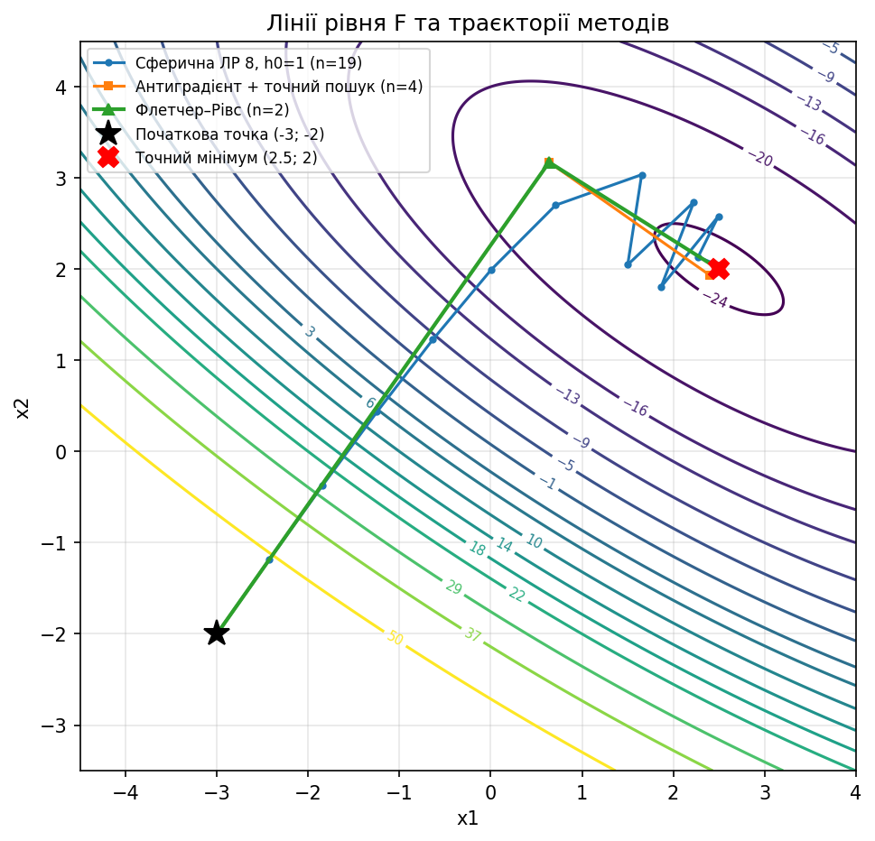

# ЛР 9. Метод спряжених градієнтів Флетчера–Рівса

## 1. Постановка задачі

| Параметр | Значення |
|---|---|
| Цільова функція | F(x₁, x₂) = x₁² + 2x₂² + 2x₁x₂ − 9x₁ − 13x₂ |
| Початкова точка | x⁽⁰⁾ = (−3; −2) |
| Точність | ε = 0,01, критерій зупинки ‖∇F(x⁽ᵏ⁾)‖₂ ≤ ε |
| Градієнт | ∇F = (2x₁ + 2x₂ − 9; 2x₁ + 4x₂ − 13) |
| Гесіан | H = [[2, 2], [2, 4]] (власні числа 0,764 і 5,236, κ ≈ 6,85) |
| Мінімум (аналітично) | x* = (2,5; 2), F(x*) = −24,25 |

Аналітичний мінімум: з ∇F = 0 маємо 2x₁ + 2x₂ = 9 і 2x₁ + 4x₂ = 13, звідки x₂ = 2, x₁ = 2,5.

## 2. Метод

```
d⁽⁰⁾ = −∇F(x⁽⁰⁾)
x⁽ᵏ⁺¹⁾ = x⁽ᵏ⁾ + hₖ·d⁽ᵏ⁾,         hₖ = argmin_h F(x⁽ᵏ⁾ + h·d⁽ᵏ⁾)
βₖ₊₁ = ‖∇F(x⁽ᵏ⁺¹⁾)‖² / ‖∇F(x⁽ᵏ⁾)‖²
d⁽ᵏ⁺¹⁾ = −∇F(x⁽ᵏ⁺¹⁾) + βₖ₊₁·d⁽ᵏ⁾
```

Кожні n = 2 ітерації виконується перезапуск (β = 0). Точний лінійний пошук складається з двох етапів:
метод Свенна (Δ₀ = 0,01) локалізує відрізок, а золотий переріз звужує його до 10⁻⁶.

Властивість: для квадратичної функції n змінних метод знаходить мінімум не більше ніж за n кроків.


## 3. Результати

### Графік траєкторій



Зелена траєкторія (Флетчер–Рівс) за два кроки потрапляє в мінімум.
Помаранчева (антиградієнт із точним пошуком) має той самий перший крок, а далі робить дрібні поправки (4 ітерації).
Синя (сферична метрика ЛР 8) зигзагує біля мінімуму через дроблення кроку.

### Лінійний пошук на першому кроці (п. 2)

Точка x⁽⁰⁾ = (−3; −2), напрямок d⁽⁰⁾ = −∇F = (19; 27). Одновимірна функція:
φ(h) = F(x⁽⁰⁾ + h·d⁽⁰⁾) = 82 − 1090h + 2845h² (⟨∇F, d⟩ = −1090, dᵀHd = 5690).

**Метод Свенна** (початковий крок 0,01, крок подвоюється, поки φ спадає):

| h | 0 | 0,01 | 0,03 | 0,07 | 0,15 | 0,31 |
|---|---:|---:|---:|---:|---:|---:|
| φ(h) | 82,0000 | 71,3845 | 51,8605 | 19,6405 | −17,4875 | 17,5045 |

Перше зростання φ на h = 0,31, тому мінімум лежить у відрізку **[a; b] = [0,07; 0,31]** (6 обчислень F).

**Золотий переріз** (ε = 10⁻⁶):

| Параметр | Значення |
|---|---|
| Початковий відрізок | [0,070000; 0,310000] |
| Кінцевий відрізок | [0,191564; 0,191565], довжина 8,8·10⁻⁷ |
| Знайдене h | 0,191564 |
| Ітерацій / обчислень F | 26 / 28 |

**Перевірка:** h* = −⟨∇F, d⟩/dᵀHd = 1090/5690 = 0,191564, а |h − h*| = 1,3·10⁻⁸.

### Три перевірки (п. 4)

| Перевірка | Значення | Очікується |
|---|---|---|
| ⟨∇F(x⁽¹⁾), d⁽⁰⁾⟩ | −7,4·10⁻⁵ | ≈ 0 (градієнт ⊥ напрямку після точного пошуку) |
| d⁽¹⁾ᵀ·H·d⁽⁰⁾ | 3,8·10⁻⁴ | ≈ 0 (напрямки спряжені) |
| ⟨∇F(x⁽¹⁾), d⁽¹⁾⟩ | −2,8314 = −‖g⁽¹⁾‖² | < 0 (напрямок спуску) |

Кут між d⁽⁰⁾ і d⁽¹⁾ дорівнює 87,08°. Він не 90°, бо напрямки спряжені, а не перпендикулярні.
Відмінність від нуля в перших двох перевірках зумовлена точністю золотого перерізу (10⁻⁶ по h).

### Зведена таблиця (наша F, старт (−3; −2))

| Метод | n | NF | N∇F | NF + N∇F | ‖x − x*‖ |
|---|---:|---:|---:|---:|---:|
| Сферична ЛР 8, h₀ = 1 | 19 | 28 | 20 | 48 | 3,24·10⁻³ |
| Сферична ЛР 8, h₀ = 0,7 | 22 | 29 | 23 | 52 | 6,18·10⁻³ |
| Антиградієнт + точний пошук | 4 | 152 | 5 | 157 | 2,06·10⁻³ |
| **Флетчер–Рівс** | **2** | 76 | 3 | 79 | **2,48·10⁻⁶** |

### Функція Розенброка, старт (−1,2; 1), ε = 0,01

| Метод | n | NF | N∇F | f(x) |
|---|---:|---:|---:|---:|
| Флетчер–Рівс, перезапуск кожні 2 | 31 | 924 | 32 | 8,6·10⁻⁶ |
| Флетчер–Рівс, без перезапуску | 61 | 1490 | 62 | 3,6·10⁻⁵ |
| Сферична ЛР 8 (h₀ = 1, ліміт 5000) | 3797 | 3809 | 3798 | 1,0·10⁻⁴ |

### Вивід у консоль

Повний вивід збережено в `console_output.txt`.

```text
======================================================================
П.1 Аналітика
grad F = (2x1+2x2-9; 2x1+4x2-13), H = [[2.0, 2.0], [2.0, 4.0]]
x* = [2.5 2. ]  F* = -24.25  eigenvalues(H) = [0.76393202 5.23606798]

П.2 Лінійний пошук на 1-му кроці: x0 = (-3; -2), d0 = -grad F = (19; 27)
phi(h) = F(x0 + h*d0) = 82 + (-1090)h + 2845h^2   (<g,d> = -1090, d'Hd = 5690)
Метод Свенна, початковий крок 0.01 (крок подвоюється, поки phi спадає):
   h = 0.00   phi = 82.0000
   h = 0.01   phi = 71.3845
   h = 0.03   phi = 51.8605
   h = 0.07   phi = 19.6405
   h = 0.15   phi = -17.4875
   h = 0.31   phi = 17.5045
   перше зростання на h = 0.31 -> відрізок [a; b] = [0.07; 0.31], 6 обчислень F
Золотий переріз, eps = 1e-6:
   початковий відрізок: [0.070000; 0.310000]
   кінцевий відрізок:   [0.191564; 0.191565]  (довжина 8.84e-07)
   h = 0.191564, ітерацій: 26, обчислень F: 28
Перевірка: h* = -<g,d>/d'Hd = 0.191564;  |h - h*| = 1.3e-08

П.3 Флетчер-Рівс
 k x(k)                     F(x(k)) grad F                   |grad| d(k)                        h_k     beta     F(k+1)
-----------------------------------------------------------------------------------------------------------------------
 0 (-3.00000; -2.00000)     82.0000 (-19.00000; -27.00000)  33.0151 (19.00000; 27.00000)   0.191564 0.002598 -2.240e+01
 1 (0.63972; 3.17223)      -22.4025 (-1.37610; 0.96836)      1.6827 (1.42545; -0.89823)    1.305046 0.000000 -2.425e+01
 2 (2.50000; 2.00000)     -2.42e+01 (0.00001; 0.00001)     1.30e-05   -> стоп
n = 2, NF = 76, Ngrad = 3, ||x-x*|| = 2.480e-06

П.4 Перевірки
1) <grad F(x1), d0>   = -7.370e-05   (має бути ~0)
2) d1' H d0           = 3.837e-04   (має бути ~0)
3) <grad F(x1), d1>   = -2.831379  (має бути < 0);  -||g1||^2 = -2.831378
   кут між d0 і d1 = 87.08 град
   Кількість ітерацій = 2  (так, n=2)

П.5 Антиградієнт + точний пошук: n = 4, NF = 152, Ngrad = 5, ||x-x*|| = 2.056e-03
   cos між кроками 1 і 2: 1.33e-06
   cos між кроками 2 і 3: 2.48e-07
   cos між кроками 3 і 4: -8.31e-07
Сферична метрика ЛР 8 (для порівняння, дроблення кроку навпіл):
   h0 = 1.0: n = 19, NF = 28, Ngrad = 20, ||x-x*|| = 3.2440e-03
   h0 = 0.7: n = 22, NF = 29, Ngrad = 23, ||x-x*|| = 6.1779e-03

П.6 Графік ліній рівня з трьома траєкторіями
Графік збережено: lr9_trajectories.png

П.7 Розенброк, старт (-1.2; 1), eps = 0.01
  ФР, перезапуск кожні 2               n=31     NF=924     Ngrad=32     f=8.64e-06
  ФР, без перезапуску                  n=61     NF=1490    Ngrad=62     f=3.55e-05
  Сферична ЛР 8 (h0=1, ліміт 5000)     n=3797   NF=3809    Ngrad=3798   f=1.01e-04

П.8 Зведена таблиця (наша F, старт (-3;-2))
Метод                                n    NF  Ngrad  NF+Ngrad    ||x-x*||
Сферична ЛР 8, h0=1                 19    28     20        48    3.24e-03
Сферична ЛР 8, h0=0.7               22    29     23        52    6.18e-03
Антиградієнт + точний пошук          4   152      5       157    2.06e-03
Флетчер–Рівс                         2    76      3        79    2.48e-06
```

## 4. Висновки

1. Теорема про збіжність за n кроків підтверджена: Флетчер–Рівс знайшов мінімум квадратичної функції двох змінних за 2 ітерації
   (точність 2,5·10⁻⁶), антиградієнт з точним пошуком за 4, сферична метрика ЛР 8 за 19–22.
2. Спряженість напрямків перевірена числами: d⁽¹⁾ᵀHd⁽⁰⁾ ≈ 0, ⟨∇F(x⁽¹⁾), d⁽⁰⁾⟩ ≈ 0, ⟨∇F(x⁽¹⁾), d⁽¹⁾⟩ = −‖g⁽¹⁾‖² < 0.
   Антиградієнт без пам'яті робить повороти рівно на 90°, що й спричиняє зигзаг.
3. Ціна точного пошуку висока: один лінійний пошук коштує близько 35 значень F.
   За загальною кількістю звернень (NF + N∇F) Флетчер–Рівс на цій простій функції програє сферичній метриці (79 проти 48–52).
   Тому за ітераціями метод кращий, а за обчислювальними витратами на цій функції ні.
4. На функції Розенброка виграш великий: 31 ітерація проти 3797 у ЛР 8, і без жодної другої похідної.
   Перезапуск корисний на неквадратичній функції: 31 ітерація проти 61 без нього.
5. Лінії рівня F помітно витягнуті (κ ≈ 6,85), а не круглі. Це пояснює зигзаг методів без пам'яті.
6. Пам'ять методу O(n) (кілька векторів), тоді як метод Ньютона потребує матрицю n × n.
   Тому метод спряжених градієнтів застосовують для задач із великою кількістю змінних.

## 5. Файли

| Файл | Призначення |
|---|---|
| `lab9.py` | вихідний код усіх пунктів завдання |
| `lr9_trajectories.png` | графік ліній рівня з трьома траєкторіями |
| `console_output.txt` | повний вивід програми |
| `README.md` | цей опис |